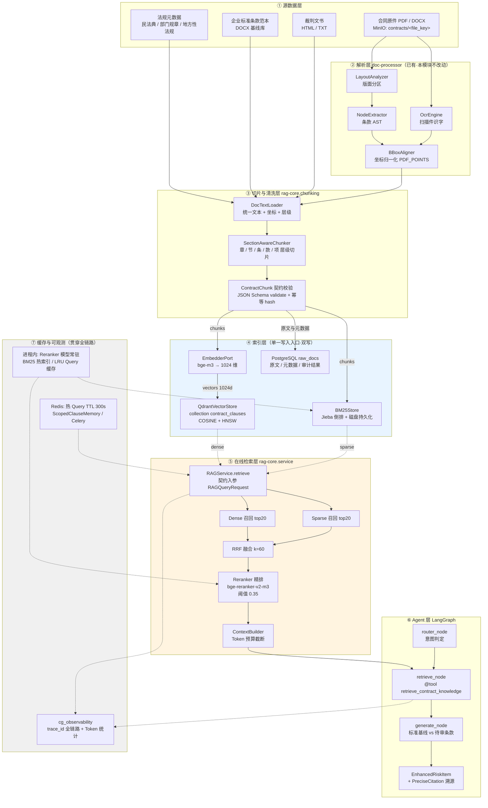
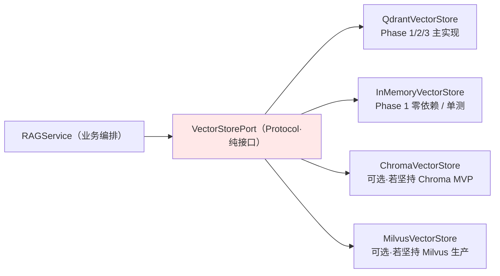
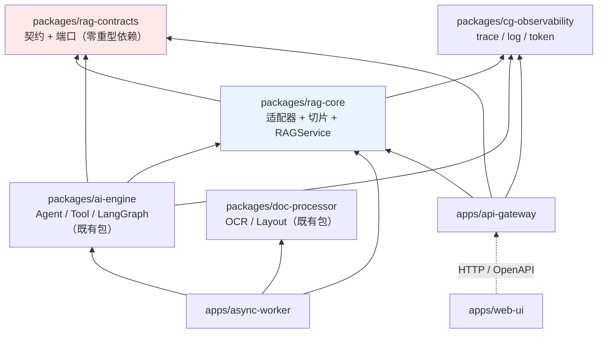
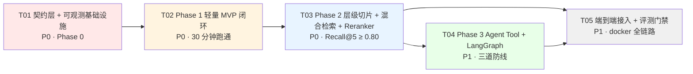
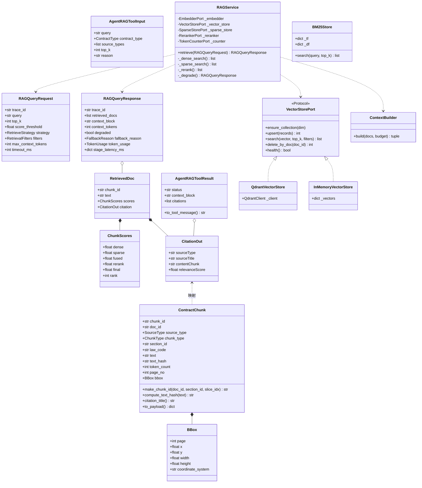
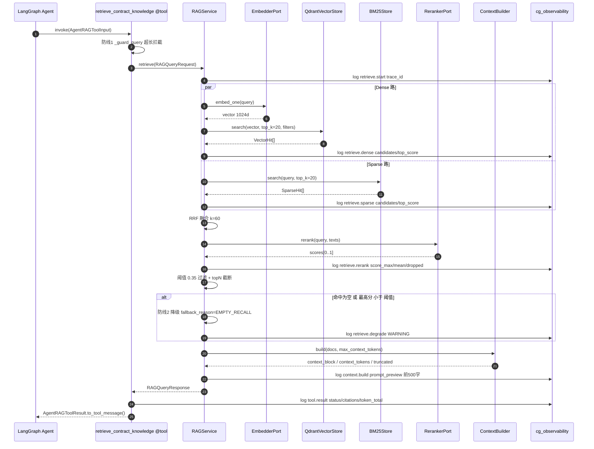

# 合同智能审核 RAG 模块落地白皮书（架构 · 契约 · 三阶段演进）

> ⚠️ **文档纠偏声明 · 2026-09-21**（本节由文档纠偏流程**追加**，原文**未删改**）
>
> **状态**：✅ **L1 · 契约权威**（**继续有效**）—— 但**有两处转引已降级**，需按下表理解。
>
> | # | 本文档的问题 | 现行事实 |
> |---|---|---|
> | 1 | §0 分工表把 `RAG_IMPLEMENTATION_GUIDE.md` 列为「实现细节」来源，并转引 `ClauseAwareChunker` / `ClauseVectorStore` | 这两者是**旧名**且来源文档已降为 **L6 历史档案**。**实现细节请改查 `RAG搭建框架.md`（L2）** |
> | 2 | L1950/1962 再次转引 `RAG_IMPLEMENTATION_GUIDE.md` §2.2 / §2.3.2 | 同上，**转引目标已失效** |
>
> ✅ **本文档仍是契约字段的唯一权威**（`ContractChunk` 28 字段、`VectorStorePort`、枚举取值、错误码）。
>
> ✅ **§1.3 的向量库结论无需修改**：其「**不切 Milvus**」的结论**与 2026-09-21 终裁一致**
> （Qdrant 主力 + Milvus 降为**备选适配器**）。§1.3.3「若坚持迁移 Milvus 的路径与代价」现作为**能力预留记录**保留。
>
> **该信谁**：见 `文件集合/codex/0.施工标准与定义归属.md` **§0.11 文档权威层级**。
> 一句话：**落点查 L0（`文件集合/codex/`）／契约字段查 L1（`RAG_MODULE_DESIGN.md`）／实现与命名查 L2（`RAG搭建框架.md`）／仓库现状查 L3（`项目代码深度阅读与分析报告.md`）**。


> **文档定位**：本文件是 `contract-guard-ai` 项目 RAG 检索与 Tool-calling 模块的**契约与设计唯一依据**。
> 工程师按第三章任务列表编码；任何接口变更必须先改本文件第二章契约，再改代码（契约驱动开发）。
>
> **版本**：v1.0.0 ｜ **适用 Python**：>=3.11（本机实测 3.13.14）｜ **向量库**：Qdrant 1024 维 COSINE

---

## 0. 与既有文档的分工（避免重复造轮子）

| 文档 | 侧重 | 关系 |
|---|---|---|
| `文件集合/report/RAG_IMPLEMENTATION_GUIDE.md`（856 行） | **实现细节**：`ClauseAwareChunker`、`ClauseVectorStore`、`BM25Store`、RRF k=60、Reranker 阈值 0.35、LangGraph 三节点图的**具体代码写法** | **前作**。本文档**不重写**这些算法细节，仅在需要时引用（如阈值 0.35、RRF k=60 直接沿用）。 |
| `文件集合/report/AI核心开发文档.md` §2 | 知识源三类、切片策略三种、Recall@5 评测口径 | 本文档把其中的 `packages/rag-etl/` 规划**收敛**为下方的包结构（见 §3.2 说明）。 |
| **本文档 RAG_MODULE_DESIGN.md** | **契约**：JSON Schema / Pydantic 模型 / 端口抽象（Protocol）；**演进**：Phase 1→2→3 的取舍与验收；**可观测性**：埋点与 Token 口径 | **本次产出**。是前作的"契约层 + 编排层"。 |

> **一句话关系**：前作告诉你"BM25 的 idf 怎么算"，本文档告诉你"BM25 必须实现哪个 Protocol、出入参长什么样、Phase 1 时能不能先不实现"。

### 0.1 磁盘核实结论（2026-08 实测，非记忆推断）

| 核实项 | 结论 |
|---|---|
| `packages/ai-engine/ai_engine/rag/retriever.py` | 存在。`HybridRetriever(top_k=8)`、`RetrievedChunk(id,title,text,sourceType,score)`，`retrieve()` 抛 `NotImplementedError` |
| `packages/ai-engine/ai_engine/rag/reranker.py` | 存在。`Reranker(top_n=4)`，`rerank()` 抛 `NotImplementedError` |
| `packages/ai-engine/ai_engine/llm/` | **不存在**（`EmbeddingClient` 尚未落地） |
| `packages/rag-etl/` | **不存在**（前作与 AI 核心文档规划中，尚未建包） |
| `apps/async-worker/worker/storage/qdrant_client.py` | 存在，仅 `get_qdrant_client()` 工厂 |
| `ai_engine/agents/auditor.py` | 存在。`PreciseCitation(sourceType, sourceTitle, contentChunk, relevanceScore)` 为**camelCase** |
| `apps/api-gateway/app/config.py` | 存在，`CG_` 前缀，但**无** Embedding/LLM/Rerank 配置 |
| 根 `pyproject.toml` | `[tool.uv.workspace] members = ["packages/*", "apps/*"]` → **新增 `packages/*` 目录即自动成为 workspace 成员** |
| `docker/docker-compose.yml` | 已有 postgres / redis / qdrant(6333,6334) / minio |

---

# 第一章 系统架构与数据流转拓扑

## 1.1 全景数据流转图



## 1.2 三层存储边界表（存什么 / 不存什么 / 谁读写）

| 存储层 | 存什么 | **不存什么**（红线） | 谁写 | 谁读 | 一致性要求 |
|---|---|---|---|---|---|
| **PostgreSQL**（关系型） | ① `contracts` 合同元数据（partyA/B、amount、contractType、status）<br/>② `raw_docs` 解析后原文 + AST 拓扑（`ClauseNode` 树）<br/>③ `risk_items` / `conflicts` 审计结果<br/>④ `audit_runs` 任务状态机、进度<br/>⑤ `feedback` 标注反馈（数据飞轮）<br/>⑥ Prompt 角色配置 | ❌ 不存向量<br/>❌ 不存 embedding 原文<br/>❌ 不存 >1MB 的正文（超长走 MinIO）<br/>❌ 不存会话临时状态 | `api-gateway`（同步写）<br/>`async-worker`（任务回写） | `api-gateway`、`web-ui`、报表 | 强一致 / 事务 / 可审计 |
| **Qdrant**（向量库，1024d COSINE） | ① `ContractChunk` 的 1024 维向量<br/>② **payload = 溯源字段子集**（`chunk_id`/`doc_id`/`source_type`/`section_id`/`law_code`/`title`/`page_no`/`bbox`/`contract_type`/`category`/`text` 截断 8000 字）<br/>③ keyword payload 索引：`contract_type`/`source_type`/`doc_id` | ❌ 不存业务状态（status/progress）<br/>❌ 不存原始二进制<br/>❌ **不存未携带 `chunk_id` 的孤儿向量**<br/>❌ payload 不放整篇合同全文 | `async-worker`（`parse_doc_task` → `rag_core.pipeline`）<br/>`rag_core`（建库/幂等 upsert） | `rag_core.service.RAGService`（在线检索） | 最终一致；**幂等**：`point_id == chunk_id` |
| **内存缓存**（进程内 + Redis） | **进程内**：Reranker / Embedding 模型常驻（避免每次加载）、BM25 倒排索引热数据、LRU Query 结果缓存<br/>**Redis**：热 Query 结果（TTL 300s）、`ScopedClauseMemory` 多轮会话、Celery broker/backend、`X-Request-ID` 幂等键 | ❌ 不存任何"唯一真理源"数据（可重建）<br/>❌ 不存审计结论（必须落 PG）<br/>❌ 不设永不过期的 key | `rag_core`（进程内）、`api-gateway`/`worker`（Redis） | 同进程 / 同集群 | 允许丢失；缓存击穿走主库 |

> **附注**：MinIO 是第四层（对象存储），只放原始 PDF/DOCX/报告文件二进制，不属于"三层存储"讨论范围，但所有 `doc_id` 需能反查 MinIO `file_key`。

### 1.2.1 边界判定口诀（给工程师）

```
需要 JOIN / 事务 / 报表统计 / 前端列表分页  → PostgreSQL
需要 语义相似度 / 模糊召回 / TopK          → Qdrant
需要 关键词精确命中 / 专名（"第五百八十五条"）→ BM25（磁盘索引 + 内存热数据）
需要 秒级重建 / 模型权重 / 会话窗口         → 进程内内存 + Redis
```

## 1.3 选型冲突对齐：Qdrant vs Chroma / PGVector / Milvus

用户模板中 Phase 1 提到 Chroma/PGVector、Phase 3 提到 Milvus，与本项目已锁定的 **Qdrant** 冲突。**处理方式：不换库，换"抽象层"。**

### 1.3.1 核心设计——向量库端口（Port）+ 适配器（Adapter）

业务代码（`RAGService`）**永远只依赖 `VectorStorePort` 协议**，不 import 任何具体 SDK。Phase 替换只改依赖注入工厂，**业务代码零改动**。



### 1.3.2 三阶段取舍表

| 阶段 | 模板原方案 | **本项目落地方案** | 取舍理由 |
|---|---|---|---|
| **Phase 1** | Chroma / PGVector | **Qdrant 本地模式** `QdrantClient(":memory:")` 或 `QdrantClient(path=./data/qdrant)`；若目标机无法装 `qdrant-client`，降级为 `InMemoryVectorStore`（纯 numpy，零依赖） | ① 与生产同 SDK、同 API，**零迁移成本**；② `qdrant-client` 的 local mode 无需起服务，满足"30 分钟跑通"；③ 若用 Chroma，则 Phase 2 需重写写入/过滤/payload 索引逻辑，**违背"渐进式"** |
| **Phase 2** | — | Qdrant server（docker-compose 已有）+ BM25 + Reranker | 沿用前作已定义的 RRF k=60、阈值 0.35 |
| **Phase 3** | Milvus 分布式 | **保持 Qdrant，走集群化**：Qdrant 分片（`shard_number`）+ 多副本 + `on_disk_payload` | ① Qdrant 原生支持分布式部署与水平扩容，无需换库；② 换 Milvus = 重写索引建表、payload schema、过滤 DSL、运维体系，**代价 ≥ 2 人周且无业务收益** |

### 1.3.3 若坚持迁移 Milvus 的路径与代价（备选，需用户拍板）

| 步骤 | 工作内容 | 估算 |
|---|---|---|
| 1 | 实现 `MilvusVectorStore(VectorStorePort)`（pymilvus SDK） | 1 人日 |
| 2 | 向量导出：Qdrant scroll → parquet → Milvus insert（1024 维 × N 条） | 0.5 人日 + 数据迁移窗口 |
| 3 | 重写过滤条件（`FieldCondition/MatchValue` → Milvus `expr` 字符串 DSL） | 1 人日 |
| 4 | payload keyword 索引 → Milvus 标量索引重建 | 0.5 人日 |
| 5 | 双跑校验（同一 query 两库 Top-10 重合度 ≥ 0.9） | 1 人日 |
| 6 | 新增 Milvus 容器 + 监控 + 备份运维 | 1 人日 |
| **合计** | | **≈ 5 人日 + 一次数据迁移窗口** |

> **结论建议**：Phase 3 不切 Milvus。若未来确有亿级向量需求，再按上表执行，届时只需新增一个 Adapter + 改 DI 工厂。

---

# 第二章 核心数据契约（Contract-Driven）

> **使用方式**：本章的 JSON Schema 落盘于 `packages/rag-contracts/rag_contracts/schemas/*.json`，由 `scripts/export_schemas.py` 从 Pydantic 模型**单向导出**（禁止手改 JSON，改模型后重跑脚本）。
> 所有跨进程/跨模块数据交换**必须**先过 `model_validate()`，契约校验失败即抛 `CG-RAG-3001`。

## 2.0 契约总览

| 契约 | 用途 | 出现位置 |
|---|---|---|
| `ContractChunkSchema` | 切片后的**入库单元**（向量 payload + BM25 doc + PG 落库同源） | 离线建库 |
| `RAGQueryRequestSchema` / `RAGQueryResponseSchema` | 检索模块**对外服务接口** | 在线检索 / FastAPI / Celery |
| `AgentRAGToolContract` | LLM Function Calling 的**工具描述 + 出入参** | LangGraph `@tool` |

### 2.0.1 与既有 `PreciseCitation` 的映射（强制）

`ai_engine/agents/auditor.py` 中 `PreciseCitation` 是**前端溯源的消费端**，RAG 必须产出可直接赋值的结构：

| `PreciseCitation` 字段 | 来源 | 兜底规则 |
|---|---|---|
| `sourceType` | `ContractChunk.source_type` | 三值枚举，无兜底（必填） |
| `sourceTitle` | `title` → `law_title + article_no` → `section_path` → `doc_id` | 逐级兜底，保证非空 |
| `contentChunk` | `ContractChunk.text` | 超 800 字截断 + `…` |
| `relevanceScore` | `scores.final`（有 rerank 用 rerank，否则归一化 fused） |  clamp 到 `[0,1]` |

> `RetrievedDoc.citation` 字段**直接就是** `PreciseCitation` 形状，Agent 侧 `citations=[d.citation for d in resp.retrieved_docs]` 一行完成，无需转换。

---

## 2.1 契约一：`ContractChunkSchema`

### 2.1.1 JSON Schema（draft 2020-12，可直接用于校验）

```json
{
  "$schema": "https://json-schema.org/draft/2020-12/schema",
  "$id": "https://contract-guard.ai/schemas/contract_chunk.schema.json",
  "title": "ContractChunk",
  "description": "合同与法条切片后的结构化存储单元。同一结构同时写入 Qdrant payload、BM25 文档表与 PostgreSQL，保证三处 chunk_id 完全一致。",
  "type": "object",
  "additionalProperties": false,
  "required": [
    "schema_version", "chunk_id", "doc_id", "source_type", "chunk_type",
    "section_id", "text", "text_hash", "char_count", "token_count",
    "seq_in_doc", "created_at"
  ],
  "properties": {
    "schema_version": {
      "type": "string",
      "const": "1.0.0",
      "description": "契约版本。破坏性变更必须递增，用于向量库灰度迁移时识别旧数据。"
    },
    "chunk_id": {
      "type": "string",
      "pattern": "^[A-Za-z0-9_\\-\\.]{8,64}$",
      "description": "全局唯一切片 ID。确定性生成：uuid5(NAMESPACE_URL, f'{doc_id}#{section_id}#{slice_idx}')，保证重复建库不产生孤儿向量。同时作为 Qdrant point_id。"
    },
    "doc_id": {
      "type": "string",
      "minLength": 1,
      "maxLength": 200,
      "description": "源文档标识：合同取 contract_id，法规取 law_code，标准范本取 MinIO file_key。"
    },
    "source_type": {
      "type": "string",
      "enum": ["STANDARD_CLAUSE", "LAW_ARTICLE", "PRECEDENT"],
      "description": "对齐 auditor.PreciseCitation.sourceType，禁止新增第四值（新增检索源须先登记到此枚举）。"
    },
    "chunk_type": {
      "type": "string",
      "enum": ["SECTION", "CLAUSE", "ARTICLE", "PARAGRAPH", "ITEM", "TABLE", "WINDOW_SLICE", "RECITAL"],
      "description": "切片粒度：SECTION=章节合并块 / CLAUSE=合同条款（第X条）/ ARTICLE=法条 / PARAGRAPH=款 / ITEM=项 / TABLE=表格 / WINDOW_SLICE=超长滑动窗口子块 / RECITAL=鉴于前言。"
    },
    "section_id": {
      "type": "string",
      "minLength": 1,
      "maxLength": 64,
      "description": "章节/条款稳定编号，如 '6.2.1' / '第五百八十五条' / '第3章'。层级切片的锚点，同一 section_id 下可有多个 chunk_type 子块。"
    },
    "law_code": {
      "type": ["string", "null"],
      "maxLength": 64,
      "description": "法规代码，如 '民法典' / '劳动合同法' / 'GB/T-xxx'。仅 source_type=LAW_ARTICLE 时必填（见下方 allOf 条件）。"
    },
    "law_title": {
      "type": ["string", "null"],
      "maxLength": 200,
      "description": "法规全称，如 '中华人民共和国民法典'。用于拼接 PreciseCitation.sourceTitle。"
    },
    "article_no": {
      "type": ["string", "null"],
      "maxLength": 64,
      "description": "法条号，如 '第五百八十五条'。合同条款为 null。"
    },
    "parent_section_id": {
      "type": ["string", "null"],
      "maxLength": 64,
      "description": "父级 section_id，构建层级树（Hierarchical Chunking）。顶层为 null。"
    },
    "section_path": {
      "type": "string",
      "maxLength": 512,
      "default": "",
      "description": "人类可读层级路径，如 '第三章/第六条/6.1'。直接进入 Prompt 提升可解释性。"
    },
    "level": {
      "type": "integer",
      "minimum": 0,
      "maximum": 8,
      "default": 0,
      "description": "层级深度：0=文档，1=章，2=节，3=条，4=款，5=项。"
    },
    "seq_in_doc": {
      "type": "integer",
      "minimum": 0,
      "description": "在文档内的顺序号，用于检索后按原文顺序重排与上下文窗口扩展。"
    },
    "title": {
      "type": ["string", "null"],
      "maxLength": 200,
      "description": "条款/法条标题。缺失时用 section_path 兜底。"
    },
    "text": {
      "type": "string",
      "minLength": 1,
      "maxLength": 8000,
      "description": "检索语料正文。红线：绝不跨条款/法条边界切（见 SectionAwareChunker）。"
    },
    "text_hash": {
      "type": "string",
      "pattern": "^[0-9a-f]{16}$",
      "description": "sha256(text)[:16]，用于增量更新去重：hash 未变则跳过 embedding 调用（省 Token）。"
    },
    "char_count": {
      "type": "integer",
      "minimum": 0,
      "description": "字符数。埋点必打：用于监控切片长度分布。"
    },
    "token_count": {
      "type": "integer",
      "minimum": 0,
      "description": "Token 数（TokenCounter 估算）。埋点必打：用于 Prompt 预算控制与成本核算。"
    },
    "page_no": {
      "type": ["integer", "null"],
      "minimum": 1,
      "description": "物理页码（1-based），供前端 PDF.js 跳转。"
    },
    "bbox": {
      "type": ["object", "null"],
      "description": "物理坐标，供前端高亮。与 doc_processor.aligner.NormalizedBBox 同构。",
      "additionalProperties": false,
      "required": ["page", "x", "y", "width", "height", "coordinate_system"],
      "properties": {
        "page": { "type": "integer", "minimum": 1 },
        "x": { "type": "number" },
        "y": { "type": "number" },
        "width": { "type": "number" },
        "height": { "type": "number" },
        "coordinate_system": { "type": "string", "const": "PDF_POINTS" }
      }
    },
    "contract_type": {
      "type": ["string", "null"],
      "enum": ["PURCHASE", "SALES", "NDA", "OUTSOURCING", "LABOR", "OTHER", null],
      "description": "合同类型，Qdrant keyword payload 索引字段，用于同类型优先过滤。"
    },
    "category": {
      "type": "string",
      "maxLength": 64,
      "default": "UNSPECIFIED",
      "description": "业务/风险类别标签（对齐 RiskCategory 或自定义），用于分层过滤。"
    },
    "effective_date": {
      "type": ["string", "null"],
      "format": "date",
      "description": "法规生效日（YYYY-MM-DD）。法条时效性过滤用；合同条款为 null。"
    },
    "tags": {
      "type": "array",
      "items": { "type": "string", "maxLength": 64 },
      "maxItems": 20,
      "default": [],
      "description": "自由标签，如 ['违约金','付款'] 。"
    },
    "embedding_model": {
      "type": ["string", "null"],
      "maxLength": 100,
      "description": "生成该向量的模型名。换 embedding 模型时可据此筛出失效向量重建。"
    },
    "embedding_dim": {
      "type": ["integer", "null"],
      "description": "向量维度，项目锁定 1024（bge-m3）。null 表示尚未向量化（切片已生成但 embedding 未跑）。非 null 时必须等于 1024，由 Pydantic 校验器强制。"
    },
    "created_at": {
      "type": "string",
      "format": "date-time",
      "description": "ISO 8601 UTC 创建时间。"
    },
    "extra": {
      "type": "object",
      "default": {},
      "description": "扩展字段逃生舱。禁止把需检索/过滤的字段塞进这里（Qdrant 无法建索引）。"
    }
  },
  "allOf": [
    {
      "if": {
        "properties": { "source_type": { "const": "LAW_ARTICLE" } },
        "required": ["source_type"]
      },
      "then": {
        "required": ["law_code"],
        "description": "source_type=LAW_ARTICLE 时 law_code 必填（契约硬约束）。"
      }
    },
    {
      "if": {
        "properties": { "chunk_type": { "const": "WINDOW_SLICE" } },
        "required": ["chunk_type"]
      },
      "then": {
        "required": ["parent_section_id"],
        "description": "滑动窗口子块必须指明父 section，保证溯源可回溯到完整条款。"
      }
    }
  ]
}
```

> ⚠️ **导出对齐说明**：上方 `required` 含 `schema_version` 与 `created_at` 共 12 项，
> 而 Pydantic 模型给这两个字段设了默认值（Pydantic 侧只需 10 项）。
> 这是**故意的**——构造时可省、上线必须带。`scripts/export_schemas.py` 需做一步后处理：
> `schema["required"] = sorted(set(schema.get("required", [])) | {"schema_version", "created_at"})`
>
> 同理 `embedding_dim` 未用 `const`（模型允许 `None` 表示"尚未向量化"），维度锁定由 Pydantic 校验器保证。

### 2.1.2 Pydantic v2 模型

```python
# packages/rag-contracts/rag_contracts/chunk.py
"""ContractChunk 契约：切片后的结构化存储单元。

设计要点：
1. 同一模型同时作为 Qdrant payload / BM25 doc / PG 落库结构，保证三处一致。
2. chunk_id 确定性生成（uuid5），重复建库幂等。
3. source_type 与 auditor.PreciseCitation.sourceType 严格对齐，禁止新增第四值。
"""

from __future__ import annotations

import hashlib
import uuid
from datetime import date, datetime, timezone
from enum import Enum
from typing import Any, Literal

from pydantic import BaseModel, ConfigDict, Field, model_validator

SCHEMA_VERSION: Literal["1.0.0"] = "1.0.0"
EMBEDDING_DIM: int = 1024

# uuid5 命名空间：固定常量，保证任何进程生成的 chunk_id 一致
_CHUNK_NAMESPACE = uuid.UUID("6ba7b811-9dad-11d1-80b4-00c04fd430c8")


class SourceType(str, Enum):
    """检索源类型。与 PreciseCitation.sourceType 一一对应，禁止扩展。"""

    STANDARD_CLAUSE = "STANDARD_CLAUSE"  # 企业标准条款范本
    LAW_ARTICLE = "LAW_ARTICLE"          # 法律法规条文
    PRECEDENT = "PRECEDENT"              # 裁判文书


class ChunkType(str, Enum):
    """切片粒度（层级切片的层级标识）。"""

    SECTION = "SECTION"            # 章/节
    CLAUSE = "CLAUSE"              # 合同条款（第X条）
    ARTICLE = "ARTICLE"            # 法条
    PARAGRAPH = "PARAGRAPH"        # 款
    ITEM = "ITEM"                  # 项
    TABLE = "TABLE"                # 表格
    WINDOW_SLICE = "WINDOW_SLICE"  # 超长条款的滑动窗口子块
    RECITAL = "RECITAL"            # 鉴于 / 前言


class ContractType(str, Enum):
    """合同类型。与 openapi.yaml ContractType 保持一致。"""

    PURCHASE = "PURCHASE"
    SALES = "SALES"
    NDA = "NDA"
    OUTSOURCING = "OUTSOURCING"
    LABOR = "LABOR"
    OTHER = "OTHER"


class BBox(BaseModel):
    """PDF 坐标（72dpi 用户空间，左上原点）。与 doc_processor.aligner 同构。"""

    model_config = ConfigDict(extra="forbid")

    page: int = Field(ge=1, description="物理页码（1-based）")
    x: float
    y: float
    width: float
    height: float
    coordinate_system: Literal["PDF_POINTS"] = "PDF_POINTS"


class ContractChunk(BaseModel):
    """切片契约主体。所有字段含义见 §2.1.1 JSON Schema。"""

    # extra="forbid"：禁止静默吞掉拼写错误的字段（契约驱动的第一道防线）
    model_config = ConfigDict(extra="forbid", str_strip_whitespace=True)

    schema_version: Literal["1.0.0"] = SCHEMA_VERSION
    chunk_id: str = Field(
        min_length=8, max_length=64, pattern=r"^[A-Za-z0-9_\-\.]+$",
        description="确定性 uuid5，同时作为 Qdrant point_id",
    )
    doc_id: str = Field(min_length=1, max_length=200)
    source_type: SourceType
    chunk_type: ChunkType
    section_id: str = Field(min_length=1, max_length=64)

    law_code: str | None = Field(default=None, max_length=64)
    law_title: str | None = Field(default=None, max_length=200)
    article_no: str | None = Field(default=None, max_length=64)
    parent_section_id: str | None = Field(default=None, max_length=64)
    section_path: str = Field(default="", max_length=512)
    level: int = Field(default=0, ge=0, le=8)
    seq_in_doc: int = Field(ge=0)
    title: str | None = Field(default=None, max_length=200)

    text: str = Field(min_length=1, max_length=8000)
    text_hash: str = Field(pattern=r"^[0-9a-f]{16}$")
    char_count: int = Field(ge=0)
    token_count: int = Field(ge=0)

    page_no: int | None = Field(default=None, ge=1)
    bbox: BBox | None = None
    contract_type: ContractType | None = None
    category: str = Field(default="UNSPECIFIED", max_length=64)
    effective_date: date | None = None
    tags: list[str] = Field(default_factory=list)

    embedding_model: str | None = Field(default=None, max_length=100)
    embedding_dim: int | None = Field(default=EMBEDDING_DIM, ge=1)
    created_at: datetime = Field(
        default_factory=lambda: datetime.now(timezone.utc),
        description="ISO 8601 UTC",
    )
    extra: dict[str, Any] = Field(default_factory=dict)

    # ------------------------------------------------------------------
    # 契约硬约束
    # ------------------------------------------------------------------
    @model_validator(mode="after")
    def _conditional_required(self) -> ContractChunk:
        if self.source_type is SourceType.LAW_ARTICLE and not self.law_code:
            raise ValueError("source_type=LAW_ARTICLE 时 law_code 必填")
        if self.chunk_type is ChunkType.WINDOW_SLICE and not self.parent_section_id:
            raise ValueError("chunk_type=WINDOW_SLICE 时 parent_section_id 必填")
        if self.embedding_dim is not None and self.embedding_dim != EMBEDDING_DIM:
            raise ValueError(f"embedding_dim 必须为 {EMBEDDING_DIM}（项目锁定）")
        return self

    # ------------------------------------------------------------------
    # 工厂方法
    # ------------------------------------------------------------------
    @staticmethod
    def compute_text_hash(text: str) -> str:
        """计算正文指纹：sha256 前 16 位，用于增量更新去重。"""
        return hashlib.sha256(text.encode("utf-8")).hexdigest()[:16]

    @staticmethod
    def make_chunk_id(doc_id: str, section_id: str, slice_idx: int = 0) -> str:
        """确定性生成 chunk_id。相同输入永远得到相同输出 → 幂等 upsert。"""
        return str(uuid.uuid5(_CHUNK_NAMESPACE, f"{doc_id}#{section_id}#{slice_idx}"))

    # ------------------------------------------------------------------
    # 溯源映射：与 auditor.PreciseCitation 对齐
    # ------------------------------------------------------------------
    def citation_title(self) -> str:
        """逐级兜底生成 sourceTitle，保证非空。"""
        if self.title:
            return self.title
        if self.law_title and self.article_no:
            return f"{self.law_title} {self.article_no}"
        if self.law_title:
            return self.law_title
        if self.section_path:
            return self.section_path
        return f"{self.doc_id}#{self.section_id}"

    def to_payload(self) -> dict[str, Any]:
        """写入 Qdrant 的 payload：扁平化 + 剔除不可序列化字段。

        注意：bbox 需 dict 化；text 保留（≤8000 字）供 Reranker 与溯源直接取用。
        """
        data = self.model_dump(mode="json")
        data.pop("extra", None)
        return data
```

---

## 2.2 契约二：`RAGQueryRequestSchema` / `RAGQueryResponseSchema`

### 2.2.1 请求 JSON Schema

```json
{
  "$schema": "https://json-schema.org/draft/2020-12/schema",
  "$id": "https://contract-guard.ai/schemas/rag_query_request.schema.json",
  "title": "RAGQueryRequest",
  "type": "object",
  "additionalProperties": false,
  "required": ["query"],
  "properties": {
    "trace_id": {
      "type": "string",
      "description": "全链路追踪 ID（UUID4）。调用方不传则由服务端生成；所有日志埋点必须携带。"
    },
    "query": {
      "type": "string",
      "minLength": 1,
      "maxLength": 4000,
      "description": "检索文本：待审条款原文 / 用户问题 / 风险点描述。"
    },
    "top_k": {
      "type": "integer",
      "minimum": 1,
      "maximum": 50,
      "default": 8,
      "description": "最终返回的文档条数上限。"
    },
    "score_threshold": {
      "type": "number",
      "minimum": 0.0,
      "maximum": 1.0,
      "default": 0.35,
      "description": "相关性下限。启用 rerank 时比较 rerank 分，否则比较归一化融合分。低于此值判为'无匹配标准基线'（缺失检测信号）。"
    },
    "strategy": {
      "type": "string",
      "enum": ["DENSE_ONLY", "SPARSE_ONLY", "HYBRID_RRF"],
      "default": "HYBRID_RRF",
      "description": "检索策略。Phase 1 固定 DENSE_ONLY；Phase 2 起用 HYBRID_RRF。"
    },
    "enable_rerank": { "type": "boolean", "default": true },
    "rerank_top_n": {
      "type": "integer", "minimum": 1, "maximum": 20, "default": 5,
      "description": "重排后保留条数（3~5 为宜，过多会挤占 Prompt 预算）。"
    },
    "enable_sparse": { "type": "boolean", "default": true, "description": "是否启用 BM25 路（Phase 2+）。" },
    "filters": {
      "type": "object",
      "additionalProperties": false,
      "default": {},
      "properties": {
        "source_types": {
          "type": ["array", "null"],
          "items": { "enum": ["STANDARD_CLAUSE", "LAW_ARTICLE", "PRECEDENT"] },
          "description": "限定检索源。null=不限。"
        },
        "chunk_types": { "type": ["array", "null"], "items": { "type": "string" } },
        "contract_type": {
          "type": ["string", "null"],
          "enum": ["PURCHASE", "SALES", "NDA", "OUTSOURCING", "LABOR", "OTHER", null],
          "description": "同类型优先过滤（软过滤：命中不足时自动放宽，见响应 warnings）。"
        },
        "law_codes": { "type": ["array", "null"], "items": { "type": "string" } },
        "doc_ids": { "type": ["array", "null"], "items": { "type": "string" } },
        "categories": { "type": ["array", "null"], "items": { "type": "string" } }
      }
    },
    "max_context_tokens": {
      "type": "integer", "minimum": 256, "maximum": 32000, "default": 3000,
      "description": "注入 Prompt 的上下文 Token 预算。超出则按相关度降序截断，并置 truncated=true。"
    },
    "timeout_ms": {
      "type": "integer", "minimum": 100, "maximum": 30000, "default": 3000,
      "description": "整体超时。内部按 embed/dense/sparse/rerank 分段预算，超时进降级流程。"
    },
    "with_highlight": {
      "type": "boolean", "default": false,
      "description": "是否返回命中词高亮片段（增加少量开销）。"
    }
  }
}
```

### 2.2.2 响应 JSON Schema

```json
{
  "$schema": "https://json-schema.org/draft/2020-12/schema",
  "$id": "https://contract-guard.ai/schemas/rag_query_response.schema.json",
  "title": "RAGQueryResponse",
  "type": "object",
  "additionalProperties": false,
  "required": ["trace_id", "query", "retrieved_docs", "degraded", "fallback_reason", "token_usage", "took_ms"],
  "properties": {
    "trace_id": { "type": "string" },
    "query": { "type": "string", "description": "回显请求 query（可能为超长拦截后的截断版本）。" },
    "strategy": { "type": "string", "enum": ["DENSE_ONLY", "SPARSE_ONLY", "HYBRID_RRF"] },
    "retrieved_docs": {
      "type": "array",
      "description": "最终召回文档（已排序、已过滤、已截断）。",
      "items": {
        "type": "object",
        "additionalProperties": false,
        "required": ["chunk_id", "source_type", "section_id", "text", "scores", "citation"],
        "properties": {
          "chunk_id": { "type": "string" },
          "doc_id": { "type": "string" },
          "source_type": { "enum": ["STANDARD_CLAUSE", "LAW_ARTICLE", "PRECEDENT"] },
          "chunk_type": { "type": "string" },
          "section_id": { "type": "string" },
          "law_code": { "type": ["string", "null"] },
          "article_no": { "type": ["string", "null"] },
          "title": { "type": ["string", "null"] },
          "text": { "type": "string" },
          "highlight": { "type": ["string", "null"] },
          "page_no": { "type": ["integer", "null"] },
          "bbox": { "type": ["object", "null"] },
          "contract_type": { "type": ["string", "null"] },
          "category": { "type": "string" },
          "section_path": { "type": "string" },
          "token_count": { "type": "integer", "minimum": 0 },
          "scores": {
            "type": "object",
            "additionalProperties": false,
            "required": ["final", "rank"],
            "properties": {
              "dense": { "type": ["number", "null"], "description": "向量余弦相似度 [-1,1]。" },
              "sparse": { "type": ["number", "null"], "description": "BM25 原始分（未归一）。" },
              "fused": { "type": ["number", "null"], "description": "RRF 融合分 Σ1/(k+rank)，k=60。" },
              "rerank": { "type": ["number", "null"], "description": "Cross-Encoder 精排分 [0,1]。" },
              "final": { "type": "number", "minimum": 0.0, "maximum": 1.0, "description": "最终用于阈值比较的分数。" },
              "rank": { "type": "integer", "minimum": 1 }
            }
          },
          "citation": {
            "type": "object",
            "description": "与 auditor.PreciseCitation 字段 1:1，可直接赋值。",
            "additionalProperties": false,
            "required": ["sourceType", "sourceTitle", "contentChunk", "relevanceScore"],
            "properties": {
              "sourceType": { "enum": ["STANDARD_CLAUSE", "LAW_ARTICLE", "PRECEDENT"] },
              "sourceTitle": { "type": "string" },
              "contentChunk": { "type": "string" },
              "relevanceScore": { "type": "number", "minimum": 0.0, "maximum": 1.0 }
            }
          }
        }
      }
    },
    "total_candidates": { "type": "integer", "minimum": 0, "description": "融合前的候选总数（用于计算召回率）。" },
    "context_block": {
      "type": "string",
      "description": "已拼装好、可直接注入 Prompt 的上下文文本（含 [n] 序号与来源标识）。空召回时为降级提示语。"
    },
    "context_tokens": { "type": "integer", "minimum": 0 },
    "truncated": { "type": "boolean", "description": "是否因 Token 预算被截断。" },
    "degraded": { "type": "boolean", "description": "是否走了降级路径。true 时生成节点须在结论中标注。 " },
    "fallback_reason": {
      "type": "string",
      "enum": ["NONE", "OVERLONG_QUERY", "EMPTY_RECALL", "TIMEOUT", "STORE_UNAVAILABLE", "RERANK_FAILED", "EMBED_FAILED"]
    },
    "warnings": { "type": "array", "items": { "type": "string" }, "default": [] },
    "token_usage": {
      "type": "object",
      "additionalProperties": false,
      "required": ["total_tokens"],
      "properties": {
        "embedding_tokens": { "type": "integer", "minimum": 0 },
        "rerank_tokens": { "type": "integer", "minimum": 0 },
        "prompt_tokens": { "type": "integer", "minimum": 0 },
        "completion_tokens": { "type": "integer", "minimum": 0 },
        "total_tokens": { "type": "integer", "minimum": 0 },
        "estimated": { "type": "boolean", "default": true, "description": "true=估算值（无真实 tokenizer 时）。" }
      }
    },
    "stage_latency_ms": {
      "type": "object",
      "description": "分段耗时：embed/dense/sparse/fuse/rerank/build。用于性能归因。",
      "additionalProperties": { "type": "integer", "minimum": 0 }
    },
    "took_ms": { "type": "integer", "minimum": 0 },
    "schema_version": { "type": "string", "const": "1.0.0" }
  }
}
```

### 2.2.3 Pydantic v2 模型

```python
# packages/rag-contracts/rag_contracts/query.py
"""RAG 检索请求 / 响应契约。

设计要点：
1. 请求即配置：所有阈值、策略、预算都在请求里，便于 A/B 与灰度。
2. 响应自带 citation：Agent 无需二次转换即可塞进 EnhancedRiskItem.citations。
3. 响应自带 token_usage 与 stage_latency_ms：可观测性的数据载体。
"""

from __future__ import annotations

from enum import Enum
from typing import Any, Literal
from uuid import uuid4

from pydantic import BaseModel, ConfigDict, Field

from .chunk import BBox, ChunkType, ContractType, SourceType

SCHEMA_VERSION: Literal["1.0.0"] = "1.0.0"
DEFAULT_RRF_K: int = 60
DEFAULT_SCORE_THRESHOLD: float = 0.35  # 沿用前作：低于此分判"缺失标准对照"


class RetrieveStrategy(str, Enum):
    DENSE_ONLY = "DENSE_ONLY"      # Phase 1：仅向量
    SPARSE_ONLY = "SPARSE_ONLY"    # 仅 BM25（调试用）
    HYBRID_RRF = "HYBRID_RRF"      # Phase 2+：双路 + RRF 融合


class FallbackReason(str, Enum):
    NONE = "NONE"
    OVERLONG_QUERY = "OVERLONG_QUERY"        # 超长文本被拦截/截断
    EMPTY_RECALL = "EMPTY_RECALL"            # 空召回或最高分低于阈值
    TIMEOUT = "TIMEOUT"                      # 整体超时
    STORE_UNAVAILABLE = "STORE_UNAVAILABLE"  # 向量库/BM25 不可用
    RERANK_FAILED = "RERANK_FAILED"          # 重排失败，降级用融合分
    EMBED_FAILED = "EMBED_FAILED"            # 向量化失败，降级用 BM25 或空


class RetrievalFilters(BaseModel):
    """检索过滤条件。null 表示不限。"""

    model_config = ConfigDict(extra="forbid")

    source_types: list[SourceType] | None = None
    chunk_types: list[ChunkType] | None = None
    contract_type: ContractType | None = None
    law_codes: list[str] | None = None
    doc_ids: list[str] | None = None
    categories: list[str] | None = None


class RAGQueryRequest(BaseModel):
    """检索请求契约。"""

    model_config = ConfigDict(extra="forbid")

    trace_id: str = Field(default_factory=lambda: str(uuid4()))
    query: str = Field(min_length=1, max_length=4000)
    top_k: int = Field(default=8, ge=1, le=50)
    score_threshold: float = Field(default=DEFAULT_SCORE_THRESHOLD, ge=0.0, le=1.0)
    strategy: RetrieveStrategy = RetrieveStrategy.HYBRID_RRF
    enable_rerank: bool = True
    rerank_top_n: int = Field(default=5, ge=1, le=20)
    enable_sparse: bool = True
    filters: RetrievalFilters = Field(default_factory=RetrievalFilters)
    max_context_tokens: int = Field(default=3000, ge=256, le=32000)
    timeout_ms: int = Field(default=3000, ge=100, le=30000)
    with_highlight: bool = False


class TokenUsage(BaseModel):
    """Token 耗用统计。可观测性必打。"""

    model_config = ConfigDict(extra="forbid")

    embedding_tokens: int = Field(default=0, ge=0)
    rerank_tokens: int = Field(default=0, ge=0)
    prompt_tokens: int = Field(default=0, ge=0)
    completion_tokens: int = Field(default=0, ge=0)
    total_tokens: int = Field(default=0, ge=0)
    estimated: bool = Field(default=True, description="true=估算值")

    def add(self, **kwargs: int) -> None:
        """累加各分项并同步 total_tokens。"""
        for key, value in kwargs.items():
            if key == "total_tokens":
                continue
            setattr(self, key, getattr(self, key) + value)
        self.total_tokens = (
            self.embedding_tokens
            + self.rerank_tokens
            + self.prompt_tokens
            + self.completion_tokens
        )


class ChunkScores(BaseModel):
    """多阶段得分。保留全链路分数用于调试与阈值调参。"""

    model_config = ConfigDict(extra="forbid")

    dense: float | None = None
    sparse: float | None = None
    fused: float | None = None
    rerank: float | None = None
    final: float = Field(ge=0.0, le=1.0)
    rank: int = Field(ge=1)


class CitationOut(BaseModel):
    """与 auditor.PreciseCitation 字段 1:1（camelCase，供前端直接消费）。"""

    model_config = ConfigDict(extra="forbid", populate_by_name=True)

    sourceType: SourceType
    sourceTitle: str
    contentChunk: str
    relevanceScore: float = Field(ge=0.0, le=1.0)


class RetrievedDoc(BaseModel):
    """单条召回结果。"""

    model_config = ConfigDict(extra="forbid")

    chunk_id: str
    doc_id: str
    source_type: SourceType
    chunk_type: ChunkType
    section_id: str
    law_code: str | None = None
    article_no: str | None = None
    title: str | None = None
    text: str
    highlight: str | None = None
    page_no: int | None = None
    bbox: BBox | None = None
    contract_type: ContractType | None = None
    category: str = "UNSPECIFIED"
    section_path: str = ""
    token_count: int = 0
    scores: ChunkScores
    citation: CitationOut


class RAGQueryResponse(BaseModel):
    """检索响应契约。"""

    model_config = ConfigDict(extra="forbid")

    trace_id: str
    query: str
    strategy: RetrieveStrategy = RetrieveStrategy.HYBRID_RRF
    retrieved_docs: list[RetrievedDoc] = Field(default_factory=list)
    total_candidates: int = Field(default=0, ge=0)
    context_block: str = ""
    context_tokens: int = Field(default=0, ge=0)
    truncated: bool = False
    degraded: bool = False
    fallback_reason: FallbackReason = FallbackReason.NONE
    warnings: list[str] = Field(default_factory=list)
    token_usage: TokenUsage = Field(default_factory=TokenUsage)
    stage_latency_ms: dict[str, int] = Field(default_factory=dict)
    took_ms: int = Field(default=0, ge=0)
    schema_version: Literal["1.0.0"] = SCHEMA_VERSION
```

---

## 2.3 契约三：`AgentRAGToolContract`（Function Calling）

### 2.3.1 OpenAI / LangChain Function Calling JSON Schema

```json
{
  "type": "function",
  "function": {
    "name": "retrieve_contract_knowledge",
    "description": "从企业标准条款库、《民法典》等法律法规库与裁判文书库中检索与给定条款相关的标准条款或法条原文。当且仅当需要外部法律依据来支撑风险判断、条款比对或缺失检测时调用。返回已按相关度精排的条款原文与可溯源引用信息。",
    "strict": true,
    "parameters": {
      "type": "object",
      "additionalProperties": false,
      "required": ["query", "contract_type", "source_types", "top_k", "reason"],
      "properties": {
        "query": {
          "type": "string",
          "minLength": 1,
          "maxLength": 2000,
          "description": "检索文本。优先使用待审条款的核心争议句（如'违约金按日千分之五计算'），而非整篇合同；超 2000 字会被自动截断并记 warning。"
        },
        "contract_type": {
          "type": ["string", "null"],
          "enum": ["PURCHASE", "SALES", "NDA", "OUTSOURCING", "LABOR", "OTHER", null],
          "description": "合同类型。传入可提升同类型标准条款的召回优先级。"
        },
        "source_types": {
          "type": ["array", "null"],
          "items": { "enum": ["STANDARD_CLAUSE", "LAW_ARTICLE", "PRECEDENT"] },
          "description": "限定检索源。查法律依据填 ['LAW_ARTICLE']；查企业标准填 ['STANDARD_CLAUSE']；不填表示全部。"
        },
        "top_k": {
          "type": "integer", "minimum": 1, "maximum": 20, "default": 5,
          "description": "期望返回的引用条数，建议 3~5。条数越多 Prompt 占用越大。"
        },
        "reason": {
          "type": ["string", "null"],
          "maxLength": 300,
          "description": "简短说明本次检索意图（如'需要违约金上限的法律依据'）。仅用于日志归因与可观测性，不影响检索结果。"
        }
      }
    }
  }
}
```

> ⚠️ **OpenAI strict 模式硬约束**：`strict: true` 时 `required` 必须列出**全部**字段（否则 API 直接 400），
> 字段的可选性由 `["string", "null"]` 这类联合类型表达。上表已按此规则列出 5 个字段。
> 若使用不强制 strict 的模型，可保留 `required: ["query"]`，但**强烈建议**统一按 strict 写，避免两套描述漂移。

### 2.3.2 工具**返回**契约（AgentRAGToolResult）

> Function Calling 的标准只约束入参；出参由本项目自定义。工具返回**字符串**（LLM 友好）还是**结构**？
> **本项目决策**：`@tool` 函数返回 `AgentRAGToolResult.model_dump_json()` 的**字符串**，同时在 LangGraph State 中额外挂一份结构化对象（见 §3.5.3），兼顾"LLM 可读"与"程序可消费"。

```json
{
  "$schema": "https://json-schema.org/draft/2020-12/schema",
  "$id": "https://contract-guard.ai/schemas/agent_rag_tool.schema.json",
  "title": "AgentRAGToolResult",
  "type": "object",
  "additionalProperties": false,
  "required": ["status", "context_block", "citations", "trace_id", "warnings", "fallback_reason"],
  "properties": {
    "status": {
      "type": "string",
      "enum": ["OK", "DEGRADED", "EMPTY"],
      "description": "OK=正常召回；DEGRADED=部分降级（如重排失败但仍有结果）；EMPTY=空召回/低于阈值，context_block 为固定兜底提示语。"
    },
    "context_block": {
      "type": "string",
      "description": "已拼装好可直接注入 Prompt 的上下文。EMPTY 时为：'知识库未检索到可对照的标准条款或法条，请依据通用法律原则评估，并在结论中明确标注【缺失标准对照】。'"
    },
    "citations": {
      "type": "array",
      "description": "可直接赋给 EnhancedRiskItem.citations 的溯源数组。",
      "items": {
        "type": "object",
        "additionalProperties": false,
        "required": ["sourceType", "sourceTitle", "contentChunk", "relevanceScore"],
        "properties": {
          "sourceType": { "enum": ["STANDARD_CLAUSE", "LAW_ARTICLE", "PRECEDENT"] },
          "sourceTitle": { "type": "string" },
          "contentChunk": { "type": "string" },
          "relevanceScore": { "type": "number", "minimum": 0.0, "maximum": 1.0 }
        }
      }
    },
    "trace_id": { "type": "string" },
    "took_ms": { "type": "integer", "minimum": 0 },
    "token_usage": { "type": "object" },
    "warnings": { "type": "array", "items": { "type": "string" } },
    "fallback_reason": {
      "type": "string",
      "enum": ["NONE", "OVERLONG_QUERY", "EMPTY_RECALL", "TIMEOUT", "STORE_UNAVAILABLE", "RERANK_FAILED", "EMBED_FAILED"]
    }
  }
}
```

### 2.3.3 Pydantic 模型 + LangChain `@tool` 实现（含三道防线）

```python
# packages/rag-contracts/rag_contracts/agent_tool.py
"""AgentRAGToolContract：Tool-calling 入参/出参契约。

三道防线（Phase 3 强制）：
1. 超长文本拦截：query > max_query_chars 时按"头部+尾部"截断并记 warning。
2. 空召回降级：无命中或最高分 < 阈值 → status=EMPTY，返回固定兜底提示语。
3. 超时重试：整体 timeout_ms 内未返回 → 指数退避重试 N 次，仍失败则降级。
"""

from __future__ import annotations

from typing import Any, Literal

from pydantic import BaseModel, ConfigDict, Field

from .chunk import ContractType, SourceType
from .query import CitationOut, FallbackReason, TokenUsage

TOOL_NAME = "retrieve_contract_knowledge"

EMPTY_CONTEXT_HINT = (
    "知识库未检索到可对照的标准条款或法条，请依据通用法律原则评估，"
    "并在结论中明确标注【缺失标准对照】。"
)


class AgentRAGToolInput(BaseModel):
    """@tool 入参契约。字段名与 JSON Schema 严格一致（strict mode）。"""

    model_config = ConfigDict(extra="forbid")

    query: str = Field(
        min_length=1, max_length=2000,
        description="检索文本。优先用待审条款的核心争议句，而非整篇合同。",
    )
    contract_type: ContractType | None = Field(
        default=None, description="合同类型，传入可提升同类型标准条款召回优先级。",
    )
    source_types: list[SourceType] | None = Field(
        default=None, description="限定检索源：LAW_ARTICLE 查法律依据 / STANDARD_CLAUSE 查企业标准。",
    )
    top_k: int = Field(default=5, ge=1, le=20, description="期望引用条数，建议 3~5。")
    reason: str | None = Field(
        default=None, max_length=300,
        description="检索意图自述，仅用于日志归因，不影响检索结果。",
    )


class AgentRAGToolResult(BaseModel):
    """@tool 出参契约。"""

    model_config = ConfigDict(extra="forbid")

    status: Literal["OK", "DEGRADED", "EMPTY"]
    context_block: str
    citations: list[CitationOut] = Field(default_factory=list)
    trace_id: str = ""
    took_ms: int = Field(default=0, ge=0)
    token_usage: TokenUsage = Field(default_factory=TokenUsage)
    warnings: list[str] = Field(default_factory=list)
    fallback_reason: FallbackReason = FallbackReason.NONE

    def to_tool_message(self) -> str:
        """返回给 LLM 的字符串。EMPTY 时必须让模型知道'没有依据'而非'依据为空'。"""
        head = f"[status={self.status}][trace_id={self.trace_id}]"
        warn = ("\n[警告] " + "; ".join(self.warnings)) if self.warnings else ""
        return f"{head}\n{self.context_block}{warn}"


def build_function_calling_spec() -> dict[str, Any]:
    """导出 OpenAI / LangChain 兼容的 function calling 描述。

    由 Pydantic 模型自动生成，避免手写 JSON 与模型漂移。
    strict=True 要求：所有字段 required 或显式 nullable，additionalProperties=false。
    """
    params = AgentRAGToolInput.model_json_schema(mode="serialization")
    params["additionalProperties"] = False
    # ⚠️ OpenAI strict 模式硬约束：所有字段必须出现在 required 中，
    # 可选性通过 ["type", "null"] 联合类型表达（Pydantic 已自动生成）。
    # 若不这么做，OpenAI 会直接 400 拒绝该工具定义。
    params["required"] = sorted(params.get("properties", {}).keys())
    return {
        "type": "function",
        "function": {
            "name": TOOL_NAME,
            "description": (
                "从企业标准条款库、《民法典》等法律法规库与裁判文书库中检索与给定条款相关的"
                "标准条款或法条原文。当需要外部法律依据支撑风险判断、条款比对或缺失检测时调用。"
            ),
            "strict": True,
            "parameters": params,
        },
    }
```

```python
# packages/ai-engine/ai_engine/agents/tools.py
"""把 RAG 检索封装为 LangChain / LangGraph 标准 @tool。

关键：工具函数本身只做"入参守卫 → 调 RAGService → 结果整形"，
所有检索逻辑在 rag_core.service.RAGService 中，便于单测与复用。
"""

from __future__ import annotations

import time
from concurrent.futures import Future, ThreadPoolExecutor
from typing import Callable, TypeVar

from langchain_core.tools import tool
from pydantic import ValidationError

from cg_observability import get_logger, log_event
from rag_contracts.agent_tool import (
    EMPTY_CONTEXT_HINT,
    AgentRAGToolInput,
    AgentRAGToolResult,
)
from rag_contracts.query import (
    FallbackReason,
    RAGQueryRequest,
    RetrieveStrategy,
    RetrievalFilters,
)
from rag_core.service import RAGService

_LOG = get_logger("ai_engine.agents.tools")

T = TypeVar("T")


def _with_timeout_retry(
    fn: Callable[[], T],
    *,
    timeout_ms: int,
    max_attempts: int = 3,
    base_delay_ms: int = 200,
    stage: str = "retrieve",
    trace_id: str = "",
) -> T:
    """超时重试执行器（同步，避免污染调用方的事件循环）。

    - 单次尝试超过 timeout_ms / max_attempts 的预算即放弃该次；
    - 仅对 TimeoutError / ConnectionError / TransientRagError 重试；
    - 指数退避：200ms → 400ms → 800ms；
    - 全部失败抛 RagTimeoutError，由上层转降级。
    """
    from rag_contracts.errors import RagTimeoutError, TransientRagError

    last_exc: BaseException | None = None
    per_attempt_ms = max(100, timeout_ms // max(1, max_attempts))
    for attempt in range(1, max_attempts + 1):
        try:
            with ThreadPoolExecutor(max_workers=1) as ex:
                future: Future[T] = ex.submit(fn)
                return future.result(timeout=per_attempt_ms / 1000.0)
        except Exception as exc:  # noqa: BLE001 - 统一收敛为可重试判定
            retryable = isinstance(exc, (TimeoutError, ConnectionError, TransientRagError))
            last_exc = exc
            log_event(
                _LOG, f"tool.{stage}.attempt_failed", level="WARNING", trace_id=trace_id,
                attempt=attempt, max_attempts=max_attempts,
                retryable=retryable, error=type(exc).__name__,
            )
            if not retryable or attempt == max_attempts:
                break
            time.sleep(base_delay_ms * (2 ** (attempt - 1)) / 1000.0)
    raise RagTimeoutError(
        f"{stage} 在 {max_attempts} 次尝试后仍失败",
        trace_id=trace_id,
    ) from last_exc


def build_retrieval_tool(service: RAGService, *, max_query_chars: int = 2000):
    """工厂：闭包注入 RAGService，产出可被 LangGraph 绑定的 @tool。"""

    def _guard_query(text: str, trace_id: str) -> tuple[str, list[str], FallbackReason]:
        """防线 1：超长文本拦截。头部 60% + 尾部 40%，中间以省略标记连接。"""
        if len(text) <= max_query_chars:
            return text, [], FallbackReason.NONE
        head_len = int(max_query_chars * 0.6)
        tail_len = max_query_chars - head_len - 12
        trimmed = f"{text[:head_len]}\n…[已截断]…\n{text[-tail_len:]}"
        log_event(
            _LOG, "tool.query_truncated", level="WARNING", trace_id=trace_id,
            origin_chars=len(text), kept_chars=len(trimmed),
        )
        return trimmed, [f"query 超长已截断：{len(text)} → {len(trimmed)} 字符"], FallbackReason.OVERLONG_QUERY

    @tool("retrieve_contract_knowledge", args_schema=AgentRAGToolInput)
    def retrieve_contract_knowledge_tool(
        query: str,
        contract_type: str | None = None,
        source_types: list[str] | None = None,
        top_k: int = 5,
        reason: str | None = None,
    ) -> str:
        """从企业标准条款库、法律法规库与裁判文书库检索相关条款或法条原文。

        用于为风险判断、条款比对、缺失检测提供可溯源的法律/标准依据。
        返回已精排的条款原文与来源标识；若无匹配会明确提示"缺失标准对照"。
        """
        t0 = time.perf_counter()
        try:
            payload = AgentRAGToolInput(
                query=query, contract_type=contract_type,
                source_types=source_types, top_k=top_k, reason=reason,
            )
        except ValidationError as exc:
            # 入参不合法：不抛给 LLM（会导致死循环），返回可理解的降级结果
            return AgentRAGToolResult(
                status="EMPTY", context_block=EMPTY_CONTEXT_HINT,
                warnings=[f"入参校验失败：{exc.errors()[0].get('msg', 'invalid')}"],
                fallback_reason=FallbackReason.OVERLONG_QUERY,
            ).to_tool_message()

        safe_query, warnings, fb = _guard_query(payload.query, trace_id="")

        request = RAGQueryRequest(
            query=safe_query,
            top_k=payload.top_k,
            strategy=RetrieveStrategy.HYBRID_RRF,
            filters=RetrievalFilters(
                source_types=payload.source_types, contract_type=payload.contract_type,
            ),
            timeout_ms=3000,
        )

        try:
            # 防线 3：超时重试
            response = _with_timeout_retry(
                lambda: service.retrieve(request),
                timeout_ms=request.timeout_ms, max_attempts=3,
                stage="retrieve", trace_id=request.trace_id,
            )
        except Exception as exc:  # noqa: BLE001
            # 兜底：任何异常都不能让 Agent 崩溃
            log_event(_LOG, "tool.retrieve_failed", level="ERROR",
                      trace_id=request.trace_id, error=repr(exc))
            return AgentRAGToolResult(
                status="EMPTY", context_block=EMPTY_CONTEXT_HINT,
                trace_id=request.trace_id,
                warnings=[f"检索服务异常，已降级：{type(exc).__name__}"],
                fallback_reason=FallbackReason.STORE_UNAVAILABLE,
            ).to_tool_message()

        # 防线 2：空召回 / 低分降级
        if not response.retrieved_docs or response.fallback_reason is FallbackReason.EMPTY_RECALL:
            status = "EMPTY"
            block = EMPTY_CONTEXT_HINT
        elif response.degraded:
            status = "DEGRADED"
            block = response.context_block
        else:
            status = "OK"
            block = response.context_block

        result = AgentRAGToolResult(
            status=status,
            context_block=block,
            citations=[d.citation for d in response.retrieved_docs],
            trace_id=response.trace_id,
            took_ms=int((time.perf_counter() - t0) * 1000),
            token_usage=response.token_usage,
            warnings=warnings + response.warnings,
            fallback_reason=response.fallback_reason,
        )
        # 埋点：Prompt 注入前文本必须落日志（用户硬性要求）
        log_event(
            _LOG, "tool.result", trace_id=result.trace_id,
            status=status, n_citations=len(result.citations),
            context_tokens=response.context_tokens,
            prompt_preview=block[:500],
            token_total=result.token_usage.total_tokens,
        )
        return result.to_tool_message()

    return retrieve_contract_knowledge_tool
```

---

## 2.4 端口抽象（Port / Protocol）——模块化解耦的落点

```python
# packages/rag-contracts/rag_contracts/ports.py
"""端口（Protocol）：业务层与基础设施层的唯一边界。

所有 Adapter（Qdrant / BM25 / Embedding / Reranker）必须实现对应 Protocol；
业务层（RAGService）只依赖 Protocol，不 import 任何 SDK。
→ Phase 1/2/3 替换存储不侵入业务代码。
"""

from __future__ import annotations

from typing import Protocol, Sequence, runtime_checkable

from pydantic import BaseModel, ConfigDict, Field

from .chunk import ContractChunk
from .query import RetrievalFilters


class VectorRecord(BaseModel):
    """写入向量库的记录：chunk + 向量。"""

    model_config = ConfigDict(extra="forbid")
    chunk: ContractChunk
    vector: list[float] = Field(min_length=1)


class VectorHit(BaseModel):
    """向量库返回的单条命中。"""

    model_config = ConfigDict(extra="forbid")
    chunk_id: str
    score: float
    payload: dict = Field(default_factory=dict)


class SparseHit(BaseModel):
    """BM25 返回的单条命中。"""

    model_config = ConfigDict(extra="forbid")
    chunk_id: str
    score: float
    text: str = ""


@runtime_checkable
class VectorStorePort(Protocol):
    """向量库端口。"""

    def ensure_collection(self, dim: int) -> None:
        """建集合 + payload keyword 索引。幂等。"""
        ...

    def upsert(self, records: Sequence[VectorRecord]) -> int:
        """幂等写入，point_id == chunk_id。返回写入条数。"""
        ...

    def search(
        self, vector: Sequence[float], top_k: int, filters: RetrievalFilters | None = None
    ) -> list[VectorHit]:
        """稠密检索。filters 为 null 时不过滤。"""
        ...

    def delete_by_doc(self, doc_id: str) -> int:
        """按 doc_id 删除，返回删除条数（增量重建用）。"""
        ...

    def health(self) -> bool:
        """健康检查，供降级判断。"""
        ...


@runtime_checkable
class SparseStorePort(Protocol):
    """稀疏检索（BM25）端口。"""

    def upsert(self, chunks: Sequence[ContractChunk]) -> int: ...
    def search(self, query: str, top_k: int) -> list[SparseHit]: ...
    def delete_by_doc(self, doc_id: str) -> int: ...
    def health(self) -> bool: ...


@runtime_checkable
class EmbedderPort(Protocol):
    """向量化端口。"""

    @property
    def model_name(self) -> str: ...
    @property
    def dim(self) -> int: ...
    def embed_one(self, text: str) -> list[float]: ...
    def embed_batch(self, texts: Sequence[str]) -> list[list[float]]: ...


@runtime_checkable
class RerankerPort(Protocol):
    """重排端口。"""

    @property
    def model_name(self) -> str: ...
    def rerank(self, query: str, texts: Sequence[str]) -> list[float]:
        """返回与 texts 等长的相关性分，建议归一化到 [0,1]。"""
        ...


@runtime_checkable
class TokenCounterPort(Protocol):
    """Token 计数端口。"""

    def count(self, text: str) -> int: ...
    def count_many(self, texts: Sequence[str]) -> int: ...
```

---

## 2.5 错误码与异常（`packages/rag-contracts/rag_contracts/errors.py`）

| 错误码 | 异常类 | 触发点 | 是否可重试 | 降级动作 |
|---|---|---|---|---|
| `CG-RAG-1001` | `QueryTooLongError` | query > 20000 字符 | 否 | 拒绝并提示缩短 |
| `CG-RAG-1002` | `EmbedFailedError` / `TransientRagError` | embedding HTTP 5xx/超时 | 是（3 次） | `EMBED_FAILED` → 仅走 BM25 |
| `CG-RAG-1003` | `StoreUnavailableError` | Qdrant/BM25 连接失败 | 是（3 次） | `STORE_UNAVAILABLE` → 空召回兜底 |
| `CG-RAG-1004` | `RagTimeoutError` | 整体超时 | 是（3 次） | `TIMEOUT` → 空召回兜底 |
| `CG-RAG-2001` | —（非异常，握手信号） | 命中为空 / 最高分 < 阈值 | — | `EMPTY_RECALL` → 固定兜底提示 |
| `CG-RAG-2002` | `RerankFailedError` / `TransientRagError` | CrossEncoder 加载或推理失败 | 是（1 次） | `RERANK_FAILED` → 用融合分 |
| `CG-RAG-3001` | `ContractValidationError` | Pydantic/JSON Schema 校验失败 | 否 | 打 ERROR 日志并丢弃该 chunk |
| `CG-RAG-3002` | `SchemaVersionMismatchError` | `schema_version` 不匹配 | 否 | 拒绝写入，提示迁移 |

---

# 第三章 渐进式开发路线图与任务分解

## 3.1 三阶段目标、技术要点与埋点

### Phase 1：轻量本地 MVP（目标 30 分钟跑通闭环）

| 项 | 内容 |
|---|---|
| **目标** | 单脚本跑通 **切片 → 向量化 → 入库 → 检索 → 打印**；日志含切片长度、召回得分、Token 耗用 |
| **技术要点** | `QdrantClient(":memory:")` 或 `InMemoryVectorStore`；`HashEmbedder`（离线兜底，无需外网）或 `HttpEmbedder`（有 TEI 时）；`SimpleChunker`（按条款编号正则切，不做层级）；`NoopReranker`；`strategy=DENSE_ONLY` |
| **交付物** | `scripts/phase1_smoke.py`，一条命令跑通 + 打印检索结果表格 |
| **验收** | ① 脚本退出码 0；② 日志出现 `chunk.done` / `embed.done` / `upsert.done` / `retrieve.done` 四条；③ 至少 1 条 query 的 top1 命中预期 chunk |

### Phase 2：生产级召回增强

| 项 | 内容 |
|---|---|
| **目标** | 章节/条文层级切片 + 混合检索（Dense+BM25）+ Reranker 重排 + 契约化清洗 |
| **技术要点** | `SectionAwareChunker`（章/节/条/款/项层级，超长 500/75 滑动窗口）；`BM25Store`（Jieba + pickle 持久化）；RRF k=60；`CrossEncoderReranker`（`BAAI/bge-reranker-v2-m3`）或 `HttpReranker`；阈值 0.35 |
| **交付物** | `rag_core.pipeline.build_and_index()` 离线建库 + `RAGService.retrieve()` 在线检索 + `Recall@5` 评测脚本 |
| **验收** | ① Recall@5 ≥ 0.80（标注集）；② Qdrant 与 BM25 的 `chunk_id` 集合完全一致；③ 重排后 top1 分数 < 0.35 时 `EMPTY_RECALL` 生效 |

### Phase 3：Agent 深度集成与分布式伸缩

| 项 | 内容 |
|---|---|
| **目标** | 包装为 LangChain/LangGraph `@tool`；三道防线齐备；Qdrant 集群化 |
| **技术要点** | `@tool(args_schema=AgentRAGToolInput)`；`_guard_query` 超长拦截；`EMPTY_CONTEXT_HINT` 空召回降级；`_with_timeout_retry` 超时重试；LangGraph `StateGraph` + Conditional Edges；Qdrant `shard_number` + 副本 + `on_disk_payload` |
| **交付物** | `ai_engine/agents/tools.py`、`ai_engine/agents/contract_agent.py`、填实后的 `ai_engine/rag/retriever.py` 与 `reranker.py` |
| **验收** | ① `build_function_calling_spec()` 输出符合 OpenAI strict 规范；② 超长/空召回/超时三类场景各有单测覆盖；③ 图可 `compile()` 且 `invoke()` 返回带 `citations` 的结论 |

### 3.1.1 全链路埋点清单（日志节点 → 必打字段）

| 阶段 | 日志 `stage` | 必打字段 | 级别 |
|---|---|---|---|
| 切片 | `chunk.start` | `doc_id`, `source_type`, `raw_chars` | INFO |
| 切片 | `chunk.done` | `doc_id`, `chunk_count`, `avg_chars`, `max_chars`, `min_chars`, `over_limit_count`, `avg_tokens`, `invalid_count` | INFO |
| 向量化 | `embed.done` | `model`, `batch_count`, `batch_size`, `dim`, `embed_tokens`, `latency_ms` | INFO |
| 入库 | `upsert.done` | `store`, `count`, `failed_count`, `latency_ms` | INFO |
| 检索入口 | `retrieve.start` | `trace_id`, `query_len`, `query_hash`, `top_k`, `threshold`, `strategy`, `filters` | INFO |
| Dense 路 | `retrieve.dense` | `trace_id`, `candidates`, `top_score`, `latency_ms` | INFO |
| Sparse 路 | `retrieve.sparse` | `trace_id`, `candidates`, `top_score`, `latency_ms` | INFO |
| 融合 | `retrieve.fuse` | `trace_id`, `rrf_k`, `fused_count` | DEBUG |
| 重排 | `retrieve.rerank` | `trace_id`, `model`, `pairs`, `score_max`, `score_min`, `score_mean`, `dropped_count`, `latency_ms` | INFO |
| 上下文拼装 | `context.build` | `trace_id`, `injected_chunks`, `context_tokens`, `budget`, `truncated`, **`prompt_preview`（前 500 字）** | INFO |
| LLM 调用 | `llm.call` | `trace_id`, `model`, `prompt_tokens`, `completion_tokens`, `total_tokens`, `latency_ms` | INFO |
| 降级 | `retrieve.degrade` | `trace_id`, `fallback_reason`, `detail` | WARNING |
| 工具 | `tool.result` | `trace_id`, `status`, `n_citations`, `context_tokens`, `prompt_preview`, `token_total` | INFO |

> **日志格式**：单行 JSON（`cg_observability.logger.JsonFormatter`），字段固定包含
> `ts`(ISO8601 UTC) / `level` / `logger` / `stage` / `trace_id` / `span_id` / `msg` + 业务字段。
> **Token 口径**：优先 `tiktoken`；不可用时按 `ceil(len(text)/1.5)` 估算，并在 `token_usage.estimated=true` 标注。

## 3.2 文件清单（新建 / 修改）

> 图例：**[新]** 新建文件 ｜ **[改]** 修改既有文件（不删既有导出，保持向后兼容）

### A. 契约包 `packages/rag-contracts/` —— [新] 全部

| 文件 | 职责 |
|---|---|
| `pyproject.toml` | 包名 `rag-contracts`，依赖仅 `pydantic>=2.7,<3`（零重型依赖，谁都能 import） |
| `rag_contracts/__init__.py` | 导出 `ContractChunk` / `RAGQueryRequest` / `RAGQueryResponse` / `AgentRAGToolInput` / `AgentRAGToolResult` |
| `rag_contracts/enums.py` | `SourceType` / `ChunkType` / `ContractType` / `RetrieveStrategy` / `FallbackReason` |
| `rag_contracts/errors.py` | `RagError` 基类 + 8 个具体异常 + 错误码常量 |
| `rag_contracts/chunk.py` | `BBox` / `ContractChunk`（§2.1.2） |
| `rag_contracts/query.py` | `RetrievalFilters` / `RAGQueryRequest` / `TokenUsage` / `ChunkScores` / `CitationOut` / `RetrievedDoc` / `RAGQueryResponse`（§2.2.3） |
| `rag_contracts/agent_tool.py` | `AgentRAGToolInput` / `AgentRAGToolResult` / `build_function_calling_spec()`（§2.3.3） |
| `rag_contracts/ports.py` | `VectorStorePort` / `SparseStorePort` / `EmbedderPort` / `RerankerPort` / `TokenCounterPort`（§2.4） |
| `rag_contracts/citation.py` | `to_citation(chunk, score)` → `CitationOut`，与 `auditor.PreciseCitation` 对齐 |
| `rag_contracts/schemas/contract_chunk.schema.json` | 由脚本导出 |
| `rag_contracts/schemas/rag_query_request.schema.json` | 同上 |
| `rag_contracts/schemas/rag_query_response.schema.json` | 同上 |
| `rag_contracts/schemas/agent_rag_tool.schema.json` | 同上 |
| `scripts/export_schemas.py` | 从 Pydantic 模型**单向导出** JSON Schema（禁止手改 JSON） |
| `tests/test_contracts.py` | 契约自检：必填校验、条件必填、枚举闭合、Citation 映射 |

### B. 可观测性包 `packages/cg-observability/` —— [新] 全部

| 文件 | 职责 |
|---|---|
| `pyproject.toml` | 包名 `cg-observability`，依赖 `structlog>=24.1`（可选）、`tiktoken>=0.7`（可选） |
| `cg_observability/__init__.py` | 导出 `get_logger` / `log_event` / `TraceContext` / `TokenCounter` |
| `cg_observability/trace.py` | `TraceContext` / `Span` / `new_trace_id()`，contextvars 传递 `trace_id` |
| `cg_observability/logger.py` | `JsonFormatter` + `get_logger()` + `log_event()`（单行 JSON） |
| `cg_observability/token_counter.py` | `TokenCounter(TokenCounterPort)`：tiktoken 优先，字符估算兜底 |
| `tests/test_observability.py` | trace 透传、Token 估算、JSON 格式 |

### C. 实现包 `packages/rag-core/` —— [新] 全部

| 文件 | 职责 |
|---|---|
| `pyproject.toml` | 依赖 `rag-contracts` / `cg-observability` / `qdrant-client>=1.9` / `jieba>=0.42` / `httpx>=0.27` / `numpy>=1.26` / `tenacity>=9.0` |
| `rag_core/__init__.py` | 导出 `RAGService` / `build_service_from_settings` / `build_and_index` |
| `rag_core/config.py` | `RagSettings(BaseSettings, env_prefix="CG_RAG_")`（见 §3.6） |
| `rag_core/adapters/qdrant_store.py` | `QdrantVectorStore(VectorStorePort)`；支持 `server` / `local_memory` / `local_path` 三种模式 |
| `rag_core/adapters/inmemory_store.py` | `InMemoryVectorStore(VectorStorePort)`：纯 numpy 余弦，Phase 1 / 单测用 |
| `rag_core/adapters/embedding.py` | `HttpEmbedder`（OpenAI/TEI 兼容）/ `HashEmbedder`（离线兜底，确定性伪向量） |
| `rag_core/adapters/bm25_store.py` | `BM25Store(SparseStorePort)`：Jieba + BM25(k1=1.5,b=0.75) + pickle 持久化（沿用前作算法） |
| `rag_core/adapters/reranker.py` | `NoopReranker` / `CrossEncoderReranker`（本地）/ `HttpReranker`（API） |
| `rag_core/chunking/section_chunker.py` | `SectionAwareChunker`：章节/条/款/项层级切片，超长 500/75 滑动窗口 |
| `rag_core/chunking/simple_chunker.py` | `SimpleChunker`：Phase 1 简易按编号正则切 |
| `rag_core/fusion.py` | `rrf_fuse(dense, sparse, k=60)` |
| `rag_core/context_builder.py` | `ContextBuilder`：拼装 `[n] (sourceType) title\n text`，按 Token 预算截断 |
| `rag_core/service.py` | **`RAGService`**：编排 embed→双路→RRF→rerank→阈值→拼装→降级→Token 统计 |
| `rag_core/pipeline.py` | `build_and_index()`：离线建库单一入口（解析产物 → 切片 → 双写） |
| `rag_core/factory.py` | `build_service_from_settings()`：DI 工厂，Phase 切换只改这里 |
| `tests/test_service.py` | 召回、降级、阈值、Token 统计 |
| `tests/test_chunking.py` | 不跨条款、超长切窗、层级字段 |
| `tests/test_eval_recall.py` | Recall@5 门禁（需标注集） |

### D. 既有 `packages/ai-engine/` —— [改]（保持向后兼容）

| 文件 | 改动 |
|---|---|
| `ai_engine/rag/retriever.py` | 填实 `HybridRetriever`：**保留 `__init__(top_k=8)` 与 `retrieve(query, contract_type=None)` 签名**（`run_audit.py` 正在无参调用），内部委托 `RAGService`；新增 `retrieve_ex(request) -> RAGQueryResponse` |
| `ai_engine/rag/reranker.py` | 填实 `Reranker`：**保留 `__init__(top_n=4)`**，内部委托 `RerankerPort`；新增 `is_absent(score)` 静态方法（阈值 0.35） |
| `ai_engine/rag/__init__.py` | 追加导出 `RAGQueryRequest` / `RAGQueryResponse` / `RetrievedChunk` 兼容别名 |
| `ai_engine/agents/tools.py` | **[新]** `build_retrieval_tool()` + 三道防线（§2.3.3） |
| `ai_engine/agents/contract_agent.py` | **[新]** LangGraph `StateGraph`（router→retrieve→generate）+ Conditional Edges |
| `ai_engine/agents/__init__.py` | 追加导出 `build_retrieval_tool` / `build_contract_agent` |
| `pyproject.toml` | 追加 `rag-contracts` / `rag-core` / `cg-observability` / `langchain-core>=0.2` / `tenacity>=9.0` |

### E. 接入层 —— [改]

| 文件 | 改动 |
|---|---|
| `apps/async-worker/worker/tasks/parse_doc.py` | 填实：MinIO 拉文件 → `doc_processor` → `rag_core.pipeline.build_and_index()` → 回写 PG |
| `apps/async-worker/worker/tasks/run_audit.py` | 填实：`HybridRetriever()` 无参构造仍可用；逐条款审核时把 `response.retrieved_docs[*].citation` 直接赋给 `EnhancedRiskItem.citations` |
| `apps/async-worker/pyproject.toml` | 追加 `rag-core` / `cg-observability` |
| `apps/api-gateway/app/config.py` | 追加 RAG 配置段（`CG_RAG_*`，见 §3.6），保持 `CG_` 前缀约定 |
| `apps/api-gateway/pyproject.toml` | 追加 `rag-contracts` / `cg-observability` |
| `docker/docker-compose.yml` | `api` / `worker` 环境变量补 `CG_RAG_*` |
| `.env.example` | **[新]** 全量 `CG_RAG_*` 示例 |
| `scripts/phase1_smoke.py` | **[新]** Phase 1 闭环脚本 |

## 3.3 依赖关系与包分层



> **分层红线**：箭头只能由下往上依赖。`ai-engine` **禁止** import `apps/*`（前作 §3.2 中 `ai_engine.rag.retriever` 直接 import `worker.storage.*` 属于**包依赖 app 的反向依赖**，本设计通过新增 `rag-core` 纠正）。

## 3.4 依赖包清单（版本约束，Python >=3.11）

```toml
# ===== 新增/追加到各包 pyproject.toml =====

# packages/rag-contracts
pydantic>=2.7,<3.0                 # 契约模型与校验（v2 API）

# packages/cg-observability
structlog>=24.1,<25.0              # 结构化日志（可选，无则回落 stdlib logging）
tiktoken>=0.7,<1.0                 # Token 计数（可选，无则按字符估算）

# packages/rag-core
qdrant-client>=1.9,<2.0            # 向量库（含 :memory: / path 本地模式）
jieba>=0.42.1                      # 中文分词（BM25）
numpy>=1.26,<3.0                   # 向量运算
httpx>=0.27,<1.0                   # Embedding / Rerank HTTP 调用
tenacity>=9.0,<10.0                # 重试（或用自研 _with_timeout_retry）
sentence-transformers>=3.0         # [extra: rag-local] 本地 CrossEncoder，约 2GB，建议装 CPU 版
torch>=2.1                         # [extra: rag-local] 上者的依赖，Windows 需匹配 CUDA/CPU
python-docx>=1.1                   # 标准条款 DOCX 解析
pdfplumber>=0.11                   # PDF 文本与坐标

# packages/ai-engine（追加）
langchain-core>=0.2,<0.4           # @tool / StructuredTool
langgraph>=0.2,<0.4                # 既有，StateGraph
tenacity>=9.0,<10.0                # 重试

# 根 dev 依赖（追加）
pytest>=8.0
pytest-asyncio>=0.23
pytest-cov>=5.0
jsonschema>=4.22                   # 用导出的 JSON Schema 做契约回归校验
```

> **Windows/离线提示**：`sentence-transformers` + `torch` 体积大，Phase 1/2 可先装 CPU 版或用 `HttpReranker` 替代；`HashEmbedder` 保证**完全离线**也能跑通 Phase 1。

## 3.5 任务分解（有序，T01 → T05）

### T01 · 契约层与工程基础设施 【P0】

- **对应阶段**：Phase 0（三阶段的前置）
- **源文件**：
  - `packages/rag-contracts/pyproject.toml` [新]
  - `packages/rag-contracts/rag_contracts/{__init__,enums,errors,chunk,query,agent_tool,ports,citation}.py` [新]
  - `packages/rag-contracts/rag_contracts/schemas/*.json` [新，脚本导出]
  - `scripts/export_schemas.py` [新]
  - `packages/rag-contracts/tests/test_contracts.py` [新]
  - `packages/cg-observability/{pyproject.toml,cg_observability/{__init__,trace,logger,token_counter}.py}` [新]
  - `packages/cg-observability/tests/test_observability.py` [新]
- **依赖**：无
- **验收标准**：
  1. `uv sync` 通过，两包可被 `import`；
  2. `python scripts/export_schemas.py` 生成 4 个 JSON Schema；`jsonschema` 校验样例数据通过；
  3. `test_contracts.py` 覆盖：`LAW_ARTICLE` 缺 `law_code` 报错、`chunk_id` 确定性（同输入 2 次结果相同）、`CitationOut` 与 `auditor.PreciseCitation` 字段一一对应；
  4. `log_event()` 输出单行 JSON 且含 `trace_id`。

### T02 · Phase 1 轻量 MVP 全链路闭环 【P0】

- **源文件**：
  - `packages/rag-core/{pyproject.toml,rag_core/__init__.py}` [新]
  - `packages/rag-core/rag_core/config.py` [新]
  - `packages/rag-core/rag_core/adapters/{qdrant_store,inmemory_store,embedding,reranker}.py` [新]
  - `packages/rag-core/rag_core/chunking/simple_chunker.py` [新]
  - `packages/rag-core/rag_core/{service,context_builder,factory}.py` [新]
  - `scripts/phase1_smoke.py` [新]
  - `.env.example` [新]
- **依赖**：T01
- **验收标准**：
  1. `python scripts/phase1_smoke.py` 退出码 0，全流程 ≤ 30 分钟（含装包）；
  2. 日志含 `chunk.done` / `embed.done` / `upsert.done` / `retrieve.done` 四条，且带 `avg_chars`、`token_count`、`top_score`；
  3. `InMemoryVectorStore` 与 `QdrantVectorStore(local_memory)` 结果一致（同一 query Top-5 `chunk_id` 相同）；
  4. 无外网时用 `HashEmbedder` 仍可跑通。

### T03 · Phase 2 层级切片 + 混合检索 + Reranker 【P0】

- **源文件**：
  - `packages/rag-core/rag_core/chunking/section_chunker.py` [新]
  - `packages/rag-core/rag_core/adapters/bm25_store.py` [新]
  - `packages/rag-core/rag_core/adapters/reranker.py` [改：补 `CrossEncoderReranker` / `HttpReranker`]
  - `packages/rag-core/rag_core/fusion.py` [新]
  - `packages/rag-core/rag_core/service.py` [改：接入双路 + RRF + 重排 + 阈值降级]
  - `packages/rag-core/rag_core/pipeline.py` [新]
  - `packages/rag-core/tests/{test_chunking,test_service,test_eval_recall}.py` [新]
- **依赖**：T02
- **验收标准**：
  1. **不跨条款红线**：`test_chunking` 断言任一 chunk 的 `text` 不含相邻条款编号；
  2. **双存一致性**：Qdrant 与 BM25 的 `chunk_id` 集合完全相等；
  3. **Recall@5 ≥ 0.80**（标注集 ≥ 50 条 query）；
  4. 重排 top1 < 0.35 时响应 `degraded=true` 且 `fallback_reason=EMPTY_RECALL`；
  5. 分段耗时出现在 `stage_latency_ms`。

### T04 · Phase 3 Agent Tool + LangGraph 集成 【P1】

- **源文件**：
  - `packages/ai-engine/ai_engine/agents/tools.py` [新]
  - `packages/ai-engine/ai_engine/agents/contract_agent.py` [新]
  - `packages/ai-engine/ai_engine/agents/__init__.py` [改]
  - `packages/ai-engine/ai_engine/rag/retriever.py` [改：填实 + `retrieve_ex`]
  - `packages/ai-engine/ai_engine/rag/reranker.py` [改：填实 + `is_absent`]
  - `packages/ai-engine/ai_engine/rag/__init__.py` [改]
  - `packages/ai-engine/pyproject.toml` [改]
  - `packages/ai-engine/tests/test_agent_tool.py` [新]
- **依赖**：T03
- **验收标准**：
  1. `build_function_calling_spec()` 输出可被 `jsonschema` 校验，且 `parameters.additionalProperties == false`；
  2. **三道防线单测**：① 30000 字符 query 被截断且 warning 存在；② mock 空召回返回 `status=EMPTY` 与 `EMPTY_CONTEXT_HINT`；③ mock 超时触发 3 次重试后降级；
  3. `HybridRetriever()` **无参构造仍可用**（不破坏 `run_audit.py` 现有调用）；
  4. LangGraph 图 `compile()` 成功，`invoke()` 返回含 `citations` 非空的结果。

### T05 · 端到端接入、评测门禁与可观测收口 【P1】

- **源文件**：
  - `apps/async-worker/worker/tasks/parse_doc.py` [改]
  - `apps/async-worker/worker/tasks/run_audit.py` [改]
  - `apps/async-worker/pyproject.toml` [改]
  - `apps/api-gateway/app/config.py` [改]
  - `apps/api-gateway/pyproject.toml` [改]
  - `docker/docker-compose.yml` [改]
  - `tests/e2e/test_pipeline_e2e.py` [新]
- **依赖**：T03, T04
- **验收标准**：
  1. `docker compose -f docker/docker-compose.yml up -d` 后，上传 → 解析 → 审核 → 报告全链路可跑；
  2. `run_audit_task` 产出的 `EnhancedRiskItem.citations[*]` 直接来自 RAG 响应，前端可点开溯源；
  3. `pytest` 全绿，覆盖率 ≥ 70%；
  4. 全链路日志可通过同一 `trace_id` 串联（从 API 入口到 LLM 调用）。

### 3.5.1 任务依赖图



### 3.5.2 实现顺序硬约束

```
1. T01 必须先完成且 JSON Schema 冻结 —— 后续所有任务以契约为准绳。
2. T02 不得引入 sentence-transformers / torch（保持 30 分钟可跑通）。
3. T03 的 chunker 替换不得改变 ContractChunk 契约（只改切分逻辑）。
4. T04 修改 ai_engine/rag/*.py 时必须保留既有构造函数签名与 __init__ 导出。
5. T05 最后做；若标注集（Recall@5 gold）未就绪，T03 的验收项 3 可延后但需在 PR 注明。
```

### 3.5.3 LangGraph State 与 Tool 结果挂载（T04 参考实现骨架）

```python
# packages/ai-engine/ai_engine/agents/contract_agent.py（骨架）
from __future__ import annotations

from typing import Annotated, TypedDict
import operator

from langgraph.graph import END, StateGraph

from rag_contracts.query import CitationOut


class AgentState(TypedDict, total=False):
    """LangGraph 运行时状态。

    rag_result 保存**结构化**检索结果（供程序消费）；
    retrieved_context 保存**字符串**（供 LLM 消费）。二者同源，避免重复检索。
    """

    query: str
    contract_type: str | None
    intent: str                                   # CHITCHAT | RISK_DIAGNOSIS | CLAUSE_REWRITE
    retrieved_context: str                        # 注入 Prompt 的文本
    rag_result: dict                              # AgentRAGToolResult.model_dump()
    citations: Annotated[list[CitationOut], operator.add]
    messages: Annotated[list, operator.add]
    answer: str


def build_contract_agent(tool):
    """构建 LangGraph：router → (conditional) → retrieve → generate。

    条件边：CHITCHAT 直接 END（省一次检索，省 Token）；
            其余先 retrieve 再 generate。
    """
    graph = StateGraph(AgentState)
    graph.add_node("router", _router_node)
    graph.add_node("retrieve", _retrieve_node_factory(tool))
    graph.add_node("generate", _generate_node)
    graph.set_entry_point("router")
    graph.add_conditional_edges(
        "router",
        lambda s: "end" if s.get("intent") == "CHITCHAT" else "retrieve",
        {"end": END, "retrieve": "retrieve"},
    )
    graph.add_edge("retrieve", "generate")
    graph.add_edge("generate", END)
    return graph.compile()
```

## 3.6 共享知识 / 跨文件约定（Shared Knowledge）

### 3.6.1 命名与序列化

| 约定 | 内容 |
|---|---|
| Python 内部字段 | `snake_case`（如 `source_type`、`chunk_id`） |
| 对外 wire 字段（API / `PreciseCitation`） | `camelCase`（如 `sourceType`、`relevanceScore`），用 Pydantic `alias` 或独立 `CitationOut` 模型承接 |
| 枚举值 | 全大写下划线（`LAW_ARTICLE`），**禁止**魔法字符串 |
| 时间 | ISO 8601 **UTC**，字段名 `*_at`（如 `created_at`） |
| ID | 全部 `string`；`chunk_id` 用确定性 `uuid5` |
| 集合空值 | 返回 `[]` 而非 `null` |

### 3.6.2 契约守卫

- 所有契约模型 `model_config = ConfigDict(extra="forbid")` —— 拼错字段立即报错，不静默吞。
- `ContractChunk.text` 上限 8000 字符；Qdrant payload 不存 >8000 字正文。
- `embedding_dim` 恒为 **1024**；`distance = COSINE`；HNSW `m=16, ef_construct=200`。
- `chunk_id` 生成规则：`uuid5(NAMESPACE_URL, f"{doc_id}#{section_id}#{slice_idx}")`，**禁止**用随机 uuid（会破坏幂等）。

### 3.6.3 配置前缀（`CG_RAG_*`）

统一由 `rag_core.config.RagSettings`（`env_prefix="CG_RAG_"`）读取，与项目 `CG_` 约定一致：

```bash
# ---- Qdrant ----
CG_RAG_QDRANT_MODE=server            # server | local_memory | local_path
CG_RAG_QDRANT_URL=http://localhost:6333
CG_RAG_QDRANT_LOCAL_PATH=./data/qdrant
CG_RAG_COLLECTION=contract_clauses
CG_RAG_VECTOR_DIM=1024

# ---- Embedding ----
CG_RAG_EMBED_MODE=http               # http | hash
CG_RAG_EMBED_BASE_URL=http://localhost:8080
CG_RAG_EMBED_API_KEY=none
CG_RAG_EMBED_MODEL=BAAI/bge-m3
CG_RAG_EMBED_BATCH_SIZE=32

# ---- BM25 ----
CG_RAG_BM25_DIR=./data/bm25
CG_RAG_SPARSE_TOP=20
CG_RAG_DENSE_TOP=20
CG_RAG_RRF_K=60

# ---- Reranker ----
CG_RAG_RERANK_ENABLED=true
CG_RAG_RERANK_MODE=local             # local | http | noop
CG_RAG_RERANK_MODEL=BAAI/bge-reranker-v2-m3
CG_RAG_RERANK_HTTP_URL=
CG_RAG_RERANK_THRESHOLD=0.35
CG_RAG_RERANK_TOP_N=5

# ---- 检索预算与降级 ----
CG_RAG_MAX_CONTEXT_TOKENS=3000
CG_RAG_MAX_QUERY_CHARS=2000
CG_RAG_TIMEOUT_MS=3000
CG_RAG_MAX_RETRIES=3
CG_RAG_SCORE_THRESHOLD=0.35

# ---- 缓存与日志 ----
CG_RAG_CACHE_TTL_S=300
CG_RAG_LOG_LEVEL=INFO
```

### 3.6.4 日志格式（单行 JSON）

```json
{"ts":"2026-08-29T02:11:03.221Z","level":"INFO","logger":"rag_core.service","stage":"retrieve.done","trace_id":"9f1c...","span_id":"b2e1...","msg":"retrieve done","query_len":42,"candidates":40,"returned":5,"top_score":0.87,"token_total":1532,"took_ms":218}
```

### 3.6.5 与既有代码的兼容红线

1. `from ai_engine.rag import HybridRetriever, Reranker` **必须继续可用**（`run_audit.py` 依赖）。
2. `HybridRetriever()` 无参构造**必须可用**（内部从 `RagSettings` 自建依赖）。
3. `RetrievedChunk(id, title, text, sourceType, score)` 字段**不得删改**；新增字段走默认参数。
4. `PreciseCitation` 的 `sourceType` **只能是** `STANDARD_CLAUSE | LAW_ARTICLE | PRECEDENT`。

## 3.7 待明确事项（需用户拍板）

| # | 事项 | 影响 | 建议默认值 |
|---|---|---|---|
| 1 | **Embedding 服务**：本地 TEI（`bge-m3`，1024d）还是商用 API？无 GPU/外网时怎么办？ | 决定 Phase 1 能否真跑通 | 提供 `HashEmbedder` 离线兜底；有 TEI 时 `CG_RAG_EMBED_MODE=http` |
| 2 | **Reranker 部署**：本地 `sentence-transformers`（约 2GB）还是 HTTP rerank 服务？ | 决定 T03 装包时长 | Phase 1/2 用 `noop`，T03 起可选 `http` |
| 3 | **是否接受新增 3 个 workspace 包**（`rag-contracts` / `cg-observability` / `rag-core`），而不是收敛进规划中的 `packages/rag-etl/`？ | 影响目录结构与依赖方向 | **建议接受**：`rag-etl` 应依赖 `rag-contracts`；把契约塞进 `rag-etl` 会让 `ai-engine` 被迫依赖 `paddleocr` 等重型包 |
| 4 | **法条数据来源**：是否有可机读的《民法典》等法规文本？`law_code` 枚举由谁维护？ | 决定 `LAW_ARTICLE` 路能否建库 | 需法务/产品提供；暂用样例 JSONL |
| 5 | **Recall@5 标注集**（≥50 条 query + gold chunk_id）由谁标注、何时就绪？ | 决定 T03 验收项 3 能否执行 | 建议由产品经理 + 法务共同标注，可先用"标准条款自身作为 query"自构造弱标注集 |
| 6 | **Token 口径**：是否接受"字符数 / 1.5"估算（`estimated=true`）？还是需要接实际 tokenizer？ | 影响成本统计精度 | 中文场景接受估算，但需在报告中标注 `estimated` |
| 7 | **Qdrant 生产形态**：单机还是集群（分片数/副本数）？数据量预估多少条？ | 决定 Phase 3 集群参数 | <100 万条单机足够；>500 万条再开 2 分片 2 副本 |
| 8 | **是否保留 Milvus 迁移路径**？ | 若坚持，需追加 ≈5 人日（见 §1.3.3） | **建议不迁移**，仅保留 `VectorStorePort` 抽象以备将来 |
| 9 | **契约变更流程**：是否要求 JSON Schema 变更必须走 PR + 版本号递增？ | 影响协作纪律 | 建议 `schema_version` 破坏性变更必须全体通知 |

## 3.8 与其他文档的交叉引用

| 需要查什么 | 去哪里 |
|---|---|
| BM25 的 idf 公式、`ClauseAwareChunker` 具体切法、LangGraph 三节点图代码 | `文件集合/report/RAG_IMPLEMENTATION_GUIDE.md` §2.2 / §2.3.2 / §四 |
| 风险类别 `RiskCategory` 10+ 类、`PreciseCitation` 定义 | `packages/ai-engine/ai_engine/agents/auditor.py` |
| API 响应包络 `code/data/traceId/serverTime` | `packages/schema/openapi.yaml` |
| 分层 Memory（全局 AST / 条款级滑窗） | `packages/ai-engine/ai_engine/memory/{global_state,scoped_memory}.py` |
| 环境与服务编排 | `docker/docker-compose.yml` |

---

## 附录 A：类图（契约与核心实现）

见 `docs/rag-class-diagram.mermaid`，核心关系：



## 附录 B：在线检索时序图

见 `docs/rag-sequence-diagram.mermaid`：



---

> **最后提醒（给工程师）**：
> 1. 本章所有 JSON Schema 与 Pydantic 模型是**唯一真理源**。改代码前先确认契约，改契约先改本文件。
> 2. 任何检索源新增（如"行业惯例库"）必须先登记 `SourceType` 枚举，禁止用 `extra` 字段绕过。
> 3. 降级不是错误，是设计。`degraded=true` 时必须让 LLM 明确知道"没有依据"，否则会幻觉出法条。
