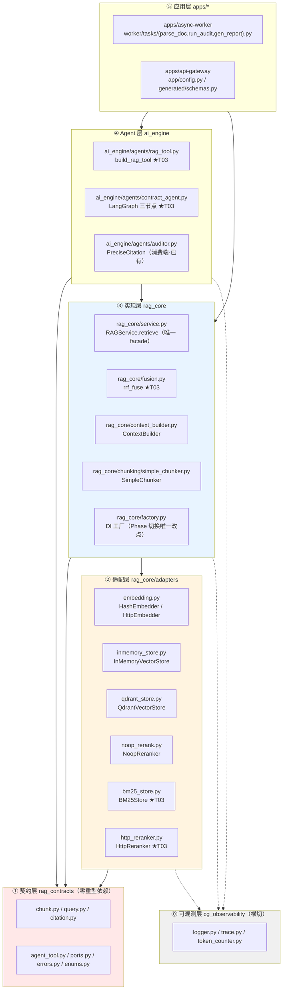
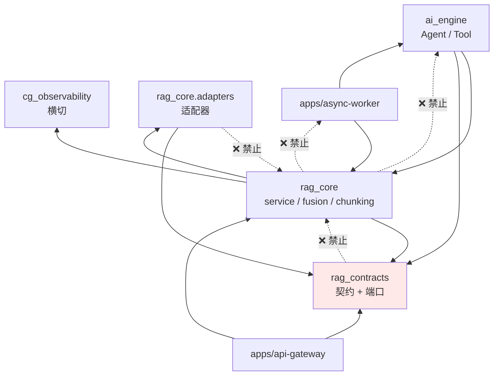
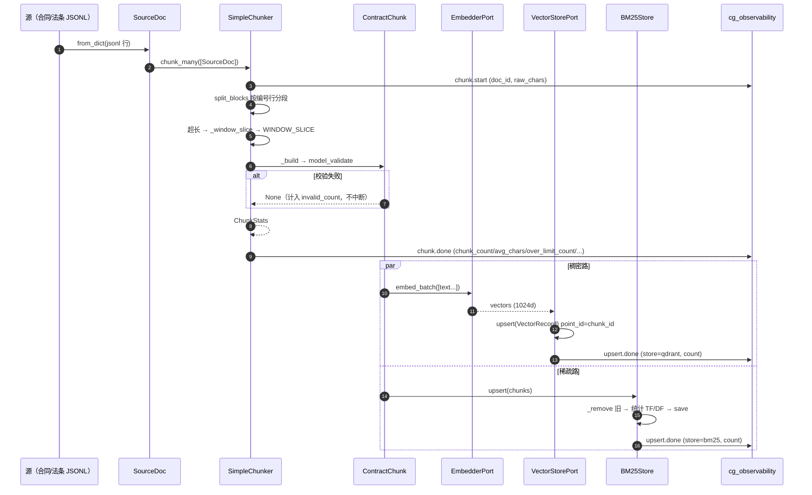
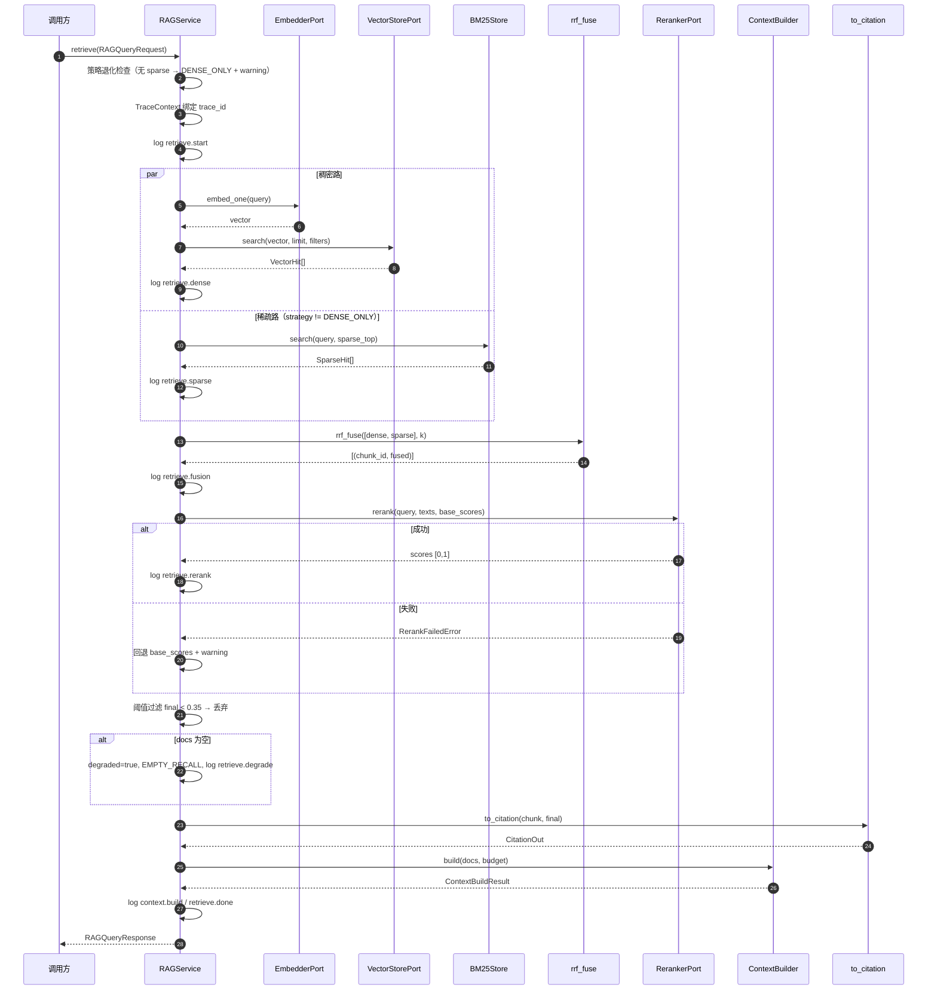
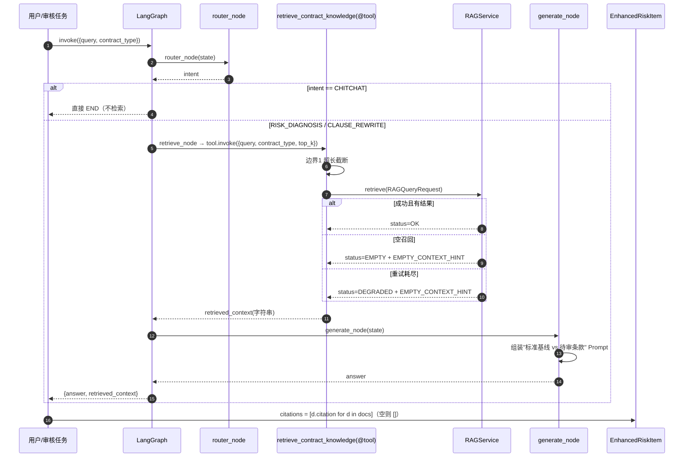
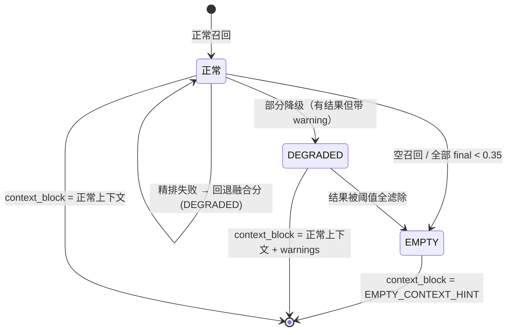
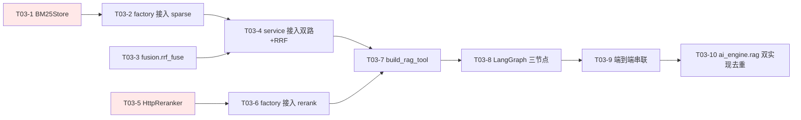

# RAG 搭建框架 —— 唯一实施依据（照着就能写码）

> ⚠️ **文档纠偏声明 · 2026-09-21**（本节由文档纠偏流程**追加**，原文**未删改**）
>
> **状态**：✅ **L2 · 实现与命名权威**（**继续有效**）—— 仅**版本数字过期**。
>
> | # | 位置 | 本文档写的 | 现行事实 |
> |---|---|---|---|
> | 1 | §1.1 版本行 | 「2026-09-08 实测，`99 passed`」 | 现基线为 **`140 passed`**（2026-09-20 实测，已现场复跑确认） |
> | 2 | §C4 断言处 | 「全量测试通过（基线 99）」 | 同上，**基线 140** |
>
> ✅ **仍完全有效的部分**：第 2 章**标识符命名总表**（零重名零同义的机制）、
> `ClauseChunk → ContractChunk` 等**别名映射表**、`HybridRetriever` 收窄为薄桥接的方案（§C4）。
> **命名冲突时以本文档为准。**
>
> **该信谁**：见 `文件集合/codex/0.施工标准与定义归属.md` **§0.11 文档权威层级**。
> 一句话：**落点查 L0（`文件集合/codex/`）／契约字段查 L1（`RAG_MODULE_DESIGN.md`）／实现与命名查 L2（`RAG搭建框架.md`）／仓库现状查 L3（`项目代码深度阅读与分析报告.md`）**。


> **文档定位**：本文是 `contract-guard-ai` 项目 RAG 模块（T03 及后续）的**唯一编码实施依据**。
> **适用读者**：即将动手写 `BM25Store` / `rrf_fuse` / `HttpReranker` / LangGraph 绑定层的工程师。
> **版本**：v1.0 · 对齐代码基座 `rag-contracts@1.0.0` / `rag-core@1.0.0` / `cg-observability`（2026-09-08 实测，`99 passed`）。
> **硬约束**：本文**所有标识符必须先在第 2 章命名总表登记**，后文才能使用。全文零重名、零同义异名。

---

## 第 1 章 文档定位与适用边界

### 1.1 三份文档的分工（开发时该查哪份）

| 你要做的事 | 查这份 | 原因 |
|---|---|---|
| 查某个**类/字段/方法叫什么名字** | **本文第 2 章 + 第 5 章** | 命名总表与逐字段定义 |
| 写 `BM25Store` / `rrf_fuse` / `HttpReranker` / `@tool` | **本文第 6 章 + 第 8 章** | 类设计到"照着就能写"的粒度 + 算法规范 |
| 搞懂"BM25 公式怎么算、RRF 为什么丢弃分数" | `RAG对照解析.md` | 机制级拆解 + 手算数值 |
| 查契约的**完整 JSON Schema**、三阶段路线图、验收标准 | `RAG白皮书.md` | 契约基线与验收基线 |
| 查架构分层、选型取舍（Qdrant vs Milvus）、任务分解 | `RAG_MODULE_DESIGN.md` | 设计侧论证 |
| 查 SSOT 数据方案（`PreciseCitation` / `EnhancedRiskItem`） | `data_scheme.md`、`openapi.yaml` | 权威数据源 |
| **逐文件对照开发**（打开某个文件 → 照着注释写 → 写完跑哪条断言） | **本文附录 B** | 新增文件全景 + 每个文件的边界 / 契约 / 签名 / 逐行代码 / 验收断言 |

> **一句话区分**：
> - **`RAG白皮书`** = **有什么**（契约 + 验收）
> - **`RAG对照解析`** = **为什么**（算法原理 + 手算）
> - **本文 `RAG搭建框架`** = **怎么写**（命名 + 类设计 + 流转 + 任务分解）

### 1.2 本文适用边界

| 范围内 ✅ | 范围外 ❌ |
|---|---|
| `rag-contracts` / `rag-core` / `cg-observability` / `ai-engine` 四个包的 RAG 相关代码 | `doc-processor`（OCR/版面/解析）内部实现 |
| T03 待建件：`BM25Store`、`fusion.rrf_fuse`、`HttpReranker`、`rag_tool`、LangGraph 节点 | 前端 `web-ui` 的 PDF.js 高亮实现 |
| RAG 与 `async-worker` / `api-gateway` 的**接入点**（不改 openapi） | 新增任何 `openapi.yaml` 端点（明令禁止，见 §1.3 红线 7） |

### 1.3 强制约束（违反会导致跑不通或契约漂移）

| # | 约束 | 违反后果 |
|---|---|---|
| 1 | `sourceType` **只有三值** `STANDARD_CLAUSE｜LAW_ARTICLE｜PRECEDENT` | 前端 `PreciseCitation` 消费端直接校验失败；溯源 UI 崩 |
| 2 | `CitationOut` 是**唯一** camelCase 模型，其余 RAG 模型一律 snake_case | 大小写写错 → Pydantic `ValidationError` |
| 3 | `generated/schemas.py` 是 snake_case 字段 + camelCase alias 且**无 `model_config`** → 入参 camelCase、出参 `model_dump(by_alias=True)` | 出参少了 alias → 前端收到 snake_case 字段名，全量类型报错 |
| 4 | `dense` 余弦 `[-1,1]` → `final [0,1]` 必须 **clamp**（`max(0,min(1,x))`），**禁止 `(x+1)/2`** | 无关文本被抬到 0.5 > 0.35 阈值 → **缺失条款检测彻底失灵**，赛题要求的能力失效 |
| 5 | `embedding_dim` 必须 == 1024（`ContractChunk` validator 强制） | `ValueError`，切片被丢弃，`invalid_count` 飙升 |
| 6 | `ERR_EMPTY_RECALL` / `degraded=true` 是**正常降级信号不是错误**，不抛异常、不告警；内部 `CG-RAG-xxxx` **不外泄**，对外收敛：超时→`ERR_LLM_TIMEOUT`，其余→`ERR_INTERNAL` | 把降级当错误 → 误告警 + 内部码泄漏 |
| 7 | **不得新增 openapi.yaml 端点**（现有 17 个 path 无 RAG 端点） | 触发 `gen:py` / `gen:ts` / `gen:zod` 三条生成链，SSOT 扩散 |
| 8 | `percent` 一律 0~1（`TaskProgress` / `ProgressMessage`），`HealthScore` 是 0~100 | 口径混用 → 前端进度条/健康分显示错误 |
| 9 | `EnhancedRiskItem.citations` / `reasoningSteps` 为**空数组 `[]` 而非 null** | 前端 `.map()` 崩溃 |
| 10 | `score_threshold=0.35` **双重语义**：相关性门槛 + **缺失条款检测触发线** | 改小 → 误判"有对照"；改大 → 漏检缺失 |

---

## 第 2 章 ★全局命名总表（Naming Registry）

> **本章是本文第一优先级产出。后文出现的每一个标识符都必须在此登记。**
> **仲裁规则**：① 已落盘代码 > 文档（代码是真理源）；② 契约层（`rag_contracts`）> 实现层；③ 新名必须登记后才能使用。

### 2.1 包 / 模块命名

| 唯一合法名 | 类型 | 职责（一句话） | 状态 |
|---|---|---|---|
| `rag_contracts` | 包 `packages/rag-contracts` | 契约与端口（零重型依赖，只依赖 pydantic） | 已有 |
| `rag_core` | 包 `packages/rag-core` | 检索实现与适配器 | 已有 |
| `cg_observability` | 包 `packages/cg-observability` | 日志 / 追踪 / Token 计量 | 已有 |
| `ai_engine` | 包 `packages/ai-engine` | Agent 与工具绑定层 | 已有 |
| `doc_processor` | 包 `packages/doc-processor` | 文档解析（RAG 的上游） | 已有 |
| `rag_contracts.enums` | 模块 | 全部枚举集中定义 | 已有 |
| `rag_contracts.chunk` | 模块 | `ContractChunk` / `BBox` | 已有 |
| `rag_contracts.query` | 模块 | 请求 / 响应 / 召回文档 / 分数 / 溯源 | 已有 |
| `rag_contracts.citation` | 模块 | 溯源映射（唯一转换点） | 已有 |
| `rag_contracts.agent_tool` | 模块 | 工具入参/出参 + function calling spec | 已有 |
| `rag_contracts.ports` | 模块 | 5 个 Protocol 端口 | 已有 |
| `rag_contracts.errors` | 模块 | 错误码与异常体系 | 已有 |
| `rag_core.config` | 模块 | `RagSettings` | 已有 |
| `rag_core.factory` | 模块 | DI 工厂（Phase 切换唯一改点） | 已有 |
| `rag_core.service` | 模块 | `RAGService` 编排 | 已有 |
| `rag_core.context_builder` | 模块 | 上下文拼装 | 已有 |
| `rag_core.chunking.simple_chunker` | 模块 | 切片器 | 已有 |
| `rag_core.adapters` | 模块 | 适配器统一出口 | 已有 |
| `rag_core.adapters.embedding` | 模块 | `HashEmbedder` / `HttpEmbedder` / `tokenize` | 已有 |
| `rag_core.adapters.inmemory_store` | 模块 | `InMemoryVectorStore` / `cosine` | 已有 |
| `rag_core.adapters.qdrant_store` | 模块 | `QdrantVectorStore` | 已有 |
| `rag_core.adapters.noop_rerank` | 模块 | `NoopReranker` | 已有 |
| **`rag_core.adapters.bm25_store`** | 模块 | **`BM25Store`** | **T03 待建** |
| **`rag_core.adapters.http_reranker`** | 模块 | **`HttpReranker`** | **T03 待建** |
| **`rag_core.fusion`** | 模块 | **`rrf_fuse`** | **T03 待建** |
| **`ai_engine.agents.rag_tool`** | 模块 | **`build_rag_tool`** | **T03 待建** |
| **`ai_engine.agents.contract_agent`** | 模块 | **LangGraph 图编排** | **T03 待建** |

### 2.2 类命名总表

| 唯一合法名 | 所在模块 | 职责 | 状态 |
|---|---|---|---|
| `ContractChunk` | `rag_contracts.chunk` | 切片契约主体（28 字段） | 已有 |
| `BBox` | `rag_contracts.chunk` | PDF 坐标 | 已有 |
| `RAGQueryRequest` | `rag_contracts.query` | 检索请求 | 已有 |
| `RAGQueryResponse` | `rag_contracts.query` | 检索响应 | 已有 |
| `RetrievedDoc` | `rag_contracts.query` | 单条召回结果 | 已有 |
| `ChunkScores` | `rag_contracts.query` | 多阶段得分 | 已有 |
| `CitationOut` | `rag_contracts.query` | 溯源（**唯一 camelCase**） | 已有 |
| `TokenUsage` | `rag_contracts.query` | Token 耗用 | 已有 |
| `RetrievalFilters` | `rag_contracts.query` | 过滤条件 | 已有 |
| `AgentRAGToolInput` | `rag_contracts.agent_tool` | 工具入参 | 已有 |
| `AgentRAGToolResult` | `rag_contracts.agent_tool` | 工具出参 | 已有 |
| `VectorStorePort` / `SparseStorePort` / `EmbedderPort` / `RerankerPort` / `TokenCounterPort` | `rag_contracts.ports` | 5 个端口 Protocol | 已有 |
| `VectorRecord` / `VectorHit` / `SparseHit` | `rag_contracts.ports` | 端口传输对象 | 已有 |
| `RagError` + 8 个子类 | `rag_contracts.errors` | 异常体系 | 已有 |
| `RagSettings` | `rag_core.config` | 配置 | 已有 |
| `RAGService` | `rag_core.service` | 检索编排（**唯一 facade**） | 已有 |
| `ContextBuilder` / `ContextBuildResult` | `rag_core.context_builder` | 上下文拼装 | 已有 |
| `SimpleChunker` / `SourceDoc` / `ChunkStats` | `rag_core.chunking.simple_chunker` | 切片 | 已有 |
| `HashEmbedder` / `HttpEmbedder` | `rag_core.adapters.embedding` | 向量化 | 已有 |
| `InMemoryVectorStore` | `rag_core.adapters.inmemory_store` | 内存向量库 | 已有 |
| `QdrantVectorStore` | `rag_core.adapters.qdrant_store` | Qdrant 向量库 | 已有 |
| `NoopReranker` | `rag_core.adapters.noop_rerank` | 恒等重排 | 已有 |
| `TokenCounter` / `TokenMeter` | `cg_observability.token_counter` | Token 与耗时 | 已有 |
| `TraceContext` / `Span` | `cg_observability.trace` | 追踪上下文 | 已有 |
| **`BM25Store`** | `rag_core.adapters.bm25_store` | BM25 稀疏检索 | **T03 待建** |
| **`HttpReranker`** | `rag_core.adapters.http_reranker` | HTTP 精排 | **T03 待建** |

### 2.3 方法命名总表（**必须复用的既有名**）

| 唯一合法名 | 归属 | 签名要点 | ⚠️ 易错点 |
|---|---|---|---|
| **`retrieve`** | `RAGService` | `retrieve(request: RAGQueryRequest) -> RAGQueryResponse` | **不是 `query` / `search` / `find`** |
| **`search`** | `VectorStorePort` / `SparseStorePort` | `(vector|query, top_k, filters=None) -> list[VectorHit\|SparseHit]` | 两端口同名不同首参 |
| `upsert` | 向量库 / BM25 | `(records: Sequence[VectorRecord]) -> int` | BM25 版是 `(chunks: Sequence[ContractChunk]) -> int` |
| `delete_by_doc` | 向量库 / BM25 | `(doc_id: str) -> int` | — |
| `health` | 向量库 / BM25 | `() -> bool` | — |
| `ensure_collection` | 向量库 | `(dim: int) -> None` | — |
| `embed_one` / `embed_batch` | `EmbedderPort` | `(text) -> list[float]` / `(texts) -> list[list[float]]` | — |
| `rerank` | `RerankerPort` | `(query, texts, base_scores=None) -> list[float]` | **见 §15 冲突 C1** |
| `count` / `count_many` | `TokenCounterPort` | `(text) -> int` | — |
| `build` | `ContextBuilder` | `(docs, budget) -> ContextBuildResult` | — |
| `chunk` / `chunk_with_stats` / `chunk_many` | `SimpleChunker` | `(doc: SourceDoc) -> ...` | — |
| `to_citation` | `rag_contracts.citation` | `(chunk, score, *, max_content_chars) -> CitationOut` | 唯一溯源转换点 |
| `truncate_text` / `clamp_score` | `rag_contracts.citation` | `(text, limit)` / `(score)` | — |
| `make_chunk_id` | `ContractChunk`（staticmethod） | `(doc_id, section_id, slice_idx=0) -> str` | **uuid5，分隔符 `#`** |
| `compute_text_hash` | `ContractChunk`（staticmethod） | `(text) -> str` | sha256 前 16 位 |
| `citation_title` | `ContractChunk` | `() -> str` | 五级兜底 |
| `to_payload` / `from_payload` | `ContractChunk` | `() -> dict` / `(payload) -> ContractChunk` | — |
| `to_log_fields` | `ChunkStats` | `() -> dict[str, int]` | — |
| `build_embedder` / `build_vector_store` / `build_reranker` / `build_sparse_store` / `build_service_from_settings` | `rag_core.factory` | 见 §6 | — |
| `log_event` | `cg_observability` | `(logger, stage, *, level, msg, trace_id, span_id, **fields)` | — |
| `get_logger` | `cg_observability` | `(name, *, level=None) -> Logger` | — |
| `stage` | `TokenMeter` | `stage(name)` 上下文管理器 | — |
| **`rrf_fuse`** | `rag_core.fusion` | `(ranked_lists, k=60) -> list[tuple[str, float]]` | **T03 待建** |
| **`build_rag_tool`** | `ai_engine.agents.rag_tool` | `(service, *, max_query_chars, max_retries, default_top_k) -> tool` | **T03 待建** |
| **`/` `router_node` / `retrieve_node` / `generate_node`** | `ai_engine.agents.contract_agent` | `(state: AgentState) -> dict` | **T03 待建** |

### 2.4 字段命名边界表（snake_case / camelCase / alias）

| 场景 | 规范 | 真实例子 |
|---|---|---|
| `rag_contracts` 内部模型（除 `CitationOut`） | **snake_case** | `chunk_id` / `source_type` / `text_hash` / `score_threshold` |
| `CitationOut`（对接 SSOT `PreciseCitation`） | **camelCase，且仅此一处** | `sourceType` / `sourceTitle` / `contentChunk` / `relevanceScore` |
| Python 变量 / 参数 / 私有属性 | snake_case + 单下划线前缀 | `self._tf` / `max_query_chars` / `ranked_lists` |
| 枚举成员 | **全大写下划线**（`str, Enum`） | `SourceType.LAW_ARTICLE` |
| 模块级常量 | **全大写下划线** | `EMBEDDING_DIM` / `DEFAULT_RRF_K` / `MAX_CONTENT_CHARS` / `TOOL_NAME` |
| 模块级"私有"常量 | 单下划线 + 全大写 | `_K1` / `_B` / `_CLAUSE_HEAD_RE` |
| `generated/schemas.py`（SSOT 生成） | snake_case 字段 + **camelCase alias** | `health_score: HealthScore = Field(..., alias='healthScore')` |
| → 作为**入参**接收 | 必须传 **camelCase** | `ContractCreate(**{"contractType": ...})` |
| → 作为**出参**返回 | 必须 `model_dump(by_alias=True)` | 否则前端拿到 `contract_type` 而非 `contractType` |
| Qdrant payload 字段 | **与 `ContractChunk` 字段名完全同名**（snake_case） | `source_type` / `chunk_type` / `doc_id` / `law_code` |
| 日志字段（`log_event(**fields)`） | snake_case | `top_score` / `took_ms` / `stage_latency_ms` |
| 环境变量 | `CG_RAG_` + 大写下划线 | `CG_RAG_VECTOR_DIM` |

### 2.5 文件 / 目录命名

| 类型 | 规范 | 例子 |
|---|---|---|
| Python 包目录 | 小写 + 连字符（发行名） | `packages/rag-contracts` / `packages/rag-core` / `packages/cg-observability` |
| Python 导入包目录 | 小写 + 下划线 | `rag_contracts/` / `rag_core/` / `cg_observability/` |
| 模块文件 | 小写 + 下划线 + `.py` | `bm25_store.py` / `http_reranker.py` / `fusion.py` / `rag_tool.py` |
| 测试文件 | `test_<模块>.py` | `test_bm25.py` / `test_fusion.py` / `test_rag_tool.py` |
| 数据目录 | `./data/<子系统>` | `./data/bm25/index.pkl` / `./data/qdrant` |
| 索引文件 | 固定 `index.pkl` | `./data/bm25/index.pkl` |
| 语料文件 | JSONL，**小写连字符 + 大写后缀** | `scripts/data/phase1_sample.jsonl` |

### 2.6 配置环境变量命名（`CG_RAG_*` 与 `CG_*` 的分工）

| 前缀 | 归属 | 读取方 | 例子 |
|---|---|---|---|
| **`CG_RAG_`** | **RAG 模块专属** | `rag_core.config.RagSettings`（`env_prefix="CG_RAG_"`） | `CG_RAG_VECTOR_DIM` / `CG_RAG_BM25_DIR` / `CG_RAG_RRF_K` |
| `CG_` | 全局基础设施与网关 | `apps/api-gateway/app/config.py`（`env_prefix="CG_"`） | `CG_POSTGRES_DSN` / `CG_QDRANT_URL` / `CG_REDIS_URL` |

> **分工铁律**：RAG 的**一切**可调参数都走 `CG_RAG_*`，**不得**往 `CG_*` 里塞 RAG 参数（会污染网关配置并导致 `extra="ignore"` 静默吞掉拼写错误）。
> **例外**：`CG_RAG_LOG_LEVEL` 未设置时，`cg_observability.logger.resolve_level()` 会回落到 `CG_LOG_LEVEL`（见 `logger.py` L50）。

### 2.7 日志 `stage` 命名登记表（**完整，含待建**）

命名规则：`<域>.<动作>`，域取**短名**（`retrieve` / `context` / `chunk` / `embed` / `upsert` / `tool`）。

| stage | 域 | 动作 | 状态 | 说明 |
|---|---|---|---|---|
| `chunk.start` | chunk | 开始切片 | T03 新增 | 建库流起点 |
| `chunk.done` | chunk | 切片完成 | T03 新增 | 打 `ChunkStats.to_log_fields()` |
| `embed.done` | embed | 向量化完成 | T03 新增 | 打 model / batch / dim |
| `upsert.done` | upsert | 入库完成 | T03 新增 | 打 store / count |
| `retrieve.start` | retrieve | 检索开始 | **已有** | `service.py` L143 |
| `retrieve.dense` | retrieve | 稠密路完成 | **已有** | `service.py` L303 |
| `retrieve.sparse` | retrieve | 稀疏路完成 | T03 新增 | 打 candidates / top_score |
| `retrieve.fusion` | retrieve | RRF 融合完成 | T03 新增 | 打 rrf_k / fused_count |
| `retrieve.rerank` | retrieve | 精排完成 | **已有** | `service.py` L363 |
| `retrieve.degrade` | retrieve | 降级发生 | **已有** | `service.py` L158/176/201 |
| `retrieve.done` | retrieve | 检索完成 | **已有** | `service.py` L252 |
| `context.build` | context | 上下文拼装完成 | **已有** | `service.py` L214 |
| **`tool.truncate`** | tool | 工具入参超长被截断 | T03 新增 | — |
| **`tool.degrade`** | tool | 工具层降级 | T03 新增 | — |
| **`tool.empty`** | tool | 工具层空召回 | T03 新增 | — |
| **`tool.done`** | tool | 工具调用完成 | T03 新增 | — |

> ⚠️ **命名冲突仲裁**：`RAG白皮书.md §3.3.1` 的示例代码使用了 `rag_tool.*` 前缀（`rag_tool.truncate` 等）。
> **本文裁定统一为 `tool.*`**：因为 `stage` 的语义是"**域.动作**"，域应取短名——与既有 `context.build`（而非 `context_builder.build`）保持同一风格。
> → T03 实现 `rag_tool.py` 时**必须写 `tool.*`**，不得沿用白皮书的 `rag_tool.*`。

> **`stage` → `stage_latency_ms` key 的映射规则**：key = `stage.split(".", 1)[-1]`。
> 即 `retrieve.dense` 的耗时 key 是 `dense`，`context.build` 的 key 是 `build`。
> 现有 key 集合：`embed` / `dense` / `rerank` / `build`；T03 追加：`sparse` / `fusion`。

### 2.8 错误码命名

| 唯一合法名 | 值 | 类型 |
|---|---|---|
| `ERR_QUERY_TOO_LONG` | `CG-RAG-1001` | 不可重试 |
| `ERR_EMBED_FAILED` | `CG-RAG-1002` | 可重试 |
| `ERR_STORE_UNAVAILABLE` | `CG-RAG-1003` | 可重试 |
| `ERR_TIMEOUT` | `CG-RAG-1004` | 可重试 |
| `ERR_EMPTY_RECALL` | `CG-RAG-2001` | **非异常，握手信号** |
| `ERR_RERANK_FAILED` | `CG-RAG-2002` | 可重试 |
| `ERR_CONTRACT_VALIDATION` | `CG-RAG-3001` | 不可重试 |
| `ERR_SCHEMA_VERSION_MISMATCH` | `CG-RAG-3002` | 不可重试 |

> 内部码**严禁**出现在对外响应中，映射见 §11.2。

### 2.9 Celery 任务名 / Qdrant 命名

| 对象 | 唯一合法名 | 说明 |
|---|---|---|
| 解析任务 | `parse_doc`（`worker/tasks/parse_doc.py`） | 已有 |
| 审核任务 | `run_audit`（`worker/tasks/run_audit.py`） | 已有 |
| 报告任务 | `gen_report`（`worker/tasks/gen_report.py`） | 已有 |
| Qdrant collection | `contract_clauses`（`CG_RAG_COLLECTION`） | 已有 |
| Qdrant point_id | **= `chunk_id`**（uuid5） | 幂等基石 |
| Qdrant payload 索引字段 | 见 `KEYWORD_INDEX_FIELDS`（6 个） | §9.1 |
| Qdrant 距离 | `Distance.COSINE` | 锁定 |
| Qdrant 维度 | `1024` | 锁定 |

### 2.10 禁用同义名清单（**反例**）

> **规则**：一个概念**只准一个名字**。下表左列在 RAG 相关代码中**禁止出现**。

| 概念 | ✅ 唯一合法名 | ❌ 禁用同义名 |
|---|---|---|
| 切片契约对象 | `ContractChunk` | `ClauseChunk` / `Slice` / `Segment` / `Doc` / `Document` |
| 切片 ID | `chunk_id` | `id` / `clause_id` / `pk` / `uid` |
| 源文档载体 | `SourceDoc` | `doc` / `document` / `RawDoc` / `InputDoc` |
| 检索入口方法 | `retrieve` | `query` / `search_docs` / `query_knowledge` / `find` |
| 向量库检索方法 | `search` | `find` / `fetch` / `match` / `knn` |
| 召回结果对象 | `RetrievedDoc` | `RetrievedChunk`（旧 stub）/ `Hit` / `Result` |
| 相关性分数字段 | `score` | `relevance` / `similarity` / `confidence` |
| 最终比较分数 | `final`（`ChunkScores.final`） | `final_score` / `relevanceScore`（那是 `CitationOut` 的字段） |
| 溯源对象 | `CitationOut` | `Citation` / `PreciseCitation`（那是 `ai_engine` 侧消费端） |
| 上下文文本 | `context_block` | `context` / `prompt_context`（**`ctx` 为例外**：它是 `TraceContext` 惯用名，不在禁用列） |
| 重排实现 | `HttpReranker` / `NoopReranker` | `CrossEncoderReranker`（禁 torch）/ `Reranker`（旧 stub） |
| 稀疏检索实现 | `BM25Store` | `SparseStore` / `KeywordIndex` / `BM25` |
| 空召回提示语 | `EMPTY_CONTEXT_HINT` | 任何手写的"未检索到…"字符串 |

> ⚠️ **不要用正则扫全文**。第一版守卫用 `\bdoc\b` 正则扫描，实测在现有代码上产生 18 处误报：
> ① 扫到注释/docstring 里的英文散文；② `for doc in docs` 这类**局部变量**被误判；
> ③ 守卫自身定义 `FORBIDDEN_SYNONYMS` 时把禁用词当字面量写了一遍，自扫描必炸。
> 因此**改用 AST 扫描**并分两档（下方可执行代码），实测误报降为 0。

**可执行的命名守卫**（建议落盘为 `packages/rag-contracts/rag_contracts/_naming_guard.py`，供 lint / 单测调用）：

设计要点：
- **档位 1 `BANNED_ANY`**：类型名/字段名/函数名，任何位置出现即拦。
- **档位 2 `BANNED_AS_DEF`**：泛用词（`doc` / `slice` / `relevance`…）**仅在被"定义为名字"时**拦截（class/def/参数/赋值目标/`self.x`），从而放过 `for doc in docs` 与冻结字段 `relevanceScore`。
- **标注豁免**：参数若标注了规范类型（`doc: SourceDoc` / `doc: RetrievedDoc`），视为安全。
- **不列 `ctx`**：`ctx` 在 `cg_observability.trace` 中是 `TraceContext` 惯用名，与 `context_block` 无关。
- 源码无法 `ast.parse` 时返回 `[]`——**宁可漏报，不可阻断构建**。

> **实测结果（已跑）：**`rag-contracts` / `rag-core` / `cg-observability` 三包**全部干净**；
> `ai-engine` 命中 4 处，全部为**已登记的存量漂移**（`RetrievedChunk` ×2 见 §15 C4；`clause_id` ×2 见 §15 **C11**）。

```python
"""命名守卫（AST 版）：把 §2.10「禁用同义名」从文档约定变成可执行检查。

两档设计，解决正则版的误伤问题：
- BANNED_ANY：任何位置出现都拦（类型名 / 字段名 / 函数名）
- BANNED_AS_DEF：仅当"被定义为名字"时才拦（class/def/参数/属性/赋值目标），
  这样 `for doc in docs`、`self.relevanceScore` 不会被误伤
"""
from __future__ import annotations

import ast

# ---- 档位 1：任何位置出现都拦截 ----
BANNED_ANY: dict[str, str] = {
    # 类型 / 类名
    "ClauseChunk": "ContractChunk",
    "RawDoc": "SourceDoc",
    "InputDoc": "SourceDoc",
    "Document": "SourceDoc",
    "Doc": "SourceDoc",      # 注意：AST 精确匹配，不会误伤 SourceDoc / RetrievedDoc
    "Slice": "ContractChunk",
    "Segment": "ContractChunk",
    "RetrievedChunk": "RetrievedDoc",
    "CrossEncoderReranker": "HttpReranker",
    "SparseStore": "BM25Store",
    "KeywordIndex": "BM25Store",
    # 字段 / 属性名（relevanceScore 是 CitationOut 冻结字段，不在列）
    "clause_id": "chunk_id",
    "final_score": "final",
    "relevance_score": "score",
    "similarity_score": "score",
    # 函数名
    "search_docs": "retrieve",
    "query_knowledge": "retrieve",
}

# ---- 档位 2：仅当"被定义为名字"时拦截（避免误伤局部变量与冻结字段）----
BANNED_AS_DEF: dict[str, str] = {
    "doc": "SourceDoc",
    "document": "SourceDoc",
    "slice": "chunk",
    "segment": "chunk",
    "relevance": "score",
    "similarity": "score",
    "confidence": "score",
    "context": "context_block",
    # 注意：不列 `ctx`。`ctx` 在 cg_observability.trace 中是 TraceContext 的惯用名，
    # 与 context_block 无关，列入会污染信号。
}

# 规范类型：参数只要标注了其中任意一个，短名（如 doc）即视为安全
CANONICAL_TYPES: frozenset[str] = frozenset(
    {"SourceDoc", "RetrievedDoc", "ContractChunk", "ChunkScores"}
)

# 白名单：这些是 SSOT 冻结字段/既有合法名，即使撞名也放行
ALLOWED: frozenset[str] = frozenset(
    {
        "relevanceScore",
        "sourceType",
        "sourceTitle",
        "contentChunk",
        "doc_id",          # ContractChunk 规范字段
        "doc_processor",   # 既有包名
    }
)


def _unparse(node: ast.AST | None) -> str:
    """把 AST 节点还原为源码文本；不可用时返回空串。"""
    if node is None:
        return ""
    try:
        return ast.unparse(node)
    except Exception:  # noqa: BLE001 - 极端节点无法 unparse 时按"无标注"处理
        return ""


def _definitions(tree: ast.AST) -> dict[str, set[str]]:
    """收集所有'被定义的名字' -> 该定义的类型标注文本集合。

    标注用于豁免：写成 `doc: SourceDoc` 的参数不再视为违禁
    （名字虽短但类型已锁定为规范名，不存在"同义异名"风险）。

    Returns:
        {名字: {标注文本, ...}}；无标注时集合含空串 ""。
    """
    names: dict[str, set[str]] = {}
    for node in ast.walk(tree):
        if isinstance(node, (ast.ClassDef, ast.FunctionDef, ast.AsyncFunctionDef)):
            names.setdefault(node.name, {""})
        elif isinstance(node, ast.arg):
            names.setdefault(node.arg, {_unparse(node.annotation)})
        elif isinstance(node, ast.Name) and isinstance(node.ctx, (ast.Store, ast.Del)):
            names.setdefault(node.id, {""})
        elif isinstance(node, ast.Attribute) and isinstance(node.ctx, ast.Store):
            names.setdefault(node.attr, {""})
        elif isinstance(node, (ast.Import, ast.ImportFrom)):
            for alias in node.names:
                names.setdefault(alias.asname or alias.name.split(".")[0], {""})
    return names


def _all_identifiers(tree: ast.AST) -> set[str]:
    """收集所有出现过的标识符（读+写）。"""
    names: set[str] = set()
    for node in ast.walk(tree):
        if isinstance(node, ast.Name):
            names.add(node.id)
        elif isinstance(node, ast.Attribute):
            names.add(node.attr)
        elif isinstance(node, (ast.ClassDef, ast.FunctionDef, ast.AsyncFunctionDef)):
            names.add(node.name)
        elif isinstance(node, ast.arg):
            names.add(node.arg)
    return names


def find_forbidden(source: str) -> list[tuple[str, str, str]]:
    """扫描源码，返回违禁名。

    Args:
        source: Python 源码文本。

    Returns:
        [(违禁名, 应改用的名字, 命中档位), ...]；无违禁时返回空列表。
        源码无法解析时返回 []（宁可漏报，不可阻断构建）。
    """
    try:
        tree = ast.parse(source)
    except SyntaxError:
        return []
    defs = _definitions(tree)
    allids = _all_identifiers(tree)

    hits: list[tuple[str, str, str]] = []
    for name, good in BANNED_ANY.items():
        if name in allids and name not in ALLOWED:
            hits.append((name, good, "any"))
    for name, good in BANNED_AS_DEF.items():
        if name not in defs or name in ALLOWED:
            continue
        # 豁免：所有定义点都标注了规范类型（如 `doc: SourceDoc` / `doc: RetrievedDoc`）
        annotations = defs[name]
        if all(any(canon in ann for canon in CANONICAL_TYPES) for ann in annotations if ann):
            continue
        hits.append((name, good, "def-only"))
    return sorted(hits)


def assert_canonical(source: str) -> None:
    """断言源码中不含被禁用的同义名。

    Args:
        source: Python 源码文本。

    Raises:
        NameError: 发现违禁同义名时抛出，消息给出应替换的名字。
    """
    hits = find_forbidden(source)
    if hits:
        detail = "; ".join(f"'{bad}' 应改为 '{good}'（{tier}）" for bad, good, tier in hits)
        raise NameError(f"检测到禁用同义名：{detail}（详见 RAG搭建框架.md §2.10）")
```

### 2.11 新增命名登记流程

1. **查表**：先查 §2.1~§2.9 是否已有同义名。已有 → 直接复用，**不得新建**。
2. **判定归属**：新名属于契约层（`rag_contracts`）还是实现层（`rag_core`）？契约层新名必须同步更新 `scripts/export_schemas.py` 导出的 4 份 JSON Schema。
3. **登记**：追加到本章对应表格，并在 `rag_contracts` 的 `__all__` 中导出。
4. **守卫**：若新名是"已有概念的又一种说法"，**直接拒绝**（见 §2.10）。
5. **同步**：涉及对外契约的，必须同步 `RAG白皮书.md` 第 2 章；涉及冲突的在 §15 登记。

---

## 第 3 章 业务需求 → 工程映射（需求追溯矩阵 RTM）

### 3.1 赛题指标 → RAG 能力 → 验收项

| # | 业务需求（赛题） | 量化指标 | RAG 能力点 | 承载契约/类 | 验收项 |
|---|---|---|---|---|---|
| R1 | ≥5 类合同分类 | 准确率 ≥85% | `contract_type` 作为 Qdrant KEYWORD 索引字段，同类型标准条款优先召回，为 LLM 提供分类先验 | `ContractType`(6值) / `RetrievalFilters.contract_type` | 5 类各 10 条样本，`filters.contract_type` 过滤后 Top-5 同类占比 ≥ 90% |
| R2 | 关键要素抽取 | F1 ≥80% | 提供 `page_no` + `bbox`（PDF_POINTS）支撑要素绑定原文位置 | `BBox` / `ContractChunk.page_no` | 每条召回 `page_no` 非空率 100%；`bbox.coordinate_system == "PDF_POINTS"` |
| R3 | 风险识别 | 召回&精准 ≥75% | 混合检索（Dense+BM25+RRF）+ Cross-Encoder 精排提升对照基线命中率 | `RAGService.retrieve` / `RAGQueryRequest.strategy` | **Recall@5 ≥ 0.80、Recall@10 ≥ 0.90**（RAG 侧设更严门禁） |
| R4 | ≥10 类风险 | — | `category` 字段承载风险类别，支持分层过滤 | `RiskCategory`(11值) / `ContractChunk.category` | `RetrievalFilters.categories` 过滤生效 |
| R5 | 报告含**原文位置** | — | `page_no` / `bbox` / `section_id` / `section_path` 全链路透传至 `CitationOut` | `to_citation()` / `CitationOut` | 每条 citation 的 `sourceTitle` 与 `contentChunk` 非空 |
| R6 | 报告含**风险等级** | — | RAG 不判定等级（由 LLM 判），但提供 `final` 分供 LLM 参考置信度 | `ChunkScores.final` | `relevanceScore ∈ [0,1]` |
| R7 | 报告含**修改建议** | — | `context_block` 提供"标准基线 vs 待审条款"对照文本 | `ContextBuilder.build()` | `context_tokens ≤ max_context_tokens` |
| R8 | 报告含**缺失条款提醒** | — | ★ `score_threshold=0.35` 兼作缺失检测触发线：全部候选 < 0.35 → `EMPTY_RECALL` → 注入 `EMPTY_CONTEXT_HINT` | `FallbackReason.EMPTY_RECALL` / `EMPTY_CONTEXT_HINT` | 构造无对照语料 → `degraded=true` 且 `context_block == EMPTY_CONTEXT_HINT` |
| R9 | Web 交互与反馈标注 | — | `FeedbackItem` → 反馈驱动索引重建（`delete_by_doc` + 重灌） | `VectorStorePort.delete_by_doc` / `SparseStorePort.delete_by_doc` | 同一 `doc_id` 二次建库后向量数不增长（幂等） |
| R10 | 可配置 | — | 全部阈值经 `CG_RAG_*` 注入，业务代码零硬编码 | `RagSettings` | 改 `CG_RAG_RRF_K` 后融合分随之变化 |
| R11 | 可解释 | — | `PreciseCitation` 1:1 映射 + `reasoningSteps` | `CitationOut` / `EnhancedRiskItem.citations` | 引用可溯源率 100%（每条 citation 四字段非空） |

### 3.2 追溯链路说明

```
赛题需求 R3（风险召回 ≥75%）
   └─> RAG 侧门禁 Recall@5 ≥ 0.80
         ├─> 依赖：BM25 精确命中条款号/专名（§8.5）
         ├─> 依赖：RRF 融合双路名次（§8.6）
         └─> 依赖：Cross-Encoder 精排纠正召回错序（§8.7）

赛题需求 R8（缺失条款提醒）
   └─> score_threshold=0.35 双重语义
         └─> 依赖：clamp 而非 (x+1)/2（红线 4）
               └─> 若误用 (x+1)/2，无关文本 final=0.5 > 0.35 → 缺失检测失效 → R8 全盘失守
```

---

## 第 4 章 分层架构与模块边界

### 4.1 分层图



### 4.2 依赖方向图与禁止的反向依赖



### 4.3 每层职责与 import 白/黑名单

| 层 | 职责（一句话） | ✅ 允许 import | ❌ 禁止 import |
|---|---|---|---|
| **① 契约层** `rag_contracts` | 定义"数据长什么样"和"接口长什么样"，不含任何实现 | `pydantic`、标准库 | `rag_core`、`cg_observability`、`ai_engine`、`apps/*`、任何 SDK（qdrant/httpx/numpy） |
| **⓪ 可观测层** `cg_observability` | 提供日志 / 追踪 / Token 计量 | 标准库、`tiktoken`（可选）、`rag_contracts.ports`（仅类型） | `rag_core`、`ai_engine`、`apps/*` |
| **② 适配层** `rag_core.adapters` | 把具体 SDK 包装成端口实现 | `rag_contracts`、`cg_observability`、`qdrant_client`（延迟）、`httpx`（延迟） | `rag_core.service`、`rag_core.fusion`、`ai_engine`、`apps/*` |
| **③ 实现层** `rag_core` | 编排检索流程（facade），不含 SDK 细节 | `rag_contracts`、`cg_observability`、`rag_core.adapters` | `ai_engine`、`apps/*` |
| **④ Agent 层** `ai_engine` | 把检索包装为 LLM 工具并编排图 | `rag_contracts`、`cg_observability`、`rag_core`、`langchain_core`、`langgraph` | `apps/*` |
| **⑤ 应用层** `apps/*` | 任务编排与 HTTP 入口 | 以上全部 | — |

> **最重要的两条**：
> 1. **`rag_contracts` 不得依赖 `rag_core`**（否则契约被实现污染，Phase 替换失效）。
> 2. **`adapters` 不得反向依赖 `service`**（否则适配器与编排耦合，无法单测替换）。

---

## 第 5 章 数据契约（字段定义逐表）

> 图例：**必填** = 无默认值必须传；**默认** = 有默认值；`—` = 不适用。

### 5.1 `ContractChunk`（28 字段，`rag_contracts/chunk.py`）

| # | 字段名 | 类型 | 必填/默认 | 约束 | 含义 | 来源 → 去向 | 备注 |
|---|---|---|---|---|---|---|---|
| 1 | `schema_version` | `Literal["1.0.0"]` | 默认 `"1.0.0"` | const | 契约版本，灰度迁移识别旧数据 | 常量 → Qdrant payload | 破坏性变更必须递增 |
| 2 | `chunk_id` | `str` | **必填** | 8~64 字符，`^[A-Za-z0-9_\-\.]+$` | 切片唯一 ID = **Qdrant point_id** | `make_chunk_id()` → 全链路 | uuid5 确定性，**禁止随机 uuid** |
| 3 | `doc_id` | `str` | **必填** | 1~200 字符 | 源文档标识 | 合同=contract_id / 法规=law_code / 范本=file_key → `delete_by_doc` | 增量重建的粒度 |
| 4 | `source_type` | `SourceType` | **必填** | 3 值枚举 | 检索源类型 | 解析层 → `CitationOut.sourceType` | **禁止第四值** |
| 5 | `chunk_type` | `ChunkType` | **必填** | 8 值枚举 | 切片粒度 | 切片器 → payload | `WINDOW_SLICE` 需父级 |
| 6 | `section_id` | `str` | **必填** | 1~64 字符 | 章节/条款稳定编号 | 切片器 → payload 过滤 | 如 `6.2.1` / `第五百八十五条` |
| 7 | `law_code` | `str \| None` | 默认 `None` | ≤64 | 法规代码 | 法条源 → payload | **LAW_ARTICLE 时必填** |
| 8 | `law_title` | `str \| None` | 默认 `None` | ≤200 | 法规全称 | 法条源 → `sourceTitle` 兜底 | |
| 9 | `article_no` | `str \| None` | 默认 `None` | ≤64 | 法条号 | 切片器 → `sourceTitle` 兜底 | |
| 10 | `parent_section_id` | `str \| None` | 默认 `None` | ≤64 | 父级编号 | 切片器 → 层级树 | **WINDOW_SLICE 时必填** |
| 11 | `section_path` | `str` | 默认 `""` | ≤512 | 人类可读层级路径 | 切片器 → Prompt | `第三章/第六条/6.1` |
| 12 | `level` | `int` | 默认 `0` | 0~8 | 层级深度 | 切片器 → — | 0=文档 1=章 2=节 3=条 4=款 5=项 |
| 13 | `seq_in_doc` | `int` | **必填** | ≥0 | 文档内顺序 | 切片器 → 结果重排 | |
| 14 | `title` | `str \| None` | 默认 `None` | ≤200 | 条款标题 | 切片器 → `sourceTitle` 首选 | |
| 15 | `text` | `str` | **必填** | 1~8000 | 检索语料正文 | 切片器 → 向量/BM25/Prompt | **绝不跨条款边界切** |
| 16 | `text_hash` | `str` | **必填** | `^[0-9a-f]{16}$` | sha256 前 16 位 | `compute_text_hash()` → 增量去重 | hash 未变则跳过 embedding |
| 17 | `char_count` | `int` | **必填** | ≥0 | 字符数 | 切片器 → 埋点 | |
| 18 | `token_count` | `int` | **必填** | ≥0 | Token 数 | `TokenCounter` → 埋点/预算 | |
| 19 | `page_no` | `int \| None` | 默认 `None` | ≥1 | 物理页码（1-based） | 解析层 → PDF.js 跳转 | |
| 20 | `bbox` | `BBox \| None` | 默认 `None` | 见 §5.2 | 物理坐标 | 解析层 → PDF.js 高亮 | |
| 21 | `contract_type` | `ContractType \| None` | 默认 `None` | 6 值枚举 | 合同类型 | 解析层 → payload KEYWORD 索引 | 同类型优先过滤 |
| 22 | `category` | `str` | 默认 `"UNSPECIFIED"` | ≤64 | 业务/风险类别 | 解析层 → payload KEYWORD 索引 | |
| 23 | `effective_date` | `date \| None` | 默认 `None` | ISO 日期 | 法规生效日 | 法条源 → 时效过滤 | |
| 24 | `tags` | `list[str]` | 默认 `[]` | 每项 ≤64，≤20 项 | 自由标签 | 解析层 → payload | |
| 25 | `embedding_model` | `str \| None` | 默认 `None` | ≤100 | 生成向量的模型名 | `EmbedderPort.model_name` → 换模型时识别失效向量 | |
| 26 | `embedding_dim` | `int \| None` | 默认 `1024` | **必须 == 1024**（非 null 时） | 向量维度 | 配置 → 强校验 | null = 尚未向量化 |
| 27 | `created_at` | `datetime` | 默认 `now(UTC)` | ISO 8601 UTC | 创建时间 | — | |
| 28 | `extra` | `dict[str, Any]` | 默认 `{}` | — | 扩展逃生舱 | — | **禁止**放需检索/过滤的字段，且 `to_payload()` 会剔除 |

**三条 validator 硬约束**（`_conditional_required`）：

| 条件 | 要求 | 违反 |
|---|---|---|
| `source_type == LAW_ARTICLE` | `law_code` 必填 | `ValueError` |
| `chunk_type == WINDOW_SLICE` | `parent_section_id` 必填 | `ValueError` |
| `embedding_dim is not None` | `== 1024` | `ValueError` |

### 5.2 `BBox`（6 字段）

| 字段名 | 类型 | 必填/默认 | 约束 | 含义 | 去向 |
|---|---|---|---|---|---|
| `page` | `int` | **必填** | ≥1 | 物理页码 | PDF.js 定位 |
| `x` | `float` | **必填** | — | 左上 X（PDF_POINTS） | 高亮 |
| `y` | `float` | **必填** | — | 左上 Y（PDF_POINTS） | 高亮 |
| `width` | `float` | **必填** | — | 宽度 | 高亮 |
| `height` | `float` | **必填** | — | 高度 | 高亮 |
| `coordinate_system` | `Literal["PDF_POINTS"]` | 默认 `"PDF_POINTS"` | const | 坐标系 | 前端 Overlay 校验 |

### 5.3 `RAGQueryRequest`（12 字段）

| 字段名 | 类型 | 必填/默认 | 约束 | 含义 | 备注 |
|---|---|---|---|---|---|
| `trace_id` | `str` | 默认 `uuid4()` | — | 全链路追踪 ID | 调用方不传则自动生成 |
| `query` | `str` | **必填** | 1~4000 | 检索文本 | 待审条款原文 / 问题 |
| `top_k` | `int` | 默认 `8` | 1~50 | 最终返回条数上限 | |
| `score_threshold` | `float` | 默认 `0.35` | 0~1 | 相关性下限 | ★ 兼作缺失检测触发线 |
| `strategy` | `RetrieveStrategy` | 默认 `HYBRID_RRF` | 3 值 | 检索策略 | ⚠️ 与 `RagSettings.strategy` 默认不一致，见 §15 C2 |
| `enable_rerank` | `bool` | 默认 `True` | — | 是否精排 | |
| `rerank_top_n` | `int` | 默认 `5` | 1~20 | 重排后保留条数 | 3~5 为宜 |
| `enable_sparse` | `bool` | 默认 `True` | — | 是否启用 BM25 | Phase 2+ |
| `filters` | `RetrievalFilters` | 默认空 | — | 过滤条件 | |
| `max_context_tokens` | `int` | 默认 `3000` | 256~32000 | 上下文 Token 预算 | |
| `timeout_ms` | `int` | 默认 `3000` | 100~30000 | 整体超时 | 内部分段分配 |
| `with_highlight` | `bool` | 默认 `False` | — | 是否返回高亮 | ⚠️ 当前恒 `None`（无人赋值），见 §15 |

### 5.4 `RAGQueryResponse`（15 字段）

| 字段名 | 类型 | 默认 | 含义 | 备注 |
|---|---|---|---|---|
| `trace_id` | `str` | — | 追踪 ID | 与请求一致或服务端生成 |
| `query` | `str` | — | 回显 query | 可能为截断版本 |
| `strategy` | `RetrieveStrategy` | `HYBRID_RRF` | 实际生效策略 | 可能已退化为 `DENSE_ONLY` |
| `retrieved_docs` | `list[RetrievedDoc]` | `[]` | 最终召回文档 | **空数组而非 null** |
| `total_candidates` | `int` | `0` | 融合前候选总数 | 用于算召回率 |
| `context_block` | `str` | `""` | 可直接注入 Prompt 的文本 | 空召回时为 `EMPTY_CONTEXT_HINT` |
| `context_tokens` | `int` | `0` | 上下文实际 Token 数 | |
| `truncated` | `bool` | `False` | 是否因预算被截断 | 第一条**永远**注入 |
| `degraded` | `bool` | `False` | 是否降级 | ★ 正常信号不是错误 |
| `fallback_reason` | `FallbackReason` | `NONE` | 降级原因 | 7 值 |
| `warnings` | `list[str]` | `[]` | 非致命告警 | |
| `token_usage` | `TokenUsage` | 空 | Token 耗用 | |
| `stage_latency_ms` | `dict[str, int]` | `{}` | 分段耗时 | key 规则见 §2.7 |
| `took_ms` | `int` | `0` | 总耗时 | |
| `schema_version` | `Literal["1.0.0"]` | `"1.0.0"` | 契约版本 | |

### 5.5 `RetrievedDoc`（18 字段）

| 字段名 | 类型 | 默认 | 含义 | 来源 |
|---|---|---|---|---|
| `chunk_id` | `str` | — | 切片 ID | `ContractChunk.chunk_id` |
| `doc_id` | `str` | — | 源文档 ID | 同上 |
| `source_type` | `SourceType` | — | 检索源 | 同上 |
| `chunk_type` | `ChunkType` | — | 切片粒度 | 同上 |
| `section_id` | `str` | — | 条款编号 | 同上 |
| `law_code` | `str \| None` | `None` | 法规代码 | 同上 |
| `article_no` | `str \| None` | `None` | 法条号 | 同上 |
| `title` | `str \| None` | `None` | 标题 | 同上 |
| `text` | `str` | — | 正文 | 同上 |
| `highlight` | `str \| None` | `None` | 高亮片段 | ⚠️ 恒 `None`（未实现） |
| `page_no` | `int \| None` | `None` | 物理页码 | 同上 |
| `bbox` | `BBox \| None` | `None` | 坐标 | 同上 |
| `contract_type` | `ContractType \| None` | `None` | 合同类型 | 同上 |
| `category` | `str` | `"UNSPECIFIED"` | 业务类别 | 同上 |
| `section_path` | `str` | `""` | 层级路径 | 同上 |
| `token_count` | `int` | `0` | 该切片 Token 数 | 同上 |
| `scores` | `ChunkScores` | — | 多阶段得分 | 本检索 |
| `citation` | `CitationOut` | — | 可直接赋给 `EnhancedRiskItem.citations` | `to_citation()` |

### 5.6 `ChunkScores`（6 字段）

| 字段名 | 类型 | 默认 | 范围 | 含义 | 备注 |
|---|---|---|---|---|---|
| `dense` | `float \| None` | `None` | `[-1,1]` | **原始**余弦相似度 | 仅供调试，**不参与阈值比较** |
| `sparse` | `float \| None` | `None` | `[0,+∞)` | BM25 原始分（未归一） | T03 接入后填充 |
| `fused` | `float \| None` | `None` | `(0,1)` 小数 | RRF 融合分 `Σ1/(k+rank)` | ⚠️ **当前恒 `None`**，T03 填充 |
| `rerank` | `float \| None` | `None` | `[0,1]` | Cross-Encoder 精排分 | 未启用时为 `None` |
| `final` | `float` | **必填** | `[0,1]` | 最终比较分数 | **clamp 而非 `(x+1)/2`** |
| `rank` | `int` | **必填** | ≥1 | 最终排名（1-based） | |

### 5.7 `CitationOut`（4 字段，**唯一 camelCase**）

| 字段名 | 类型 | 必填 | 约束 | 含义 | 映射来源 |
|---|---|---|---|---|---|
| `sourceType` | `SourceType` | ✅ | 3 值 | 检索源类型 | `chunk.source_type` |
| `sourceTitle` | `str` | ✅ | 非空 | 来源标题 | `chunk.citation_title()`（五级兜底） |
| `contentChunk` | `str` | ✅ | ≤801 字符 | 原文片段 | `truncate_text(chunk.text, 800)` |
| `relevanceScore` | `float` | ✅ | `[0,1]` | 相关性 | `clamp_score(final)` |

### 5.8 `TokenUsage`（6 字段）

| 字段名 | 类型 | 默认 | 含义 | 备注 |
|---|---|---|---|---|
| `embedding_tokens` | `int` | `0` | 向量化耗用 | |
| `rerank_tokens` | `int` | `0` | 精排耗用 | |
| `prompt_tokens` | `int` | `0` | Prompt 耗用 | 当前由 `context_tokens` 回填 |
| `completion_tokens` | `int` | `0` | 生成耗用 | |
| `total_tokens` | `int` | `0` | 合计 | **由 `add()` 自动重算，禁止手工赋值** |
| `estimated` | `bool` | `True` | 是否估算值 | `TokenCounter.estimated` |

### 5.9 `RetrievalFilters`（6 字段）

| 字段名 | 类型 | 默认 | 含义 | Qdrant 索引 |
|---|---|---|---|---|
| `source_types` | `list[SourceType] \| None` | `None` | 限定检索源 | ✅ KEYWORD |
| `chunk_types` | `list[ChunkType] \| None` | `None` | 限定切片粒度 | ✅ KEYWORD |
| `contract_type` | `ContractType \| None` | `None` | 同类型优先（软过滤） | ✅ KEYWORD |
| `law_codes` | `list[str] \| None` | `None` | 限定法规代码 | ✅ KEYWORD |
| `doc_ids` | `list[str] \| None` | `None` | 限定源文档 | ✅ KEYWORD |
| `categories` | `list[str] \| None` | `None` | 限定业务类别 | ✅ KEYWORD |

> `None` = 该维度不限。多维之间是 **AND** 语义。

### 5.10 `AgentRAGToolInput`（5 字段）

| 字段名 | 类型 | 必填/默认 | 约束 | 含义 |
|---|---|---|---|---|
| `query` | `str` | **必填** | 1~2000 | 检索文本（核心争议句，非整篇合同） |
| `contract_type` | `ContractType \| None` | `None` | 6 值 | 合同类型过滤 |
| `source_types` | `list[SourceType] \| None` | `None` | 3 值 | 限定检索源 |
| `top_k` | `int` | `5` | 1~20 | 期望引用条数 |
| `reason` | `str \| None` | `None` | ≤300 | 检索意图自述，**仅日志归因用** |

### 5.11 `AgentRAGToolResult`（8 字段）

| 字段名 | 类型 | 默认 | 含义 |
|---|---|---|---|
| `status` | `Literal["OK","DEGRADED","EMPTY"]` | **必填** | 三态 |
| `context_block` | `str` | **必填** | 可注入 Prompt 的上下文 |
| `citations` | `list[CitationOut]` | `[]` | 直接赋给 `EnhancedRiskItem.citations` |
| `trace_id` | `str` | `""` | 追踪 ID |
| `took_ms` | `int` | `0` | 耗时 |
| `token_usage` | `TokenUsage` | 空 | Token 耗用 |
| `warnings` | `list[str]` | `[]` | 告警 |
| `fallback_reason` | `FallbackReason` | `NONE` | 降级原因 |

### 5.12 五个 Port 协议的方法签名表

#### `VectorStorePort`

| 方法 | 签名 | 返回 | 异常语义 |
|---|---|---|---|
| `ensure_collection` | `(dim: int) -> None` | `None` | 幂等；失败抛 `StoreUnavailableError` |
| `upsert` | `(records: Sequence[VectorRecord]) -> int` | 写入条数 | `point_id == chunk_id` 幂等；失败抛 `StoreUnavailableError`(retryable) |
| `search` | `(vector: Sequence[float], top_k: int, filters: RetrievalFilters \| None = None) -> list[VectorHit]` | 得分降序 | `filters=None` 不过滤；失败抛 `StoreUnavailableError` |
| `delete_by_doc` | `(doc_id: str) -> int` | 删除条数 | 失败抛 `StoreUnavailableError` |
| `health` | `() -> bool` | 可用性 | 不抛异常，失败返回 `False` |

#### `SparseStorePort`

| 方法 | 签名 | 返回 | 异常语义 |
|---|---|---|---|
| `upsert` | `(chunks: Sequence[ContractChunk]) -> int` | 写入条数 | 幂等（先删后写） |
| `search` | `(query: str, top_k: int) -> list[SparseHit]` | BM25 分降序 | 空库返回 `[]`，不抛异常 |
| `delete_by_doc` | `(doc_id: str) -> int` | 删除条数 | — |
| `health` | `() -> bool` | 可用性 | — |

#### `EmbedderPort`

| 成员 | 签名 | 返回 | 异常语义 |
|---|---|---|---|
| `model_name` | `@property` | `str` | — |
| `dim` | `@property` | `int` | 项目恒 1024 |
| `embed_one` | `(text: str) -> list[float]` | 长度 `dim` 的向量 | 失败抛 `EmbedFailedError`(retryable) |
| `embed_batch` | `(texts: Sequence[str]) -> list[list[float]]` | 与输入等长 | 同上；**顺序必须与输入严格一致** |

#### `RerankerPort`

| 成员 | 签名 | 返回 | 异常语义 |
|---|---|---|---|
| `model_name` | `@property` | `str` | `"noop"` = 未启用 |
| `rerank` | `(query: str, texts: Sequence[str], base_scores: Sequence[float] \| None = None) -> list[float]` | 与 `texts` 等长的 `[0,1]` 分数 | 失败抛 `RerankFailedError`(retryable) → 上层降级 |

> ⚠️ **签名冲突**：`rag_contracts/ports.py` 当前声明为 `rerank(self, query, texts)`（**两参**），
> 但 `NoopReranker` / `HttpReranker` / `RAGService._rerank_safe` 实际使用**三参**（含 `base_scores`）。
> 见 §15 冲突 **C1**，建议按"三参（第三参可选）"统一修订 Protocol。

#### `TokenCounterPort`

| 方法 | 签名 | 返回 | 异常语义 |
|---|---|---|---|
| `count` | `(text: str) -> int` | Token 数 | 空串返回 0，不抛异常 |
| `count_many` | `(texts: Sequence[str]) -> int` | 总数 | — |

### 5.13 枚举全表

#### `SourceType`（3 值，**冻结**）

| 成员 | 值 | 语义 | 使用场景 |
|---|---|---|---|
| `STANDARD_CLAUSE` | `"STANDARD_CLAUSE"` | 企业标准条款范本 | 我方基线库 |
| `LAW_ARTICLE` | `"LAW_ARTICLE"` | 法律法规条文 | 民法典等 |
| `PRECEDENT` | `"PRECEDENT"` | 裁判文书 | 判例参考 |

#### `ChunkType`（8 值）

| 成员 | 值 | 语义 | 使用场景 |
|---|---|---|---|
| `SECTION` | `"SECTION"` | 章/节合并块 | 章节标题+正文 |
| `CLAUSE` | `"CLAUSE"` | 合同条款（第 X 条） | 合同默认类型 |
| `ARTICLE` | `"ARTICLE"` | 法条 | LAW_ARTICLE 默认类型 |
| `PARAGRAPH` | `"PARAGRAPH"` | 款 | 层级切片 |
| `ITEM` | `"ITEM"` | 项 | 层级切片 |
| `TABLE` | `"TABLE"` | 表格 | 表格内容 |
| `WINDOW_SLICE` | `"WINDOW_SLICE"` | 超长滑动窗口子块 | 必须带 `parent_section_id` |
| `RECITAL` | `"RECITAL"` | 鉴于/前言 | 无编号正文 |

#### `ContractType`（6 值）

| 成员 | 值 | 语义 |
|---|---|---|
| `PURCHASE` | `"PURCHASE"` | 采购合同 |
| `SALES` | `"SALES"` | 销售合同 |
| `NDA` | `"NDA"` | 保密协议 |
| `OUTSOURCING` | `"OUTSOURCING"` | 服务外包 |
| `LABOR` | `"LABOR"` | 劳动合同 |
| `OTHER` | `"OTHER"` | 其他 |

#### `RetrieveStrategy`（3 值）

| 成员 | 值 | 语义 | 阶段 |
|---|---|---|---|
| `DENSE_ONLY` | `"DENSE_ONLY"` | 仅向量路 | Phase 1 |
| `SPARSE_ONLY` | `"SPARSE_ONLY"` | 仅 BM25 路 | 调试 |
| `HYBRID_RRF` | `"HYBRID_RRF"` | 双路 + RRF | Phase 2+ |

#### `FallbackReason`（7 值）

| 成员 | 值 | 语义 | 是否错误 |
|---|---|---|---|
| `NONE` | `"NONE"` | 无降级 | — |
| `OVERLONG_QUERY` | `"OVERLONG_QUERY"` | 超长被拦截/截断 | 否（警告） |
| `EMPTY_RECALL` | `"EMPTY_RECALL"` | 空召回 / 最高分低于阈值 | **否，缺失检测信号** |
| `TIMEOUT` | `"TIMEOUT"` | 整体超时 | 是（可重试） |
| `STORE_UNAVAILABLE` | `"STORE_UNAVAILABLE"` | 向量库/BM25 不可用 | 是（可重试） |
| `RERANK_FAILED` | `"RERANK_FAILED"` | 重排失败降级用融合分 | 是（可重试） |
| `EMBED_FAILED` | `"EMBED_FAILED"` | 向量化失败 | 是（可重试） |

---

## 第 6 章 类设计

> 模板：`类名 | 所在文件 | 职责 | 构造参数 | 公开方法签名 | 依赖接口 | 并发/进程安全 | 异常语义 | 是否待建`

### 6.1 既有类（只固化契约，**不改**）

| 类 | 文件 | 职责 | 构造参数 | 公开方法 | 依赖接口 | 并发安全 | 异常语义 | 待建 |
|---|---|---|---|---|---|---|---|---|
| `ContractChunk` | `rag_contracts/chunk.py` | 切片契约主体 | Pydantic 字段 | `compute_text_hash` / `make_chunk_id` / `citation_title` / `to_payload` / `from_payload` | — | 不可变（Pydantic） | 校验失败抛 `ValidationError` | 否 |
| `RAGService` | `rag_core/service.py` | 检索编排唯一 facade | `*, embedder, vector_store, counter=None, reranker=None, sparse_store=None, dense_top=20, default_max_context_tokens=3000, logger=None` | `retrieve(request) -> RAGQueryResponse`；只读属性 `embedder` / `vector_store` / `sparse_store` / `reranker` / `counter` | 5 个 Port | **无内部可变状态**，可多例；但底层 store 需各自保证 | **永不抛异常**，全部转降级 | 否 |
| `ContextBuilder` | `rag_core/context_builder.py` | 按预算拼装上下文 | `counter=None` | `build(docs, budget) -> ContextBuildResult`；`format_entry(index, doc)` (static) | `TokenCounterPort` | 无状态，线程安全 | 不抛异常 | 否 |
| `SimpleChunker` | `rag_core/chunking/simple_chunker.py` | 按编号正则切分 | `counter=None, *, max_chars=600, min_chars=2, window_overlap=0` | `chunk(doc)` / `chunk_with_stats(doc)` / `chunk_many(docs)`；`split_blocks(text)` (static) | `TokenCounterPort` | 无状态 | 单块校验失败返回 `None`（计 `invalid_count`），不中断 | 否 |
| `HashEmbedder` | `rag_core/adapters/embedding.py` | 离线哈希向量化 | `dim=1024, *, model_name="hash-trick-v1", ngram=2` | `embed_one` / `embed_batch`；`model_name` / `dim` 属性 | `EmbedderPort` | 无状态，确定性 | 不抛异常 | 否 |
| `HttpEmbedder` | `rag_core/adapters/embedding.py` | HTTP 向量化（TEI/OpenAI） | `base_url, model, *, api_key="none", dim=1024, batch_size=32, timeout_ms=3000, path="/v1/embeddings"` | 同上 | `EmbedderPort` | `httpx.Client` 每次新建 | 失败抛 `EmbedFailedError`(retryable) | 否 |
| `InMemoryVectorStore` | `rag_core/adapters/inmemory_store.py` | 内存向量库 | 无 | Port 五方法 + `count()` / `clear()` | `VectorStorePort` | ❌ **非线程安全**（裸 dict），单测/单进程用 | 不抛异常 | 否 |
| `QdrantVectorStore` | `rag_core/adapters/qdrant_store.py` | Qdrant 向量库 | `*, mode="local_memory", url, path, api_key=None, collection="contract_clauses", timeout_s=3.0` | Port 五方法 + `count()` | `VectorStorePort` | ✅ SDK 内部保证 | 失败抛 `StoreUnavailableError`(retryable) | 否 |
| `NoopReranker` | `rag_core/adapters/noop_rerank.py` | 恒等重排（非全 0） | 无 | `rerank(query, texts, base_scores=None)` | `RerankerPort` | 无状态 | 不抛异常；`base_scores=None` 时返回全 0（必然触发 EMPTY_RECALL） | 否 |
| `TokenCounter` | `cg_observability/token_counter.py` | Token 计数 | `model="gpt-3.5-turbo", *, chars_per_token=1.5, force_estimate=False` | `count` / `count_many` / `count_batch`；`backend` / `estimated` 属性 | `TokenCounterPort` | 无状态 | 不抛异常（tiktoken 缺失自动回落估算） | 否 |
| `TokenMeter` | 同上 | 分阶段 Token + 耗时累加 | `counter=None` | `add` / `count_text` / `usage` / `stage(name)` / `record_latency` / `latency_ms` / `latencies` / `snapshot` / `total` | `TokenCounterPort` | ❌ 单调用内使用，勿跨线程共享 | 不抛异常 | 否 |
| `TraceContext` / `Span` | `cg_observability/trace.py` | trace/span 上下文 | `trace_id=None, name="request"` / `name, *, trace_id=None` | `__enter__/__exit__` / `span(name)` / `set(**attrs)` / `to_dict()` | — | ✅ `contextvars` 隔离 | 不抛异常 | 否 |

### 6.2 ★ `BM25Store`（T03 待建 —— 照着就能写）

| 项 | 内容 |
|---|---|
| **类名** | `BM25Store` |
| **所在文件** | `packages/rag-core/rag_core/adapters/bm25_store.py`（**新建**） |
| **职责** | 实现 `SparseStorePort`：Jieba/二元组切词 + BM25 倒排索引 + pickle 持久化，支持幂等增量更新 |
| **构造参数** | `data_dir: str \| Path = "./data/bm25"` |
| **公开方法** | `upsert(chunks: Sequence[ContractChunk]) -> int`；`search(query: str, top_k: int = 20) -> list[SparseHit]`；`delete_by_doc(doc_id: str) -> int`；`health() -> bool`；`save() -> None` |
| **依赖接口** | `rag_contracts.ports.SparseStorePort` / `SparseHit`；`rag_core.adapters.embedding.tokenize` |
| **内部状态** | `_tf: dict[str, dict[str, int]]`（chunk_id → {词: 频次}）；`_texts: dict[str, str]`；`_doc_len: dict[str, int]`；`_doc_source: dict[str, str]`（chunk_id → doc_id）；`_df: defaultdict[str, int]`；`_avgdl: float` |
| **并发/进程安全** | ❌ **非线程安全**（裸 dict + 全量 `save()`）。多进程写入需外部加锁，或单 writer 进程（Celery worker 建议 concurrency=1 或按 doc_id 串行） |
| **异常语义** | `search` 空库返回 `[]` 不抛异常；`upsert` 中 pickle 失败会抛出（建库流需捕获） |
| **是否待建** | ✅ **T03** |

```python
"""BM25 稀疏检索：实现 rag_contracts.ports.SparseStorePort。

零新增依赖：复用 rag_core.adapters.embedding.tokenize 切词（拉丁词 + CJK 单字 + CJK 二元组，无需 jieba）。
磁盘持久化：pickle 单文件；同一 chunk_id 先删后写，保证幂等重跑。

对应：RAG搭建框架.md §6.2 / §8.5，RAG白皮书.md §3.2.2。
"""
from __future__ import annotations

import math
import pickle
from collections import defaultdict
from pathlib import Path
from typing import Sequence

from rag_contracts.chunk import ContractChunk
from rag_contracts.ports import SparseHit
from rag_core.adapters.embedding import tokenize

# BM25 超参（沿用前作 RAG_IMPLEMENTATION_GUIDE，见 §8.5）
_K1 = 1.5    # 词频饱和参数
_B = 0.75    # 长度归一化强度


class BM25Store:
    """BM25 倒排索引（disk-persisted, idempotent upsert）。

    内部状态：
        _tf         : chunk_id -> {term: freq}
        _texts      : chunk_id -> 原文（供下游重排取文本，见 SparseHit.text）
        _doc_len    : chunk_id -> token 数
        _doc_source : chunk_id -> doc_id（支撑 delete_by_doc）
        _df         : term -> 多少篇文档含它
        _avgdl      : 全库平均文档长度
    """

    def __init__(self, data_dir: str | Path = "./data/bm25") -> None:
        """初始化并加载已存在的索引。

        Args:
            data_dir: 索引目录；不存在则创建。
        """
        self._dir = Path(data_dir)
        self._dir.mkdir(parents=True, exist_ok=True)
        self._tf: dict[str, dict[str, int]] = {}
        self._texts: dict[str, str] = {}
        self._doc_len: dict[str, int] = {}
        self._doc_source: dict[str, str] = {}
        self._df: defaultdict[str, int] = defaultdict(int)
        self._avgdl = 0.0
        self._load()

    # ---------------- 持久化 ----------------
    @property
    def _path(self) -> Path:
        """索引文件路径（固定 index.pkl，见 §2.5）。"""
        return self._dir / "index.pkl"

    def _load(self) -> None:
        """启动时加载索引。文件不存在或损坏时静默降级为空索引。

        元组顺序必须与 save() 严格一致 —— 顺序错位会导致 TF/DF 静默错乱。
        """
        if not self._path.exists():
            return
        try:
            blob = pickle.loads(self._path.read_bytes())
            (
                self._tf,
                self._texts,
                self._doc_len,
                self._doc_source,
                self._df,
                self._avgdl,
            ) = blob
        except Exception:  # noqa: BLE001 - 索引损坏时重建优于崩溃
            self._tf, self._texts = {}, {}
            self._doc_len, self._doc_source = {}, {}
            self._df, self._avgdl = defaultdict(int), 0.0
        else:
            self._df = defaultdict(int, self._df)

    def save(self) -> None:
        """落盘（全量覆盖写）。"""
        self._path.write_bytes(
            pickle.dumps(
                (
                    self._tf,
                    self._texts,
                    self._doc_len,
                    self._doc_source,
                    dict(self._df),
                    self._avgdl,
                )
            )
        )

    # ---------------- SparseStorePort ----------------
    def upsert(self, chunks: Sequence[ContractChunk]) -> int:
        """幂等写入：同一 chunk_id 先删旧索引再写新索引。

        Args:
            chunks: 切片序列。

        Returns:
            写入条数。
        """
        for chunk in chunks:
            self._remove(chunk.chunk_id)
            tf: defaultdict[str, int] = defaultdict(int)
            for term in tokenize(chunk.text):
                tf[term] += 1
            self._tf[chunk.chunk_id] = dict(tf)
            self._texts[chunk.chunk_id] = chunk.text
            self._doc_len[chunk.chunk_id] = sum(tf.values())
            self._doc_source[chunk.chunk_id] = chunk.doc_id
            # DF 只关心"是否出现"，故遍历去重后的词集合
            for term in tf:
                self._df[term] += 1
        self._refresh_avgdl()
        self.save()
        return len(list(chunks))

    def search(self, query: str, top_k: int = 20) -> list[SparseHit]:
        """BM25 打分并取 Top-K。

        实现要点（见 §8.5）：
        - idf <= 0 的词直接跳过（该词过于普遍，无区分度）；
        - text 一并回传，否则下游重排拿不到文本。

        Args:
            query: 查询文本。
            top_k: 返回条数上限。

        Returns:
            按 BM25 分降序的命中列表；空库返回 []。
        """
        if not self._tf or not query:
            return []
        n = len(self._doc_len)
        avgdl = self._avgdl or 1.0
        scores: dict[str, float] = {}
        for term in set(tokenize(query)):
            df = self._df.get(term, 0)
            idf = math.log(1 + (n - df + 0.5) / (df + 0.5))
            if idf <= 0:
                continue
            for chunk_id, tf in self._tf.items():
                freq = tf.get(term, 0)
                if freq == 0:
                    continue
                doc_len = self._doc_len[chunk_id]
                denom = freq + _K1 * (1 - _B + _B * doc_len / avgdl)
                scores[chunk_id] = scores.get(chunk_id, 0.0) + idf * freq * (_K1 + 1) / denom
        ranked = sorted(scores.items(), key=lambda item: item[1], reverse=True)[:max(0, top_k)]
        return [
            SparseHit(chunk_id=cid, score=float(score), text=self._texts.get(cid, ""))
            for cid, score in ranked
        ]

    def delete_by_doc(self, doc_id: str) -> int:
        """按 doc_id 删除全部切片并回退 DF。

        Args:
            doc_id: 源文档标识。

        Returns:
            删除条数。
        """
        targets = [cid for cid, src in self._doc_source.items() if src == doc_id]
        for chunk_id in targets:
            self._remove(chunk_id)
        self._refresh_avgdl()
        self.save()
        return len(targets)

    def health(self) -> bool:
        """健康检查：本实现为纯本地结构，恒可用。"""
        return True

    # ---------------- 内部 ----------------
    def _remove(self, chunk_id: str) -> None:
        """移除单个 chunk 的索引并**回退 DF**（否则 IDF 会失真）。

        Args:
            chunk_id: 切片 ID。
        """
        if chunk_id not in self._tf:
            return
        for term in self._tf[chunk_id]:
            self._df[term] = max(0, self._df[term] - 1)
        self._tf.pop(chunk_id, None)
        self._texts.pop(chunk_id, None)
        self._doc_len.pop(chunk_id, None)
        self._doc_source.pop(chunk_id, None)

    def _refresh_avgdl(self) -> None:
        """重算平均文档长度（每次增删后必须调用）。"""
        total = sum(self._doc_len.values())
        self._avgdl = (total / len(self._doc_len)) if self._doc_len else 0.0

    # ---------------- 调试辅助 ----------------
    def stats(self) -> dict[str, float | int]:
        """返回索引规模统计（供埋点 `upsert.done` 使用）。"""
        return {
            "docs": len(self._tf),
            "terms": len(self._df),
            "avgdl": round(self._avgdl, 4),
        }
```

### 6.3 ★ `rrf_fuse`（T03 待建）

| 项 | 内容 |
|---|---|
| **函数名** | `rrf_fuse` |
| **所在文件** | `packages/rag-core/rag_core/fusion.py`（**新建**） |
| **职责** | 把多路有序结果按倒数排名融合为单一有序列表 |
| **签名** | `rrf_fuse(ranked_lists: Sequence[Sequence[tuple[str, float]]], k: int = DEFAULT_RRF_K) -> list[tuple[str, float]]` |
| **依赖** | 无（纯函数） |
| **并发安全** | ✅ 纯函数 |
| **异常语义** | 不抛异常；空输入返回 `[]` |
| **是否待建** | ✅ **T03** |

```python
"""Reciprocal Rank Fusion（RRF）融合。

公式：score(d) = Σ_各路 1 / (k + rank_路(d))，**原始分数被完全丢弃**。
对应：RAG搭建框架.md §6.3 / §8.6，RAG白皮书.md §3.2.3。

为什么丢弃分数：dense 是余弦 [-1,1]，BM25 是 [0,+∞)，量纲不可比；
名次是天然的"可比值"，故只保留rank。详见 RAG对照解析.md §4.1。
"""
from __future__ import annotations

from typing import Sequence

from rag_contracts.query import DEFAULT_RRF_K


def rrf_fuse(
    ranked_lists: Sequence[Sequence[tuple[str, float]]],
    k: int = DEFAULT_RRF_K,
) -> list[tuple[str, float]]:
    """把多路有序结果融合为单一有序列表。

    Args:
        ranked_lists: 每路是 [(chunk_id, 原始分), ...]，**必须已按分数降序**。
        k: 平滑常数，默认 60（`DEFAULT_RRF_K`）。越大则名次差距越被抹平。

    Returns:
        按 RRF 分降序的 [(chunk_id, fused_score), ...]。fused 为 (0,1) 内的小数，**非归一**。
    """
    fused: dict[str, float] = {}
    for ranked in ranked_lists:
        # rank 从 1 开始（第一名是 1 不是 0）
        for rank, (chunk_id, _original_score) in enumerate(ranked, start=1):
            # _original_score 故意不使用 —— 这是 RRF 的核心
            fused[chunk_id] = fused.get(chunk_id, 0.0) + 1.0 / (k + rank)
    return sorted(fused.items(), key=lambda item: item[1], reverse=True)
```

### 6.4 ★ `HttpReranker`（T03 待建）

| 项 | 内容 |
|---|---|
| **类名** | `HttpReranker` |
| **所在文件** | `packages/rag-core/rag_core/adapters/http_reranker.py`（**新建**） |
| **职责** | 实现 `RerankerPort`：通过 HTTP 调用 Cross-Encoder 服务做精排（规避 torch） |
| **构造参数** | `url: str, model: str = "BAAI/bge-reranker-v2-m3", *, api_key: str = "none", timeout_ms: int = 3000, query_path: str = "/rerank"` |
| **公开方法** | `rerank(query, texts, base_scores=None) -> list[float]`；`model_name` 属性 |
| **依赖接口** | `RerankerPort`；`httpx`；`RerankFailedError` |
| **并发安全** | ✅ 无状态（`httpx.post` 每次新建连接） |
| **异常语义** | 网络/超时/非 2xx/结构不合法 → 抛 `RerankFailedError`(retryable)，由 `RAGService._rerank_safe` 降级 |
| **是否待建** | ✅ **T03** |

```python
"""HTTP Cross-Encoder 精排：实现 rag_contracts.ports.RerankerPort。

设计约束：rag-core 禁止引入 sentence-transformers / torch，故本地模型一律走 HTTP 服务。
失败语义：HTTP 异常/超时 → 抛 RerankFailedError（retryable），由 RAGService._rerank_safe
降级为 base_scores 并置 fallback_reason=RERANK_FAILED（不中断检索）。

对应：RAG搭建框架.md §6.4 / §8.7，RAG白皮书.md §3.2.4。
"""
from __future__ import annotations

import time
from typing import Sequence

import httpx

from rag_contracts.errors import RerankFailedError


class HttpReranker:
    """HTTP 精排器。"""

    def __init__(
        self,
        url: str,
        model: str = "BAAI/bge-reranker-v2-m3",
        *,
        api_key: str = "none",
        timeout_ms: int = 3000,
        query_path: str = "/rerank",
    ) -> None:
        """初始化。

        Args:
            url: 重排服务根地址。
            model: 模型名。
            api_key: Bearer Token；"none" 时不带鉴权头。
            timeout_ms: 单次请求超时（毫秒）。
            query_path: 接口路径。

        Raises:
            RerankFailedError: url 为空（配置缺失属于不可恢复，直接抛）。
        """
        if not url:
            raise RerankFailedError("rerank http url 未配置", detail={"url": url})
        self._url = url.rstrip("/")
        self._model = model
        self._timeout_s = max(0.1, timeout_ms / 1000.0)
        self._path = query_path if query_path.startswith("/") else f"/{query_path}"
        self._headers = {"Authorization": f"Bearer {api_key}"} if api_key != "none" else {}

    @property
    def model_name(self) -> str:
        """模型名。"""
        return self._model

    def rerank(
        self,
        query: str,
        texts: Sequence[str],
        base_scores: Sequence[float] | None = None,
    ) -> list[float]:
        """对 (query, text) 逐对打分。

        Args:
            query: 查询文本。
            texts: 候选文本。
            base_scores: 上游得分；本实现不使用（透传参数仅为与 NoopReranker 签名一致）。

        Returns:
            与 texts 等长、已 clamp 到 [0,1] 的分数列表。

        Raises:
            RerankFailedError: 请求失败或返回结构不合法（retryable，触发降级）。
        """
        del base_scores  # 服务端自行打分，无需上游分数
        if not texts:
            return []
        payload = {"model": self._model, "query": query, "texts": list(texts)}
        started = time.perf_counter()
        try:
            resp = httpx.post(
                f"{self._url}{self._path}",
                json=payload,
                headers=self._headers,
                timeout=self._timeout_s,
            )
            resp.raise_for_status()
            body = resp.json()
        except Exception as exc:  # noqa: BLE001 - 网络/超时/非2xx 一律降级
            raise RerankFailedError(
                "rerank 服务调用失败",
                detail={
                    "model": self._model,
                    "elapsed_ms": int((time.perf_counter() - started) * 1000),
                    "error": str(exc),
                },
            ) from exc

        raw = body.get("scores") if isinstance(body, dict) else None
        if not isinstance(raw, list) or len(raw) != len(texts):
            raise RerankFailedError(
                "rerank 返回结构不合法",
                detail={
                    "expected": len(texts),
                    "got": (len(raw) if isinstance(raw, list) else None),
                },
            )
        # clamp 到 [0,1]：与红线 4 一致，禁止 (x+1)/2
        return [max(0.0, min(1.0, float(score))) for score in raw]
```

### 6.5 ★ `build_rag_tool` → `@tool`（T03 待建）

| 项 | 内容 |
|---|---|
| **函数名** | `build_rag_tool` |
| **所在文件** | `packages/ai-engine/ai_engine/agents/rag_tool.py`（**新建**） |
| **职责** | 把 `RAGService` 包装为 LangChain/LangGraph 标准 `@tool`，含三道防线 |
| **构造参数** | `service: Any, *, max_query_chars: int = 2000, max_retries: int = 3, default_top_k: int = 5` |
| **返回** | 被 `@tool` 装饰的可调用对象；调用返回 `AgentRAGToolResult.to_tool_message()` 字符串 |
| **依赖接口** | `RAGService.retrieve`；`AgentRAGToolInput/Result`；`TransientRagError` |
| **并发安全** | ✅ 闭包只读 `service`，无可变状态 |
| **异常语义** | **绝不向上抛异常**，全部转为 `DEGRADED` / `EMPTY` 结果 |
| **是否待建** | ✅ **T03** |

> **三道防线**（缺一不可，见 §8.10）：① 超长拦截 ② 空召回降级 ③ 超时重试。

```python
"""把 RAGService 封装为 LangGraph / LangChain 标准工具。

边界思维三件套（必须全部具备）：
  1. 超长文本拦截：query 超过 max_query_chars → 截断，fallback_reason=OVERLONG_QUERY
  2. 空召回降级  ：无命中 → status=EMPTY + EMPTY_CONTEXT_HINT，绝不抛异常
  3. 超时重试    ：TransientRagError(retryable=True) 指数退避重试，耗尽后走降级

对应：RAG搭建框架.md §6.5，RAG白皮书.md §3.3.1。
注意：日志 stage 用 tool.* 而非 rag_tool.*（见 §2.7 命名仲裁）。
"""
from __future__ import annotations

import time
from typing import Any

from langchain_core.tools import tool

from cg_observability import get_logger, log_event
from rag_contracts.agent_tool import (
    EMPTY_CONTEXT_HINT,
    TOOL_DESCRIPTION,
    TOOL_NAME,
    AgentRAGToolResult,
)
from rag_contracts.enums import FallbackReason
from rag_contracts.errors import RagError, RagTimeoutError, TransientRagError
from rag_contracts.query import RAGQueryRequest, TokenUsage

_LOGGER = get_logger("ai_engine.agents.rag_tool")
_DEFAULT_MAX_QUERY_CHARS = 2000
_DEFAULT_MAX_RETRIES = 3


def build_rag_tool(
    service: Any,
    *,
    max_query_chars: int = _DEFAULT_MAX_QUERY_CHARS,
    max_retries: int = _DEFAULT_MAX_RETRIES,
    default_top_k: int = 5,
) -> Any:
    """构造 retrieve_contract_knowledge 工具。

    Args:
        service: RAGService 实例（有 .retrieve(request) -> RAGQueryResponse）。
        max_query_chars: query 字符上限。
        max_retries: 最大重试次数。
        default_top_k: 默认返回条数。

    Returns:
        被 @tool 装饰的可调用对象。
    """

    @tool(TOOL_NAME, description=TOOL_DESCRIPTION)
    def retrieve_contract_knowledge(
        query: str,
        contract_type: str | None = None,
        top_k: int = default_top_k,
    ) -> str:
        """从企业标准条款库、《民法典》等法律法规与裁判文书中检索相关条款。

        query: 待审条款原文或法务问题（超长会被截断）
        contract_type: PURCHASE/SALES/NDA/OUTSOURCING/LABOR/OTHER，可选过滤
        top_k: 返回条数，1~20
        """
        warnings: list[str] = []
        fallback = FallbackReason.NONE
        started = time.perf_counter()

        # ---- 边界 1：超长文本拦截 ----
        if len(query) > max_query_chars:
            query = query[:max_query_chars]
            warnings.append(f"query 超过 {max_query_chars} 字已截断")
            fallback = FallbackReason.OVERLONG_QUERY
            log_event(_LOGGER, "tool.truncate", level="WARNING",
                      max_query_chars=max_query_chars)

        # ---- 边界 3：超时重试（仅对 retryable 的瞬时错误）----
        response = None
        last_error: Exception | None = None
        for attempt in range(1, max_retries + 1):
            try:
                response = service.retrieve(RAGQueryRequest(
                    query=query,
                    top_k=top_k,
                    filters=_build_filters(contract_type),
                ))
                break
            except TransientRagError as exc:            # retryable=True
                last_error = exc
                if attempt == max_retries:
                    break
                time.sleep(0.1 * (2 ** (attempt - 1)))  # 指数退避 0.1/0.2/0.4s
            except RagError as exc:                     # 不可重试
                last_error = exc
                break

        # ---- 重试耗尽 / 非瞬时错误 → 降级，绝不向上抛 ----
        if response is None:
            # 用异常类型判断，不比对魔法字符串（RagTimeoutError.code == ERR_TIMEOUT）
            code = getattr(last_error, "code", "CG-RAG-0000")
            fallback = (
                FallbackReason.TIMEOUT if isinstance(last_error, RagTimeoutError)
                else FallbackReason.STORE_UNAVAILABLE
            )
            warnings.append(f"检索失败已降级：{code}")
            log_event(_LOGGER, "tool.degrade", level="ERROR",
                      fallback_reason=fallback.value, error_code=code)
            return AgentRAGToolResult(
                status="DEGRADED",
                context_block=EMPTY_CONTEXT_HINT,
                citations=[], trace_id="", took_ms=_elapsed_ms(started),
                token_usage=TokenUsage(), warnings=warnings,
                fallback_reason=fallback,
            ).to_tool_message()

        # ---- 边界 2：空召回降级 ----
        docs = response.retrieved_docs
        if not docs:
            fallback = FallbackReason.EMPTY_RECALL
            warnings.append("知识库无命中，已注入 EMPTY_CONTEXT_HINT")
            log_event(_LOGGER, "tool.empty", level="WARNING",
                      trace_id=response.trace_id, fallback_reason=fallback.value)
            return AgentRAGToolResult(
                status="EMPTY",
                context_block=EMPTY_CONTEXT_HINT,
                citations=[], trace_id=response.trace_id,
                took_ms=_elapsed_ms(started),
                token_usage=response.token_usage,
                warnings=warnings + list(response.warnings),
                fallback_reason=fallback,
            ).to_tool_message()

        status = "DEGRADED" if (response.degraded or warnings) else "OK"
        log_event(_LOGGER, "tool.done", trace_id=response.trace_id,
                  returned=len(docs), top_score=docs[0].scores.final,
                  degraded=response.degraded, took_ms=response.took_ms, status=status)
        return AgentRAGToolResult(
            status=status,
            context_block=response.context_block,
            citations=[doc.citation for doc in docs],
            trace_id=response.trace_id,
            took_ms=response.took_ms or _elapsed_ms(started),
            token_usage=response.token_usage,
            warnings=warnings + list(response.warnings),
            fallback_reason=response.fallback_reason if response.degraded else fallback,
        ).to_tool_message()

    return retrieve_contract_knowledge


def _build_filters(contract_type: str | None) -> Any:
    """把字符串合同类型转为 RetrievalFilters（非法值退化为不过滤）。

    Args:
        contract_type: 合同类型字符串。

    Returns:
        RetrievalFilters 实例。
    """
    from rag_contracts.enums import ContractType
    from rag_contracts.query import RetrievalFilters

    if not contract_type:
        return RetrievalFilters()
    try:
        return RetrievalFilters(contract_type=ContractType(contract_type))
    except ValueError:
        return RetrievalFilters()          # 非法枚举值不阻断，退化为不过滤


def _elapsed_ms(started: float) -> int:
    """计算从 started 至今的毫秒数。"""
    return int((time.perf_counter() - started) * 1000)
```

### 6.6 ★ LangGraph 三节点（T03 待建）

| 项 | 内容 |
|---|---|
| **节点** | `router_node` / `retrieve_node` / `generate_node` |
| **所在文件** | `packages/ai-engine/ai_engine/agents/contract_agent.py`（**新建**） |
| **职责** | 用 `StateGraph` + Conditional Edges 编排"意图判定 → 检索 → 生成" |
| **State** | `AgentState`（TypedDict，见下） |
| **依赖** | `langgraph.graph.StateGraph`；`build_rag_tool` 产出的 tool |
| **并发安全** | 图本身无状态；`messages` 用 `Annotated[list, operator.add]` 累加 |
| **是否待建** | ✅ **T03** |

**`AgentState` 字段登记**（§2 命名登记）：`query` / `contract_type` / `intent` / `retrieved_context` / `citations` / `messages` / `answer`。

```python
"""合同审核 Agent 图：条件边决定是否检索，retrieve_node 注入 retrieved_context。

对应：RAG搭建框架.md §6.6，RAG白皮书.md §3.3.2。
intent 取值：CHITCHAT（不检索）| RISK_DIAGNOSIS | CLAUSE_REWRITE
"""
from __future__ import annotations

import operator
from typing import Annotated, Any, TypedDict

from langgraph.graph import END, StateGraph


class AgentState(TypedDict, total=False):
    """LangGraph 运行时状态（字段名已登记于 §6.6）。"""

    query: str                                    # 待审条款 / 用户问题
    contract_type: str | None
    intent: str                                   # CHITCHAT | RISK_DIAGNOSIS | CLAUSE_REWRITE
    retrieved_context: str                        # ★ retrieve_node 写入
    citations: list                               # CitationOut 列表，供报告溯源
    messages: Annotated[list, operator.add]
    answer: str


def build_contract_agent(rag_tool: Any, llm_call: Any) -> Any:
    """构建合同审核 Agent 图。

    Args:
        rag_tool: build_rag_tool() 返回的工具对象。
        llm_call: (prompt: str) -> str 的可调用对象。

    Returns:
        已 compile 的 LangGraph 图。
    """

    def router_node(state: AgentState) -> dict:
        """意图路由：过短的输入视为闲聊，不检索（省一次调用、省 Token）。"""
        intent = "CHITCHAT" if len(state.get("query", "")) < 8 else "RISK_DIAGNOSIS"
        return {"intent": intent}

    def retrieve_node(state: AgentState) -> dict:
        """调用检索工具，把结果串写入 retrieved_context。"""
        ctx = rag_tool.invoke({
            "query": state["query"],
            "contract_type": state.get("contract_type"),
            "top_k": 5,
        })
        return {"retrieved_context": ctx}

    def generate_node(state: AgentState) -> dict:
        """组装"标准基线 vs 待审条款" Prompt 并调用 LLM。"""
        prompt = (
            "你是企业法务审核助手。\n\n"
            f"【检索到的标准基线】\n{state.get('retrieved_context', '')}\n\n"
            f"【待审条款】\n{state['query']}\n\n"
            "请输出：风险等级(HIGH/MEDIUM/LOW)、理由、修改建议、引用来源。"
        )
        return {"answer": llm_call(prompt)}

    graph = StateGraph(AgentState)
    graph.add_node("router", router_node)
    graph.add_node("retrieve", retrieve_node)
    graph.add_node("generate", generate_node)
    graph.set_entry_point("router")
    graph.add_conditional_edges(
        "router",
        lambda s: "end" if s.get("intent") == "CHITCHAT" else "retrieve",
        {"end": END, "retrieve": "retrieve"},
    )
    graph.add_edge("retrieve", "generate")
    graph.add_edge("generate", END)
    return graph.compile()
```

---

## 第 7 章 数据流转

### 7.1 离线建库流



**逐环节入参 → 处理 → 出参**

| # | 环节 | 入参 | 处理 | 出参 | 失败分支 |
|---|---|---|---|---|---|
| 1 | 装载 | JSONL 行 `dict` | `SourceDoc.from_dict()` 转枚举/日期 | `SourceDoc` | 缺 `doc_id`/`source_type` → `KeyError` → 跳过该行并 ERROR 日志 |
| 2 | 分段 | `SourceDoc.text` | `split_blocks()` 按 `_CLAUSE_HEAD_RE` 切 | `[(section_id, title, lines)]` | 无编号 → 归 `PREAMBLE` |
| 3 | 切块 | 块文本 | `>max_chars` → `_window_slice()` | `ContractChunk \| None` | 校验失败 → `None`（`invalid_count++`） |
| 4 | 向量化 | `list[str]` | `embed_batch()` 分批 32 | `list[list[float]]`（1024d） | HTTP 失败 → `EmbedFailedError` → 整批中止，不写库 |
| 5 | 稠密写 | `list[VectorRecord]` | `upsert()`，`point_id=chunk_id` | 写入条数 | 连接失败 → `StoreUnavailableError` |
| 6 | 稀疏写 | `list[ContractChunk]` | 先删后写 + `save()` | 写入条数 | pickle 失败 → 抛出，建库任务重试 |

### 7.2 在线召回流（`RAGService.retrieve()` 内部）



**逐环节入参 → 处理 → 出参**

| # | 环节 | 入参 | 处理 | 出参 | 失败分支 |
|---|---|---|---|---|---|
| 1 | 策略退化 | `request.strategy` | `!= DENSE_ONLY and sparse_store is None` | 退化为 `DENSE_ONLY` + warning | — |
| 2 | 向量化 | `request.query` | `embed_one` | `vector` | 异常 → 包成 `StoreUnavailableError` → **整体降级** |
| 3 | 稠密召回 | `vector, limit, filters` | `search()` | `list[VectorHit]` | `StoreUnavailableError` → 整体降级 |
| 4 | payload 还原 | `hit.payload` | `ContractChunk.from_payload()` | `ContractChunk` | `ValidationError` → 丢弃该条 + warning |
| 5 | 稀疏召回 | `query, sparse_top` | `BM25Store.search()` | `list[SparseHit]` | 异常 → warning + 继续（仅稠密路） |
| 6 | RRF 融合 | 两路 `(chunk_id, score)` | `rrf_fuse(k=60)` | `[(chunk_id, fused)]` | 单路缺失 → 等价保留该路顺序 |
| 7 | 精排 | `query, texts, base_scores` | `rerank()` | `list[float]` | `RerankFailedError` → 回退 `base_scores` + warning |
| 8 | 阈值过滤 | `final, score_threshold` | `< 0.35` 丢弃 | `RetrievedDoc[]` | 全丢 → `EMPTY_RECALL` 降级 |
| 9 | 溯源映射 | `chunk, final` | `to_citation()` | `CitationOut` | — |
| 10 | 上下文拼装 | `docs, budget` | 贪心填充 | `ContextBuildResult` | 空 docs → `EMPTY_CONTEXT_HINT` |

### 7.3 Agent 注入流



**失败分支汇总**

| 失败点 | 表现 | `status` | `context_block` |
|---|---|---|---|
| query 超长 | 截断 + warning | `DEGRADED` 或 `OK` | 正常上下文 |
| 向量库不可用 | 重试 3 次耗尽 | `DEGRADED` | `EMPTY_CONTEXT_HINT` |
| 精排失败 | 回退融合分 | `OK` 或 `DEGRADED` | 正常上下文（带 warning） |
| 空召回 / 全低于 0.35 | — | `EMPTY` | `EMPTY_CONTEXT_HINT` |
| 入参非法枚举 | 退化为不过滤 | `OK` | 正常上下文 |

---

## 第 8 章 算法实现规范

> 模板：`输入 | 输出 | 公式 | 实现步骤 | 边界条件与退化处理 | 时间复杂度 | 可测断言点`

### 8.1 切词 `tokenize`

| 项 | 内容 |
|---|---|
| 输入 | `text: str, *, ngram: int = 2` |
| 输出 | `list[str]`（已小写化） |
| 公式 | 拉丁词 `[a-z0-9]+` + CJK 单字 + CJK 二元组 |
| 步骤 | ① 小写化 ② 正则抽拉丁词与数字 ③ 正则抽 CJK 单字 ④ 若 `ngram>=2` 追加滑动二元组 |
| 边界 | 空串 → `[]`；纯符号 → `[]`；`ngram=1` 时不生成二元组 |
| 复杂度 | `O(L)`，L 为字符数 |
| 可测断言 | `tokenize("违约金上限")` 含 `"违约"` 与 `"约金"` |

> **为什么用二元组而非 Jieba**：`rag-core` 依赖硬约束禁止新增重型依赖，且法律术语词表在 Jieba 中覆盖不全。二元组零依赖且能保留语序。

### 8.2 Hashing Embedding（`HashEmbedder`）

| 项 | 内容 |
|---|---|
| 输入 | `text: str` |
| 输出 | `list[float]`，长度 `dim`，**已 L2 归一化** |
| 公式 | `vec[idx(t)] += sign(t)`，其中 `idx = blake2b(t) % dim`，`sign ∈ {+1,-1}`；再 `vec /= ‖vec‖₂` |
| 步骤 | ① 全 0 向量 ② `tokenize` ③ 每词 `blake2b(digest_size=8)` → `idx`/`sign` → 累加 ④ L2 归一化 |
| 边界 | 空文本/无 token → 零向量（不除零）；**必须用 `blake2b` 而非内置 `hash()`**（后者带随机盐，跨进程结果不同 → 永远搜不到） |
| 复杂度 | `O(T + D)`，T 为 token 数 |
| 可测断言 | 同文本两次调用结果**完全相等**；`‖vec‖₂ ≈ 1.0`；`len(vec) == 1024` |

### 8.3 L2 归一化

| 项 | 内容 |
|---|---|
| 输入 | `vec: list[float]` |
| 输出 | `list[float]`，模长为 1 |
| 公式 | `v_i' = v_i / √(Σ v_j²)` |
| 步骤 | ① 算平方和 ② 开方 ③ 逐项除 |
| 边界 | `norm == 0` → **原样返回**（避免除零） |
| 复杂度 | `O(D)` |
| 可测断言 | `[3,4]` → `[0.6,0.8]`；`[0,0]` → `[0,0]` |

> **推论**：归一化后**余弦相似度 == 点积**（两边模长均为 1）。

### 8.4 余弦相似度 `cosine`

| 项 | 内容 |
|---|---|
| 输入 | `a, b: Sequence[float]` |
| 输出 | `float`，`[-1,1]` |
| 公式 | `dot(a,b) / (‖a‖·‖b‖)` |
| 步骤 | ① 长度不等 → 直接 `0.0` ② 累加点积与两模长平方 ③ 任一模长 ≤0 → `0.0` ④ 除 |
| 边界 | 长度不符 → `0.0`；零向量 → `0.0` |
| 复杂度 | `O(D)` |
| 可测断言 | `cosine([1,2],[2,1]) == 0.8` |

### 8.5 BM25

| 项 | 内容 |
|---|---|
| 输入 | `search(query: str, top_k: int)` |
| 输出 | `list[SparseHit]`，按分降序 |
| 公式 | `score(Q,D) = Σ_t IDF(t)·f(t,D)·(k₁+1) / (f(t,D) + k₁·(1−b+b·\|D\|/avgdl))`；`IDF(t) = ln(1 + (N−df+0.5)/(df+0.5))` |
| 参数 | `k₁ = 1.5`（词频饱和），`b = 0.75`（长度归一化强度） |
| 步骤 | ① `tokenize(query)` 并 **去重**（避免重复计分）② 逐词算 IDF，`idf<=0` 跳过 ③ 遍历 `_tf` 累加 ④ 排序取 Top-K ⑤ 回传 `text` |
| 边界与退化 | 空库 → `[]`；`avgdl=0` → 用 `1.0` 兜底；查询词全未命中 → `[]`；**增量更新必须先 `_remove`（回退 DF）再写**，否则 IDF 失真 |
| 复杂度 | 建索引 `O(ΣT)`；检索 `O(Q·N)`，Q 为查询词数、N 为文档数 |
| 可测断言 | 玩具语料下 `c0 = 3.3432 > c1 = 0.9321 > c2 = 0.0`（⚠️ 见下方说明） |

> ⚠️ **预期数值来源说明**：`c0=3.3432 / c1=0.9321 / c2=0.0` 取自 `RAG对照解析.md §3.5`，是**玩具语料（`CORPUS` 仅 3 条、纯中文二元组切词）下的实测值**。
> 本项目 `tokenize` 还包含拉丁词，且真实语料规模远大于 3 条，因此**实际数值必然不同**。
> ✅ **可稳定复用的断言是"序关系"而非"绝对值"**：`score(c0) > score(c1) > score(c2)` 且 `score(c2) == 0.0`。

**BM25 增量更新与 DF 回退**（关键）：

| 操作 | 动作 | 不这么做的后果 |
|---|---|---|
| `upsert(chunk)` | ① `_remove(chunk_id)` ② 统计 TF ③ `df[t] += 1`（遍历去重后词集）④ `_refresh_avgdl()` ⑤ `save()` | 旧切片残留词污染 DF → IDF 失真 → 排序漂移 |
| `delete_by_doc(doc_id)` | 逐 chunk `_remove` → `_refresh_avgdl()` → `save()` | DF 只增不减 |

**pickle 持久化格式**（元组顺序**严禁调整**）：

```python
(self._tf, self._texts, self._doc_len, self._doc_source, dict(self._df), self._avgdl)
#  dict[str, dict[str,int]] | dict[str,str] | dict[str,int] | dict[str,str] | dict[str,int] | float
```

### 8.6 RRF 融合

| 项 | 内容 |
|---|---|
| 输入 | `ranked_lists: Sequence[Sequence[tuple[str, float]]], k: int = 60` |
| 输出 | `list[tuple[str, float]]`，按 RRF 分降序 |
| 公式 | `score(d) = Σ_路 1/(k + rank_路(d))`，`rank` 从 **1** 开始 |
| 步骤 | ① 遍历每路 ② `enumerate(start=1)` ③ 累加 `1/(k+rank)`（**丢弃原始分**）④ 按值降序排序 |
| 边界 | 空输入 → `[]`；单路 → 等价保留该路顺序；**并列/同分**：`dict` 累加天然合并，`sorted` 稳定 |
| 复杂度 | `O(ΣL·log(ΣL))` |
| 可测断言 | 场景 A（两路一致）：`c0 = 1/61+1/61 = 0.032787`；场景 B（两路分歧）：只在一路出现的 `c1` 得分**腰斩** |

> ⚠️ 场景 A/B 的具体分数（`0.032787` / `0.032522`）同样来自 `RAG对照解析.md §4.4` 的**玩具语料**。
> ✅ **稳定断言**：场景 B 中"两路都命中的 `c0`" > "只在一路命中的 `c1`"。

### 8.7 Rerank 精排

| 项 | 内容 |
|---|---|
| 输入 | `query: str, texts: Sequence[str], base_scores: Sequence[float] \| None` |
| 输出 | `list[float]`，与 `texts` 等长，`[0,1]` |
| 公式 | 双塔：`cos(enc(q), enc(d))`；**交叉编码**：`model(q ⊕ d) → score`（本项目用后者） |
| 步骤 | ① `texts` 为空 → 返回 `[]`（不发无效请求）② 组 `{"model","query","texts"}` ③ POST ④ 校验 `len(scores)==len(texts)` ⑤ clamp 到 `[0,1]` |
| 边界与退化 | 空 `texts` → `[]`；返回长度不符 → `RerankFailedError`；异常 → `RerankFailedError`(retryable) → 上层回退 `base_scores` + `RERANK_FAILED` |
| 复杂度 | 服务端决定；客户端 `O(N)` |
| 截断顺序 | **`rerank_top_n` → `top_k`**：先按精排分取 `rerank_top_n`（默认 5），再取 `top_k`（默认 8），最后阈值过滤 |
| 可测断言 | `len(out) == len(texts)`；所有值 ∈ `[0,1]`；`texts=[]` → `[]` |

> **双塔 vs 交叉编码**：双塔可离线预存文档向量（毫秒级召回百万条）；交叉编码必须在线对每个 `(q,d)` 实时推理（慢但准）。
> **因此必须先召回后精排**：100 万条直接精排需几小时；召回缩到 20 条后精排仅几百毫秒。

### 8.8 clamp（红线 4）

| 项 | 内容 |
|---|---|
| 输入 | `score: float` |
| 输出 | `float ∈ [0,1]` |
| 公式 | `max(0, min(1, x))`，`NaN → 0.0` |
| 步骤 | ① `x != x` 判 NaN → `0.0` ② `<0` → `0.0` ③ `>1` → `1.0` ④ 否则原值 |
| 边界 | NaN 必须处理（NaN 参与比较恒为 False，会导致该条"既不被保留也不被丢弃"的诡异状态） |
| 可测断言 | `clamp_score(float("nan")) == 0.0`；`clamp_score(-0.5) == 0.0`；`clamp_score(1.7) == 1.0` |
| **反例** | ❌ `(x+1)/2`：无关文本余弦≈0 → `final=0.5 > 0.35` → 被判"有对照" → **缺失检测彻底失灵** |

### 8.9 Context 贪心组装

| 项 | 内容 |
|---|---|
| 输入 | `docs: Sequence[RetrievedDoc], budget: int` |
| 输出 | `ContextBuildResult(context_block, context_tokens, truncated, injected_chunks)` |
| 公式 | 逐条累加 `cost = counter.count(entry)`，超出预算即停 |
| 步骤 | ① `docs` 为空 → 返回 `EMPTY_CONTEXT_HINT` ② 逐条 `format_entry` ③ **已有至少一条**且超预算 → `truncated=True` 并 break ④ 拼 `"\n\n".join` |
| 边界 | **第一条永远注入**（哪怕超预算），否则 LLM 什么都看不到；空 docs → 兜底提示语而非空串 |
| 复杂度 | `O(N·L)` |
| 可测断言 | `budget=1` 时 `injected_chunks == 1` 且 `truncated is True`；空 docs 时 `context_block == EMPTY_CONTEXT_HINT` |

### 8.10 三道防线（工具层）

| 防线 | 触发条件 | 动作 | 断言 |
|---|---|---|---|
| ① 超长拦截 | `len(query) > max_query_chars(2000)` | 硬截断 + `fallback=OVERLONG_QUERY` + warning + `tool.truncate` 日志 | 3000 字输入 → 输出 2000 字且 warning 非空 |
| ② 空召回降级 | `not docs` 或 全部 `final < 0.35` | `status=EMPTY` + `context_block=EMPTY_CONTEXT_HINT` + `citations=[]` | 清空知识库 → `status=="EMPTY"` |
| ③ 超时重试 | `TransientRagError`（`retryable=True`） | 指数退避 `0.1/0.2/0.4s`，上限 3 次；耗尽 → `DEGRADED` | mock 抛 3 次 → 第 3 次后返回 `DEGRADED` |

---

## 第 9 章 存储与索引规范

### 9.1 Qdrant

| 项 | 规范 | 备注 |
|---|---|---|
| collection 名 | `contract_clauses`（`CG_RAG_COLLECTION`） | |
| 向量参数 | `VectorParams(size=1024, distance=Distance.COSINE)` | **锁定，不得改** |
| HNSW | ⚠️ **当前 `qdrant_store.py` 未显式设置**（用 SDK 默认）。`RAG对照解析.md §2.5` 提到 `m=16 / ef_construct=200`，但代码未落地 → 见 §15 C3 | 生产建议显式设置 |
| payload 索引 | 6 个 KEYWORD 字段：`source_type` / `chunk_type` / `contract_type` / `doc_id` / `category` / `law_code`（`KEYWORD_INDEX_FIELDS`） | 仅 `mode=="server"` 时创建；本地模式建了只刷警告 |
| point_id | **= `chunk_id`**（uuid5） | 幂等基石 |
| payload 内容 | `ContractChunk.to_payload()`（剔除 `extra`） | |
| 写入 | `upsert(..., wait=True)` | 失败 → `StoreUnavailableError` |
| 检索 | `query_points(..., with_payload=True)` | 较旧的 `search()` API |
| 重建流程 | `delete_by_doc(doc_id)`（scroll 取 id → `delete`）→ 重新 `upsert` | Qdrant 不支持按 payload 直接删 |

**`delete_by_doc` 流程**：

| 步骤 | 调用 | 说明 |
|---|---|---|
| 1 | `scroll(scroll_filter=Filter(doc_id==X), limit=10000, with_payload=False)` | 取全部 point id |
| 2 | `ids = [p.id for p in points]` | |
| 3 | `ids` 为空 → 返回 0 | 短路，避免无效调用 |
| 4 | `delete(points_selector=PointIdsList(points=ids), wait=True)` | |
| 5 | 返回 `len(ids)` | |

> ⚠️ `limit=10_000`：单文档切片超过 1 万条时会被截断删除。合同场景远达不到，但**批量导入法规全集时需分片处理**（见 §15）。

### 9.2 BM25

| 项 | 规范 |
|---|---|
| 落盘目录 | `./data/bm25`（`CG_RAG_BM25_DIR`） |
| 文件名 | `index.pkl` |
| 文件格式 | pickle 元组，顺序见 §8.5（**严禁调整**） |
| 增量更新 | `upsert()` 先 `_remove` 再写，自动 `save()` |
| 一致性 | 与 Qdrant **共用 `chunk_id`**，两侧必须同源同批写入 |
| 重建流程 | ① `delete_by_doc(doc_id)` ② 重新切片 ③ `upsert(chunks)`；或整个目录删除后全量重建 |
| 并发 | ❌ 非线程安全 → 单 writer；Celery worker 建议 `concurrency=1` |

### 9.3 PostgreSQL（与 RAG 的边界）

| 存什么 | 不存什么 |
|---|---|
| 合同元数据 `Contract`(status/version/healthScore/reportId) | ❌ 向量 |
| `ContractElement` | ❌ 切片正文（在 Qdrant payload + MinIO） |
| `EnhancedRiskItem` / `CrossClauseConflict` / `SealSignatureDetection` | ❌ BM25 倒排 |
| `FeedbackItem`（反馈标注 → 数据飞轮 → 驱动索引重建） | |
| `SystemAuditConfiguration`（可配置规则库） | |
| `raw_docs` 原文 | |

> **边界铁律**：PostgreSQL 是**唯一业务真值源**；Qdrant 与 BM25 都是**可重建的派生索引**。
> 任何索引损坏都不得影响业务数据 —— 重建手段即 `delete_by_doc` + 重灌。

**建议表结构（若需新增 `raw_docs`）**：

| 字段 | 类型 | 说明 |
|---|---|---|
| `id` | `str` (PK) | |
| `contract_id` | `str` (FK) | 对应 `doc_id` |
| `file_key` | `str` | MinIO 对象键 |
| `raw_text` | `text` | 解析后全文 |
| `source_type` | `str` | 3 值枚举，与 `SourceType` 对齐 |
| `created_at` | `timestamptz` | |

### 9.4 MinIO

| 项 | 规范 |
|---|---|
| 端点 | `localhost:9000`（console 9001），`minioadmin/minioadmin`；容器内 `minio:9000` |
| bucket | `contracts`（`CG_MINIO_BUCKET`） |
| ⚠️ 创建 | **compose 未自动创建**，首次启动后需 `mc mb local/contracts` |
| 源文件路径 | `contracts/{contract_id}/{file_key}` |
| 报告路径 | `contracts/{contract_id}/report/{report_id}.pdf` |
| 与 RAG 关系 | RAG **不直接读写** MinIO；`doc_id` 需能反查 `file_key` |

### 9.5 Redis / 缓存

| 项 | 规范 |
|---|---|
| 连接 | `redis://localhost:6379/0`；Celery broker `/1`、backend `/2` |
| `cache_ttl_s` | 默认 300（§12） |
| ⚠️ 现状 | **缓存未实现**（`rag-core` 无 Redis 依赖） |
| 建议落地 | 缓存 key = `rag:{trace_id 无关的 query_hash + top_k + filters_hash}`；**不要**把 `trace_id` 放进 key（否则永不命中） |
| 缓存内容 | `RAGQueryResponse.model_dump_json()`；仅缓存 `degraded == False` 的结果 |
| 失效 | 建库 `upsert` 后按 `doc_id` 前缀清理（或直接依赖 300s TTL，成本更低） |

---

## 第 10 章 可观测性规范

### 10.1 `log_event` 调用契约

> 与 `cg_observability/logger.py:112` 的真实签名**逐字一致**（下方为可直接编译的等价声明）。

```python
import logging
from typing import Any


def log_event(
    logger: logging.Logger,      # 由 get_logger(name) 得到
    stage: str,                  # 必须已在 §2.7 登记
    *,
    level: str = "INFO",         # DEBUG/INFO/WARNING/WARN/ERROR/CRITICAL
    msg: str | None = None,      # 摘要；为空则用 stage 兜底
    trace_id: str | None = None, # 为空则取 contextvars 上下文
    span_id: str | None = None,
    **fields: Any,               # 业务字段（必打字段见 §10.2）
) -> None:  # pragma: no cover - 真实实现见 cg_observability
    """调用约定说明（禁止另写实现，直接 import 使用）。"""
    raise NotImplementedError
```

**输出固定字段**：`ts`(ISO8601 UTC, ms) / `level` / `logger` / `stage` / `trace_id` / `span_id` / `msg` + `**fields`。
**格式**：单行 JSON，`ensure_ascii=False`（保留中文），`default=str` 兜住不可序列化对象。

### 10.2 stage 必打字段登记表

| stage | 级别 | 必打字段 |
|---|---|---|
| `chunk.start` | INFO | `doc_id`, `source_type`, `raw_chars` |
| `chunk.done` | INFO | `doc_id`, `chunk_count`, `avg_chars`, `max_chars`, `min_chars`, `over_limit_count`, `avg_tokens`, `token_count`, `invalid_count` |
| `embed.done` | INFO | `model`, `batch_count`, `batch_size`, `dim`, `embed_tokens`, `latency_ms` |
| `upsert.done` | INFO | `store`, `count`, `failed_count`, `latency_ms` |
| `retrieve.start` | INFO | `query_len`, `query_hash`, `top_k`, `threshold`, `strategy`, `has_filters` |
| `retrieve.dense` | INFO | `candidates`, `top_score`, `latency_ms`, `strategy` |
| `retrieve.sparse` | INFO | `candidates`, `top_score`, `latency_ms` |
| `retrieve.fusion` | INFO | `rrf_k`, `fused_count`, `latency_ms` |
| `retrieve.rerank` | INFO | `model`, `pairs`, `score_max`, `score_min`, `score_mean`, `dropped_count`, `latency_ms` |
| `context.build` | INFO | `injected_chunks`, `context_tokens`, `budget`, `truncated`, **`prompt_preview`（前 500 字）** |
| `retrieve.degrade` | WARNING/ERROR | `fallback_reason`, `detail`, `error_code`（有则打） |
| `retrieve.done` | INFO | `query_len`, `candidates`, `returned`, `top_score`, `token_count`, `context_tokens`, `degraded`, `took_ms` |
| `tool.truncate` | WARNING | `max_query_chars` |
| `tool.degrade` | ERROR | `fallback_reason`, `error_code` |
| `tool.empty` | WARNING | `trace_id`, `fallback_reason` |
| `tool.done` | INFO | `trace_id`, `returned`, `top_score`, `degraded`, `took_ms`, `status` |

> **`chunk.done` 的字段来源**：直接 `ChunkStats.to_log_fields()`，它已按上表命名输出。

### 10.3 `trace_id` / `span_id` 传播规则

| 场景 | 规则 |
|---|---|
| 载体 | `contextvars.ContextVar`（`_TRACE_ID` / `_SPAN_ID`） |
| 入口绑定 | API 入口调用 `bind_trace_id(request_trace_id)` 一次 |
| 检索内 | `with TraceContext(trace_id=request.trace_id, name="rag.retrieve") as ctx:` 自动绑定并在退出时还原 |
| 分段 | `ctx.span("embed")` 创建子 span（每个 span 自带 16 位 `span_id`） |
| 日志 | `log_event(..., trace_id=...)` 显式传；不传则自动取上下文 |
| 跨线程 | `asyncio.to_thread` / `copy_context().run()` 自动携带；**裸 `ThreadPoolExecutor` 需显式拷贝上下文** |
| `span_id` 生成 | `uuid4().hex[:16]` |
| `trace_id` 生成 | `uuid4()` 全串 |

### 10.4 Token 计量口径

| 项 | 规范 |
|---|---|
| 后端 | `tiktoken` 优先；不可用时回落估算 |
| 估算公式 | `max(1, ceil(len(text) / 1.5))`（中文 1 token ≈ 1.5 字符） |
| `estimated` 标志 | `TokenCounter.estimated == (self._encoding is None)`，回填 `TokenUsage.estimated` |
| 分段累加 | `TokenMeter.add(stage, tokens)` / `count_text(stage, text)` |
| 分段计时 | `with meter.stage("dense"): ...`；`meter.latency_ms("dense")` |
| 汇总 | `meter.usage("embedding")` / `meter.latencies` → 填入响应 |
| 强制 | `total_tokens` 由 `TokenUsage.add()` 自动重算，**禁止手工赋值** |
| 参考值 | Phase 1 三条查询检索阶段合计 ≈ 459 Token（估端口径）—— 语料相关，仅作量级参考 |

---

## 第 11 章 异常与降级规范

### 11.1 异常类层次与 `retryable`

```
RagError (code=CG-RAG-0000, retryable=False)
├── TransientRagError (retryable=True, 可覆盖 code)
│   ├── EmbedFailedError        (CG-RAG-1002, retryable=True)
│   ├── StoreUnavailableError   (CG-RAG-1003, retryable=True)
│   ├── RagTimeoutError         (CG-RAG-1004, retryable=True)
│   └── RerankFailedError       (CG-RAG-2002, retryable=True)
├── QueryTooLongError           (CG-RAG-1001, retryable=False)
├── ContractValidationError     (CG-RAG-3001, retryable=False)
└── SchemaVersionMismatchError  (CG-RAG-3002, retryable=False)
```

| 异常 | 码 | retryable | 触发条件 | 降级动作 |
|---|---|---|---|---|
| `QueryTooLongError` | 1001 | ❌ | query > 20000（硬上限） | 拒绝并提示缩短 |
| `EmbedFailedError` | 1002 | ✅ | HTTP 5xx / 超时 / 维度不符 | `EMBED_FAILED` → 仅走 BM25 或空 |
| `StoreUnavailableError` | 1003 | ✅ | 连接失败 / 集合缺失 | `STORE_UNAVAILABLE` → 空召回兜底 |
| `RagTimeoutError` | 1004 | ✅ | 整体或分段超时 | `TIMEOUT` → 空召回兜底 |
| `RerankFailedError` | 2002 | ✅ | 模型加载失败 / 推理异常 / 结构不合法 | `RERANK_FAILED` → 用融合分 |
| `ContractValidationError` | 3001 | ❌ | Pydantic / JSON Schema 校验失败 | 打 ERROR 日志并丢弃该 chunk |
| `SchemaVersionMismatchError` | 3002 | ❌ | `schema_version` 不匹配 | 拒绝写入，提示迁移 |
| `TransientRagError` | 可覆盖 | ✅ | 通用瞬时错误（网络抖动/5xx） | 重试后按具体码降级 |

> 🔑 **`ERR_EMPTY_RECALL`(2001) 没有异常类** —— 它是握手信号，走 `degraded=True` 正常返回，**不抛异常、不告警**。

### 11.2 内部码 `CG-RAG-xxxx` → 对外 `ErrorCode` 映射表（**完整**）

| 内部码 | 内部异常 | **对外 `ErrorCode`** | 说明 |
|---|---|---|---|
| `CG-RAG-1001` | `QueryTooLongError` | `ERR_BAD_REQUEST`（若存在）否则 `ERR_INTERNAL` | 入参问题，非系统故障 |
| `CG-RAG-1002` | `EmbedFailedError` | `ERR_INTERNAL` | 内部故障，不暴露向量化细节 |
| `CG-RAG-1003` | `StoreUnavailableError` | `ERR_INTERNAL` | 同上 |
| `CG-RAG-1004` | `RagTimeoutError` | **`ERR_LLM_TIMEOUT`** | ★ 唯一映射到超时的场景 |
| `CG-RAG-2001` | （无异常，信号） | **不外泄** | 走 `degraded=true` 正常返回 |
| `CG-RAG-2002` | `RerankFailedError` | `ERR_INTERNAL` | 已被内部降级为融合分，通常无需外传 |
| `CG-RAG-3001` | `ContractValidationError` | `ERR_INTERNAL` | 数据问题，记日志告警 |
| `CG-RAG-3002` | `SchemaVersionMismatchError` | `ERR_INTERNAL` | 需人工迁移 |
| `CG-RAG-0000` | `RagError` 基类 | `ERR_INTERNAL` | 兜底 |

> **对外 `ErrorCode` 成员（13 个，`generated/schemas.py` L116-133）**：`ERR_LLM_TIMEOUT` / `ERR_DATA_CONFLICT` / `ERR_DUPLICATE_REQUEST` / `ERR_FILE_TOO_LARGE` / `ERR_INTERNAL` 等。
> **映射实现位置**：`apps/api-gateway` 或 `async-worker` 的**边界层**（RAG 包内不得出现对外 `ErrorCode`）。

### 11.3 降级状态机



| 状态 | `AgentRAGToolResult.status` | 触发 | `context_block` | `citations` | 日志级别 |
|---|---|---|---|---|---|
| 正常 | `OK` | 有结果、无 warning | 拼装上下文 | 非空 | INFO |
| 部分降级 | `DEGRADED` | 有结果但 `degraded=True` 或有 warning | 拼装上下文 | 非空 | WARNING |
| 空召回 | `EMPTY` | 无 docs 或全低于阈值 | `EMPTY_CONTEXT_HINT` | `[]` | WARNING（**不是 ERROR**） |

> **关键**：`EMPTY` 时**必须**让 LLM 知道"没有依据"而非"依据为空"，否则会幻觉编造法条 —— 这正是 `EMPTY_CONTEXT_HINT` 存在的理由。

### 11.4 重试策略

| 项 | 规范 |
|---|---|
| 触发条件 | **仅** `TransientRagError`（`retryable=True`） |
| 最大次数 | 3（`CG_RAG_MAX_RETRIES`） |
| 退避 | 指数：`0.1s → 0.2s → 0.4s`，公式 `time.sleep(0.1 * (2 ** (attempt - 1)))` |
| 不可重试 | `QueryTooLongError` / `ContractValidationError` / `SchemaVersionMismatchError`（重试一万次也一样失败） |
| 耗尽后 | 转降级（`DEGRADED`），**绝不向上抛** |

**参考实现**（与 §6.5 的 `build_rag_tool` 内联逻辑等价，抽出来便于单测）：

```python
"""重试工具：仅对 TransientRagError 做指数退避重试。

对应：RAG搭建框架.md §11.4。
"""
from __future__ import annotations

import time
from typing import Callable, TypeVar

from rag_contracts.errors import RagError, TransientRagError

T = TypeVar("T")
_MAX_RETRIES = 3
_BASE_DELAY_S = 0.1


def call_with_retry(
    fn: Callable[[], T],
    max_retries: int = _MAX_RETRIES,
    base_delay_s: float = _BASE_DELAY_S,
) -> T:
    """指数退避重试。

    Args:
        fn: 无参可调用对象。
        max_retries: 最大尝试次数（含首次）。
        base_delay_s: 首次退避基数（秒）。

    Returns:
        fn() 的返回值。

    Raises:
        最后一次的异常：重试耗尽，或遇到不可重试的 RagError。
    """
    for attempt in range(1, max_retries + 1):
        try:
            return fn()
        except TransientRagError:
            if attempt == max_retries:
                raise                                   # 次数耗尽，交给上层降级
            time.sleep(base_delay_s * (2 ** (attempt - 1)))  # 0.1 / 0.2 / 0.4s
        except RagError:
            raise                                       # 不可重试类型，立即放弃
```

### 11.5 三个必测边界

| # | 边界 | 构造方式 | 期望 |
|---|---|---|---|
| 1 | 超长 query | 传入 3000 字符 query（`max_query_chars=2000`） | 截断到 2000；`warnings` 含"截断"；`fallback_reason=OVERLONG_QUERY`；**不抛异常** |
| 2 | 空召回 | 清空向量库与 BM25 后检索 | `status=EMPTY`；`context_block == EMPTY_CONTEXT_HINT`；`citations == []`；`degraded=True`；`fallback_reason=EMPTY_RECALL` |
| 3 | rerank 超时 | mock `HttpReranker` 抛 `RerankFailedError` | 回退 `base_scores`；结果**非空**；`degraded=True` 或带 warning；`fallback_reason=RERANK_FAILED`；**不抛异常** |

---

## 第 12 章 配置规范（`CG_RAG_*`）

> 全部字段来自 `rag_core/config.py::RagSettings`，`env_prefix="CG_RAG_"`。

| 环境变量 | 类型 | 默认值 | 生效位置（哪个类读） | 变更影响 | 生产建议值 |
|---|---|---|---|---|---|
| `CG_RAG_VECTOR_STORE` | `Literal[inmemory,qdrant]` | `inmemory` | `factory.build_vector_store` | 切换检索后端 | `qdrant` |
| `CG_RAG_QDRANT_MODE` | `Literal[server,local_memory,local_path]` | `local_memory` | `QdrantVectorStore._build_client` | 是否起服务 | `server` |
| `CG_RAG_QDRANT_URL` | `str` | `http://localhost:6333` | 同上 | 连接地址 | `http://qdrant:6333`（容器内） |
| `CG_RAG_QDRANT_LOCAL_PATH` | `str` | `./data/qdrant` | 同上 | 本地磁盘目录 | — |
| `CG_RAG_QDRANT_API_KEY` | `str \| None` | `None` | 同上 | Cloud 鉴权 | 按需 |
| `CG_RAG_COLLECTION` | `str` | `contract_clauses` | `QdrantVectorStore` | 集合名 | 保持 |
| `CG_RAG_VECTOR_DIM` | `int` | `1024` | `RagSettings` → embedder/store | **必须与模型输出一致**，否则写入失败 | `1024`（锁定） |
| `CG_RAG_EMBED_MODE` | `Literal[http,hash]` | `hash` | `factory.build_embedder` | 离线/真实语义 | `http` |
| `CG_RAG_EMBED_BASE_URL` | `str` | `http://localhost:8080` | `HttpEmbedder` | 服务地址 | TEI/vLLM 地址 |
| `CG_RAG_EMBED_API_KEY` | `str` | `none` | 同上（`HttpReranker` 复用） | 鉴权 | 按需 |
| `CG_RAG_EMBED_MODEL` | `str` | `BAAI/bge-m3` | 同上 | 写入 `chunk.embedding_model` | 保持 |
| `CG_RAG_EMBED_BATCH_SIZE` | `int` | `32` | `HttpEmbedder.embed_batch` | 网络往返次数 | `32` |
| `CG_RAG_EMBED_TIMEOUT_MS` | `int` | `3000` | 同上（`HttpReranker` 复用） | 超时降级频率 | `3000` |
| `CG_RAG_EMBED_PATH` | `str` | `/v1/embeddings` | 同上 | TEI 需改 `/embed` | 按服务 |
| `CG_RAG_BM25_DIR` | `str` | `./data/bm25` | `BM25Store`（**T03**） | 索引位置 | 持久化卷 |
| `CG_RAG_SPARSE_TOP` | `int` | `20` | `RAGService._recall`（T03） | 稀疏路候选量 | `20` |
| `CG_RAG_DENSE_TOP` | `int` | `20` | `RAGService._recall` | 稠密路候选量 | `20` |
| `CG_RAG_RRF_K` | `int` | `60` | `rrf_fuse`（T03） | 名次差距抹平程度 | `60` |
| `CG_RAG_RERANK_ENABLED` | `bool` | `True` | `factory.build_reranker` | 是否精排 | `True` |
| `CG_RAG_RERANK_MODE` | `Literal[local,http,noop]` | `noop` | 同上 | **local 需 torch，被禁** | `http` |
| `CG_RAG_RERANK_MODEL` | `str` | `BAAI/bge-reranker-v2-m3` | `HttpReranker`（T03） | 模型选择 | 保持 |
| `CG_RAG_RERANK_HTTP_URL` | `str` | `""` | 同上 | **空则构造时抛 `RerankFailedError`** | 必填 |
| `CG_RAG_RERANK_THRESHOLD` | `float` | `0.35` | 响应阈值参考 | 精排后阈值 | `0.35` |
| `CG_RAG_RERANK_TOP_N` | `int` | `5` | `RAGService._rank` | 截断条数 | `5` |
| `CG_RAG_MAX_CONTEXT_TOKENS` | `int` | `3000` | `RAGService` / `ContextBuilder` | Prompt 预算 | `3000` |
| `CG_RAG_MAX_QUERY_CHARS` | `int` | `2000` | `build_rag_tool`（T03） | 超长拦截线 | `2000` |
| `CG_RAG_TIMEOUT_MS` | `int` | `3000` | `RAGQueryRequest.timeout_ms` | 整体超时 | `3000` |
| `CG_RAG_MAX_RETRIES` | `int` | `3` | `build_rag_tool`（T03） | 重试上限 | `3` |
| `CG_RAG_SCORE_THRESHOLD` | `float` | `0.35` | `RAGQueryRequest.score_threshold` | ★ **缺失检测触发线** | `0.35` |
| `CG_RAG_STRATEGY` | `RetrieveStrategy` | `DENSE_ONLY` | `RagSettings.strategy` | ⚠️ 与请求默认不一致（§15 C2） | `HYBRID_RRF` |
| `CG_RAG_CACHE_TTL_S` | `int` | `300` | 缓存层（**未实现**） | 缓存有效期 | `300` |
| `CG_RAG_LOG_LEVEL` | `str` | `INFO` | `logger.resolve_level()` | 日志量 | `INFO` |

### 12.1 与 `CG_*`（api-gateway）的分工

| 前缀 | 读取方 | 职责 |
|---|---|---|
| `CG_RAG_*` | `rag_core.config.RagSettings` | RAG 模块全部可调参数 |
| `CG_*` | `apps/api-gateway/app/config.py::Settings` | 全局基础设施（DSN / Redis / MinIO / JWT） |

> **唯一例外**：`CG_RAG_LOG_LEVEL` 未设置时，`resolve_level()` 回落到 `CG_LOG_LEVEL`（`logger.py` L50）。

### 12.2 配置缺失时的默认行为

| 情况 | 行为 |
|---|---|
| 完全不设任何 `CG_RAG_*` | **离线可跑通**：`inmemory` + `hash` + `noop` + `DENSE_ONLY` |
| `CG_RAG_RERANK_MODE=http` 但 `CG_RAG_RERANK_HTTP_URL=""` | `HttpReranker.__init__` 抛 `RerankFailedError` → 工厂未捕获 → **启动失败**（需显式配置或改 `noop`） |
| `CG_RAG_EMBED_MODE=http` 但服务不可达 | `EmbedFailedError` → `RAGService` 转 `StoreUnavailableError` → 整体降级 |
| `strategy=HYBRID_RRF` 但无 BM25 | 自动退化 `DENSE_ONLY` + warning（T03 接入后此 warning 消失即为验收信号） |
| `CG_RAG_VECTOR_DIM` 与模型输出不符 | `HttpEmbedder._post` 抛 `EmbedFailedError`（可重试） |

---

## 第 13 章 实施任务分解（T03 细分）

### 13.1 子任务依赖图



### 13.2 子任务明细

#### T03-1 · `BM25Store` 实现

| 项 | 内容 |
|---|---|
| **目标** | 实现 `SparseStorePort`，支持幂等 upsert / BM25 检索 / 按 doc 删除 / pickle 持久化 |
| **涉及文件** | 新建 `packages/rag-core/rag_core/adapters/bm25_store.py`；新建 `packages/rag-core/tests/test_bm25.py` |
| **依赖前置** | 无（`tokenize` 已有） |
| **实现要点** | §6.2（类设计）、§8.5（BM25 算法）、§9.2（存储规范） |
| **DoD** | ① 实现 `SparseStorePort` 四方法 ② `_remove` 回退 DF ③ `_load` 兼容索引损坏 ④ 单测覆盖：序关系 / 幂等 / 空库 / 增量更新 |
| **验收命令** | `PYTHONPATH="packages/rag-contracts;packages/rag-core;packages/cg-observability" .venv/Scripts/python.exe -m pytest packages/rag-core/tests/test_bm25.py -q` |
| **断言** | `score(c0) > score(c1) > score(c2)`；`score(c2) == 0.0`；同 chunk 二次 upsert 后 `stats()["docs"]` 不增长 |

#### T03-2 · `build_sparse_store` 接入

| 项 | 内容 |
|---|---|
| **目标** | 让 `build_sparse_store()` 真正返回 `BM25Store`，而非 `None` |
| **涉及文件** | 改 `packages/rag-core/rag_core/factory.py`（`build_sparse_store`） |
| **依赖前置** | T03-1 |
| **实现要点** | §6.1（factory）、§12（`CG_RAG_BM25_DIR`）；建议延迟导入 `bm25_store`，保持默认路径零开销 |
| **附带项（C3 已拍板）** | **Qdrant HNSW 显式化**：在 `qdrant_store.py::ensure_collection` 的 `create_collection` 中补 `hnsw_config=models.HnswConfigDiff(m=16, ef_construct=200)` —— **已于本次决策中提前执行完毕**（见 §15.2 C3），T03-2 只需回归验证 |
| **DoD** | `build_sparse_store(settings)` 返回 `BM25Store(data_dir=settings.bm25_dir)`；`build_service_from_settings()` 的 `service.sparse_store` 非 None；`ensure_collection` 显式传入 HNSW 参数 |
| **验收命令** | 同上 + `pytest packages/rag-core/tests/test_service.py -q` |
| **断言** | `service.sparse_store is not None`；`isinstance(service.sparse_store, SparseStorePort)` |

#### T03-3 · `rrf_fuse` 实现

| 项 | 内容 |
|---|---|
| **目标** | 实现 RRF 融合纯函数 |
| **涉及文件** | 新建 `packages/rag-core/rag_core/fusion.py`；新建 `packages/rag-core/tests/test_fusion.py` |
| **依赖前置** | 无 |
| **实现要点** | §6.3、§8.6 |
| **DoD** | 纯函数、无副作用、`k` 默认取 `DEFAULT_RRF_K` |
| **验收命令** | `pytest packages/rag-core/tests/test_fusion.py -q` |
| **断言** | 空输入 `[]`；单路保持顺序；场景 B 中"两路命中" > "单路命中"；`fused` 值 = `1/(60+1)` |

#### T03-4 · `RAGService._recall` 接入双路 + RRF

| 项 | 内容 |
|---|---|
| **目标** | `strategy=HYBRID_RRF` 时稠密+稀疏双路召回并 RRF 融合，回填 `ChunkScores.fused` |
| **涉及文件** | 改 `packages/rag-core/rag_core/service.py`（`_recall`）；改 `tests/test_service.py` |
| **依赖前置** | T03-2、T03-3 |
| **实现要点** | §7.2（时序）、§8.6、§2.7（`retrieve.sparse` / `retrieve.fusion` stage） |
| **DoD** | ① 新增 `retrieve.sparse` / `retrieve.fusion` 两条日志 ② `ChunkScores.fused` 非 None ③ 稀疏路异常不中断整体 ④ `stage_latency_ms` 新增 `sparse` / `fusion` key |
| **验收命令** | `pytest packages/rag-core/tests/test_service.py -q` |
| **断言** | `resp.retrieved_docs[0].scores.fused is not None`；`"sparse" in resp.stage_latency_ms`；warning 中**不再**出现"未接入 BM25" |

#### T03-5 · `HttpReranker` 实现

| 项 | 内容 |
|---|---|
| **目标** | 实现 `RerankerPort`，走 HTTP 规避 torch |
| **涉及文件** | 新建 `packages/rag-core/rag_core/adapters/http_reranker.py`；新建 `tests/test_http_reranker.py` |
| **依赖前置** | 无 |
| **实现要点** | §6.4、§8.7、**红线 4（clamp）**；绝对不得 import `torch` / `sentence_transformers` |
| **DoD** | ① 空 `texts` 返回 `[]` ② 长度不符/异常抛 `RerankFailedError` ③ 返回值 clamp 到 `[0,1]` |
| **验收命令** | `pytest packages/rag-core/tests/test_http_reranker.py -q` |
| **断言** | `len(out) == len(texts)`；`all(0 <= s <= 1)`；mock 500 → `RerankFailedError`；`texts=[]` → `[]` |

#### T03-6 · `build_reranker` 接入 http 模式

| 项 | 内容 |
|---|---|
| **目标** | `rerank_mode=http` 时返回 `HttpReranker`，不再 warning 回退 noop |
| **涉及文件** | 改 `packages/rag-core/rag_core/factory.py`（`build_reranker`） |
| **依赖前置** | T03-5 |
| **实现要点** | §6.1、§12；`local` 模式仍回退 noop（torch 被禁） |
| **DoD** | `rerank_mode=http` + url 非空 → `HttpReranker`；url 为空 → 显式失败提示 |
| **验收命令** | `pytest packages/rag-core/tests/test_factory.py -q` |
| **断言** | `isinstance(build_reranker(cfg), HttpReranker)` |

#### T03-7 · `build_rag_tool`（`@tool` 绑定）

| 项 | 内容 |
|---|---|
| **目标** | 把 `RAGService` 包装为 LangGraph/LangChain 标准工具，含三道防线 |
| **涉及文件** | 新建 `packages/ai-engine/ai_engine/agents/rag_tool.py`；新建 `packages/ai-engine/tests/test_rag_tool.py` |
| **依赖前置** | T03-4、T03-6 |
| **实现要点** | §6.5、§8.10、§11.5；日志 stage 用 **`tool.*`**（§2.7） |
| **DoD** | ① 三道防线齐全 ② 绝不向上抛异常 ③ `build_function_calling_spec()` 快照断言通过 |
| **验收命令** | `PYTHONPATH="packages/rag-contracts;packages/rag-core;packages/cg-observability;packages/ai-engine" .venv/Scripts/python.exe -m pytest packages/ai-engine/tests -q` |
| **断言** | 超长 → 2000 字 + `OVERLONG_QUERY`；空库 → `status=="EMPTY"`；mock 3 次 `TransientRagError` → `DEGRADED` |

#### T03-8 · LangGraph 三节点编排

| 项 | 内容 |
|---|---|
| **目标** | `StateGraph` + Conditional Edges：router → retrieve → generate |
| **涉及文件** | 新建 `packages/ai-engine/ai_engine/agents/contract_agent.py`；新建 `tests/test_contract_agent.py` |
| **依赖前置** | T03-7 |
| **实现要点** | §6.6、§7.3；`AgentState` 字段已登记 |
| **DoD** | 图可 `compile()`；`invoke()` 返回 `answer` 与 `retrieved_context`；`CHITCHAT` 短路不检索 |
| **验收命令** | `pytest packages/ai-engine/tests/test_contract_agent.py -q` |
| **断言** | `graph.compile()` 不抛；短 query（<8 字）不触发检索 |

#### T03-9 · 端到端串联

| 项 | 内容 |
|---|---|
| **目标** | 建库 → 检索 → Agent → `EnhancedRiskItem.citations` 全链路打通 |
| **涉及文件** | 改 `scripts/phase1_smoke.py`（增加 Phase 2/3 演示分支）；新建 `tests/test_e2e_rag.py` |
| **依赖前置** | T03-8 |
| **范围约束** | **C10 已拍板：只做「Python 包内端到端串联」**（建库 → 检索 → Agent），**不碰 Celery / Worker**——`celery` 未安装，worker 任务 import 会失败。Worker 链路另立 T04 |
| **实现要点** | §7.1~§7.3；`citations = [d.citation for d in docs]`（空则 `[]`，**红线 9**） |
| **DoD** | ① `CG_RAG_STRATEGY=HYBRID_RRF CG_RAG_RERANK_MODE=http` 下退出码 0 ② citations 可映射为 `PreciseCitation` ③ **不 import 任何 `celery` 符号** |
| **验收命令** | `CG_RAG_STRATEGY=HYBRID_RRF .venv/Scripts/python.exe scripts/phase1_smoke.py; echo $?` |
| **断言** | 退出码 0；`PreciseCitation(**citation.model_dump())` 构造成功；`relevanceScore ∈ [0,1]` |

#### T03-10 · `ai_engine.rag` 双实现去重

| 项 | 内容 |
|---|---|
| **目标** | 消除 `ai_engine.rag.HybridRetriever/Reranker`（stub）与 `rag-core` 的重复 |
| **涉及文件** | 改 `packages/ai-engine/ai_engine/rag/{retriever,reranker,__init__}.py`；改 `apps/async-worker/worker/tasks/run_audit.py`；**再加** `ai_engine/agents/rewriter.py`、`ai_engine/memory/scoped_memory.py`（C11） |
| **依赖前置** | T03-9（确保 rag-core 已完全可替代） |
| **实现要点** | §15 冲突 **C4**（薄适配：委托 `rag-core`、**不删文件**、同步改 `run_audit.py`、标记 deprecated，下版本再彻底删）；`run_audit.py` L13 的 import 必须同步改 |
| **附带项（C11 已拍板）** | **`clause_id` → `chunk_id` 重命名**：实测命中 **7 处 / 3 文件** —— `ai_engine/agents/rewriter.py` L60（1 处）、`ai_engine/memory/scoped_memory.py` L37/38/41/42/44（5 处）、`ai_engine/agents/conflict.py` L42 docstring（1 处）。纯机械替换、不改逻辑 |
| **DoD** | ① `ai_engine.rag` 改为**薄适配**（内部委托 `RAGService`）并标记 deprecated ② `run_audit.py` 改用 `rag_core` ③ 全量 `pytest` 不因 import 失败 ④ `clause_id` 在 `packages/ai-engine` 内存量清零 |
| **验收命令** | `pytest` 全量；`grep -rnw "clause_id" packages/ai-engine packages/rag-core --include=*.py \| grep -v generated` |
| **断言** | `from ai_engine.rag import HybridRetriever` 不抛异常（**注意：stub 只在调用时抛 `NotImplementedError`，import 阶段是成功的**，见 B.7.1 D5）；全量测试通过（基线 99）；`clause_id` 在收窄范围内 grep 命中 0 |
| **⚠️ 闸门收窄** | 原"全仓库命中 0"**不可达**：`app/generated/schemas.py` 是 openapi 生成物（红线 7 禁改，8 处）且含 `standard_clause_id` 等合法复合名。已收窄为 `-w` 全词匹配 + 排除 `generated`，详见 **§15.3 C11** 与 **B.7.1 D3** |

---

## 第 14 章 一致性检查清单（Checklist）

### 14.1 开工前

- [ ] 已通读本文第 1、2 章，明确要写的**唯一合法名**
- [ ] 待用的每个标识符都已在 §2.1~§2.10 登记
- [ ] 确认没有引入被禁同义名（§2.10，可跑 `_naming_guard.assert_canonical`）
- [ ] 确认 `stage` 名已在 §2.7 登记（不得自造 `stage`）
- [ ] 确认错误码用 `rag_contracts.errors` 的常量，未手写 `"CG-RAG-xxxx"` 字面量
- [ ] 确认不会修改 `openapi.yaml`（红线 7）

### 14.2 编码中

- [ ] 新模型 `model_config = ConfigDict(extra="forbid")`
- [ ] 除 `CitationOut` 外，所有字段 snake_case（红线 2）
- [ ] `dense → final` 用 **clamp**，未出现 `(x+1)/2`（红线 4）
- [ ] 向量维度写 `EMBEDDING_DIM` 常量，未硬编码 `1024`
- [ ] 未 import `torch` / `sentence_transformers`（§3.3 硬约束）
- [ ] 未 import `jieba` / `rank_bm25`（复用 `tokenize`）
- [ ] 适配器只依赖 `rag_contracts`，未反向依赖 `rag_core.service`
- [ ] 异常用 `rag_contracts.errors` 的类，`retryable` 语义正确
- [ ] 降级路径返回 `degraded=True`，**未抛异常**（红线 6）
- [ ] 日志用 `log_event()` 且 `stage` 已登记，必打字段齐全（§10.2）
- [ ] Token 统计经 `TokenMeter`，`total_tokens` 由 `add()` 重算（未手工赋值）
- [ ] 涉及 SSOT 生成模型的出参用了 `model_dump(by_alias=True)`（红线 3）
- [ ] `rerank` 调用为**三参**（C1），未保留 `try/except TypeError` 兜底
- [ ] 未出现 `clause_id`（C11，统一 `chunk_id`）
- [ ] function calling schema 的 `required` 为**全字段**（C6：`strict:true` 硬约束），未手写子集

### 14.3 提交前

- [ ] `pytest` 全量通过（Windows 用 `;` 分隔 `PYTHONPATH`）
- [ ] 新增了对应测试文件，覆盖三个必测边界（§11.5）
- [ ] 未新增 `openapi.yaml` 端点
- [ ] 契约有变 → 已跑 `scripts/export_schemas.py` 重新导出 4 份 JSON Schema
- [ ] 内部 `CG-RAG-xxxx` 未出现在对外响应中（§11.2）
- [ ] `citations` / `reasoningSteps` 空时为 `[]` 而非 `None`（红线 9）
- [ ] 文档侧：新命名/冲突已登记到本文 §2 或 §15

---

## 第 15 章 待明确事项 · 决策记录（已逐条拍板）

> **本章性质已变更**：原先是"待明确事项（待拍板）"，现项目所有者已对 C1–C11 **全部拍板**，
> 部分条目已直接落到代码与文档并通过全量测试。因此本章改写为**决策记录 + 执行台账**——
> 每一条只保留结论与落点，不再保留"推荐/待定"的悬置状态。
>
> 每条结构：**冲突 → 最终决策 → 采纳理由 → 执行记录（文件:行 + before/after）→ 验收 → 状态**。

---

### 15.0 状态图例

| 标记 | 含义 | 判定标准 |
|---|---|---|
| ✅ **已闭环** | 决策已执行，代码或文档已改，`pytest` 全量通过 | 文件已落盘 + 测试绿灯 |
| 🔧 **已决策 · 待 T03 执行** | 方向已定，但改动绑定在某个 T03 任务里，开工时才做 | 已在第 13 章对应任务登记 |
| ⏸ **已决策 · 本次范围外** | 明确不做，但有书面理由，避免日后重复讨论 | 仅保留字段/注释，不实现逻辑 |
| 🔒 **已决策 · 范围约束** | 不是改动，而是对某个任务验收范围的**边界锁定** | 已写入对应 T03 任务表 |

---

### 15.1 决策总览（一表打尽）

| 编号 | 议题 | 最终决策 | 状态 | 落地位置 | 关联任务 |
|---|---|---|---|---|---|
| **C1** ⭐高 | `RerankerPort.rerank` 两参/三参不一致 | **Protocol 统一三参**，删除 `try/except TypeError` 兜底 | ✅ 已闭环 | `rag-contracts/rag_contracts/ports.py` L204-208<br>`rag-core/rag_core/service.py` L422-436 | T03-5 契约前提 |
| **C2** ⭐中 | `strategy` 请求默认 vs 配置默认不一致 | **保持现状**，仅加注释说明二者语义不同 | ✅ 已闭环 | `.env.example` L64-72 | 无 |
| **C3** ⭐中 | Qdrant HNSW 参数文档有、代码无 | **显式补** `HnswConfigDiff(m=16, ef_construct=200)` | ✅ 已闭环 | `rag-core/rag_core/adapters/qdrant_store.py` L166-172<br>`RAG对照解析.md` §2.6 | T03-2 回归验证 |
| **C4** ⭐中 | `ai_engine.rag` 双实现去重方向 | **薄适配过渡**：委托 `rag-core`、不删文件、改 `run_audit.py` import、标记 deprecated | 🔧 待执行 | `ai_engine/rag/{retriever,reranker,__init__}.py`<br>`apps/async-worker/worker/tasks/run_audit.py` | **T03-10** |
| **C5** ⭐低 | `make_chunk_id` 分隔符不一致 | **以代码为准**（`#`），修正文档 | ✅ 已闭环 | `RAG对照解析.md` L323 | 无 |
| **C6** ⭐低 | function calling `required` 不一致 | **以代码为准**（strict:true 下全字段 required），修正文档 | ✅ 已闭环 | `RAG对照解析.md` L994-997 | T03-7 依据 |
| **C7** ⭐低 | `with_highlight` 恒为 `None` | **本次不实现**，字段保留 | ⏸ 范围外 | 仅保留契约字段 | 无 |
| **C8** ⭐低 | BM25 `delete_by_doc` 1 万条上限 | **暂不处理**，仅在建库脚本/方法注释标明限制 | ✅ 已闭环 | `qdrant_store.py` L258-262（注释） | 无 |
| **C9** ⭐低 | Redis 缓存是否落地 | **本次不实现**，留给应用层（`async-worker`） | ⏸ 范围外 | `rag-core` 保持无 Redis 依赖 | 无 |
| **C10** ⭐中 | `celery` 未安装 | **T03-9 验收范围锁定为"包内串联"**，不碰 Celery/Worker | 🔒 范围约束 | 第 13 章 T03-9 表已加"范围约束"行 | **T03-9** |
| **C11** ⭐中 | `clause_id` 存量漂移 | **纳入 T03-10 一并重命名为 `chunk_id`** | 🔧 待执行 | `ai_engine/agents/rewriter.py`<br>`ai_engine/memory/scoped_memory.py` | **T03-10** |

---

### 15.2 ✅ 已闭环项（代码/文档已改 + 全量测试通过）

#### C1 · `RerankerPort.rerank` 签名两参与三参不一致 ⭐高

| 项 | 内容 |
|---|---|
| **冲突** | `ports.py` 声明 `rerank(self, query, texts)`（两参）；`NoopReranker` / `HttpReranker` 实际都是三参；`service.py::_rerank_safe` 先三参调用、捕获 `TypeError` 后退回两参 |
| **决策** | **Protocol 统一为三参**：`(query, texts, base_scores=None)`；删除 `_rerank_safe` 的 `try/except TypeError` |
| **采纳理由** | ① `try/except TypeError` 是"运行时鸭子类型赌博"——它把真正的契约违反静默降级成"没传 base_scores"，让 bug 更晚暴露、更难定位；② 所有实现已经是三参，改 Protocol 只是**形式化确认既有事实**，零风险；③ 简化后的 `_rerank_safe` 更清晰可维护 |

**执行记录 A —— `packages/rag-contracts/rag_contracts/ports.py` L204-208**

```python
# BEFORE（两参，与所有实现都不符）
def rerank(self, query: str, texts: Sequence[str]) -> list[float]: ...

# AFTER（三参，base_scores 可选 —— 形式化确认既有实现）
def rerank(
    self,
    query: str,
    texts: Sequence[str],
    base_scores: Sequence[float] | None = None,
) -> list[float]:
    """精排打分。

    Args:
        query: 查询文本。
        texts: 候选文本序列。
        base_scores: 上游（召回/融合）得分，供支持分数透传的实现使用；
            不支持的实现可忽略。自 C1 决策起为契约的一部分（可选参）。

    Returns:
        与 texts 等长的相关性分，归一化到 [0,1]。
    """
    ...
```

**执行记录 B —— `packages/rag-core/rag_core/service.py` L422-436（`_rerank_safe`）**

```diff
# BEFORE：靠异常兜底做签名兼容
try:
    return list(self._reranker.rerank(query, list(texts), base_scores=list(base_scores)))  # type: ignore[call-arg]
except TypeError:
    # 真实 CrossEncoder 只有 (query, texts) 两个入参
    return list(self._reranker.rerank(query, list(texts)))

# AFTER：契约已统一，直接调用，无需兜底
assert self._reranker is not None
return list(self._reranker.rerank(query, list(texts), base_scores=list(base_scores)))
```

| 验收 | 命令 | 结果 |
|---|---|---|
| 全量回归 | `pytest -q` | **99 passed**（`NoopReranker` 三参兼容，无回归） |
| 契约一致性 | 校验 `ports.py` 与 `service.py` 调用点参数个数 | 均为 3 |

---

#### C2 · `RagSettings.strategy` 默认 `DENSE_ONLY` vs `RAGQueryRequest.strategy` 默认 `HYBRID_RRF` ⭐中

| 项 | 内容 |
|---|---|
| **冲突** | 配置侧默认 `DENSE_ONLY`，请求侧默认 `HYBRID_RRF` |
| **决策** | **保持现状不动**；在 `.env.example` 加注释说明二者关系；T03-4 完成后生产值改为 `HYBRID_RRF` |
| **采纳理由** | 请求默认值是"**能力声明**"（我有能力做混合），配置默认值是"**当前实际启用**"（BM25 还没接好）。T03 完成后二者自然收敛；提前改会破坏 Phase 1 的离线可跑性 |

**执行记录 —— `.env.example` L64-72**

```dotenv
# DENSE_ONLY（Phase 1）| SPARSE_ONLY（调试）| HYBRID_RRF（Phase 2+）
#
# ⚠️ 与 RAGQueryRequest.strategy 的默认值（HYBRID_RRF）不一致是刻意的：
#   请求默认值 = 能力声明（系统支持混合检索）
#   配置默认值 = 当前实际启用（BM25Store 尚未接入，暂只能用稠密）
#   二者不一致是刻意的：它保证 Phase 1 离线可跑（无需 BM25 服务）。
#   T03 完成（BM25Store 接入）后，生产环境请将本值改为 HYBRID_RRF。
#   另：strategy != DENSE_ONLY 且 sparse_store is None 时，RAGService 会
#   自动降级为 DENSE_ONLY 并追加 warning，属正常行为。
CG_RAG_STRATEGY=DENSE_ONLY
```

---

#### C3 · Qdrant HNSW 参数：文档说设了，代码没设 ⭐中

| 项 | 内容 |
|---|---|
| **冲突** | `RAG对照解析.md §2.5/§2.6` 称建集合用 `m=16, ef_construct=200`；`qdrant_store.py::ensure_collection` 只传了 `VectorParams`，**未传 `hnsw_config`**（吃 SDK 默认） |
| **决策** | **显式补上** `HnswConfigDiff(m=16, ef_construct=200)`，并同步修正对照解析文档 |
| **采纳理由** | "显式优于隐式"——SDK 默认参数会随版本漂移，今天能跑、明天可能性能骤降；且 §2.5 的百万级容量测算正是基于这两个值。文档与代码双向不一致必须修一端 |

**执行记录 —— `packages/rag-core/rag_core/adapters/qdrant_store.py` L166-172**

```python
# BEFORE
self._client.create_collection(
    collection_name=self._collection,
    vectors_config=models.VectorParams(
        size=int(dim), distance=models.Distance.COSINE
    ),
)

# AFTER（显式 HNSW，避免随 SDK 版本漂移）
self._client.create_collection(
    collection_name=self._collection,
    vectors_config=models.VectorParams(
        size=int(dim), distance=models.Distance.COSINE
    ),
    # m=16：每个节点的连接数；ef_construct=200：建索引时考察的候选数
    hnsw_config=models.HnswConfigDiff(m=16, ef_construct=200),
)
```

**执行记录 —— `文件集合/report/RAG对照解析.md` §2.6（文档同步）**

```python
VectorParams(size=1024, distance=Distance.COSINE)     # 1024 维 + 余弦距离
HnswConfigDiff(m=16, ef_construct=200)                # 显式 HNSW 参数（C3 决策后补齐）
```

> ⚠️ **残留风险 R1（见 §15.6）**：`ensure_collection` 只在集合**不存在**时执行 `create_collection`，
> 因此**已存在的 collection 不会回溯获得新 HNSW 参数**。生产环境老库需单独处理。

---

#### C5 · `make_chunk_id` 分隔符不一致 ⭐低

| 项 | 内容 |
|---|---|
| **冲突** | `RAG对照解析.md` 写 `f"{doc_id}:{section_id}:{slice_idx}"`（冒号）；实际代码是 `f"{doc_id}#{section_id}#{slice_idx}"`（井号） |
| **决策** | **以代码为准**（`#`），修正文档 |
| **采纳理由** | 代码是真理源。改分隔符会使**所有既有 `chunk_id` 失效**（同一条款重建库后 ID 变了 → 覆盖失效 → 产生孤儿向量），绝不能动代码 |

**执行记录 —— `RAG对照解析.md` L323**

```diff
# BEFORE
return str(uuid.uuid5(_NAMESPACE, f"{doc_id}:{section_id}:{slice_idx}"))

# AFTER（与 rag_contracts/chunk.py L194 逐字一致）
return str(uuid.uuid5(_NAMESPACE, f"{doc_id}#{section_id}#{slice_idx}"))
```

---

#### C6 · function calling `required` 不一致 ⭐低

| 项 | 内容 |
|---|---|
| **冲突** | 文档示例只把 `query` 放 `required`；实际代码生成的是**全部字段** required |
| **决策** | **以代码为准**，修正文档 |
| **采纳理由** | OpenAI `strict: true` 模式下，**所有字段都必须在 `required` 里**是硬约束（否则 400），不是可选项。文档示例是简化展示，应反映真实行为 |

**执行记录 —— `RAG对照解析.md` L994-997**

```jsonc
"strict": true,
"parameters": {
  "type": "object",
  "additionalProperties": false,
  // ⚠️ strict:true 模式下所有字段都必须在 required 里（OpenAI 硬约束，否则 400）。
  // 真实生成逻辑：params["required"] = sorted(properties.keys())
  // 所以这里是「全部 5 个字段」而非只有 query。
  "required": ["contract_type", "query", "reason", "source_types", "top_k"],
```

> 对 T03-7 的约束：`build_rag_tool` 生成 schema 时必须 `required = sorted(properties.keys())`，
> 不得手写子集。

---

#### C8 · BM25 `delete_by_doc` 1 万条上限 ⭐低

| 项 | 内容 |
|---|---|
| **冲突** | `delete_by_doc` 走"先查 id 再删"，默认上限 1 万条 |
| **决策** | **暂不处理**，仅注释标明限制 |
| **采纳理由** | 当前规模远达不到"单文档 1 万切片"，过早优化（加分页/滚动删除）只会增加复杂度与出错面 |

**执行记录 —— `packages/rag-core/rag_core/adapters/qdrant_store.py` L258-262（docstring 增补）**

```
限制：单次最多删除 1 万条（Qdrant scroll 默认上限）。若单个源文档的
切片数超过 1 万，超出部分不会被删除，将残留孤儿向量。合同场景单文档
切片数通常在百级，暂不实现分页删除。
```

---

### 15.3 🔧 已决策 · 纳入 T03 执行

#### C4 · `ai_engine.rag` 双实现去重 ⭐中 → **T03-10**

| 项 | 内容 |
|---|---|
| **冲突** | `ai_engine/rag/{retriever,reranker}.py` 的 `HybridRetriever` / `Reranker` 仍是 `NotImplementedError` stub，与 `rag-core` 重复；两份旧文档方向相反（一份要求保留无参构造兼容 `run_audit.py`，一份要求废弃） |
| **决策** | **薄适配（委托模式）过渡**：① `ai_engine.rag` 内部委托 `rag_core`，**不删文件、不删导出**；② 同步改 `run_audit.py` 的 import 指向 `rag_core`；③ 标记 `ai_engine/rag` deprecated，**下个大版本再彻底删除** |
| **采纳理由** | 直接删除会打断 `run_audit.py`，不可接受；薄适配是经典的渐进式重构（先桥接 → 再迁移 → 最后删除），保留 1 个版本过渡期给调用方缓冲 |

| 落地步骤 | 改动 | 验证 |
|---|---|---|
| 1 | `ai_engine/rag/retriever.py`：`HybridRetriever()` 保持**无参可构造**，内部持有 `RAGService` 懒加载实例 | `from ai_engine.rag import HybridRetriever` 不抛 `NotImplementedError` |
| 2 | `ai_engine/rag/reranker.py`：同上委托 `HttpReranker` / `NoopReranker` | 同上 |
| 3 | `__init__.py` 保留原有导出名，追加 `DeprecationWarning` | 导入时可见 warning |
| 4 | `run_audit.py` L13 import 改为指向 `rag_core` | 全量 `pytest` 通过 |

---

#### C11 · `clause_id` 存量漂移 ⭐中 → **T03-10**

| 项 | 内容 |
|---|---|
| **冲突** | `ai_engine/agents/rewriter.py`、`ai_engine/memory/scoped_memory.py` 用 `clause_id`，而契约层唯一合法名是 `chunk_id`。两者混用会出现 `clause_id=chunk_id` 的隐式赋值，排障时无法判断字段归属 |
| **决策** | **T03-10 一并重命名为 `chunk_id`** |
| **采纳理由** | ① 这是命名守卫扫出的**真正不一致**，不是吹毛求疵；② 现在不改，后续所有 Agent 代码都会继承这个不一致，守卫将长期红灯、失去威慑力；③ 改动量极小（2 个文件各 2~4 处），纯机械替换 |

| 落地步骤 | 改动 | 验证 |
|---|---|---|
| 1 | `rewriter.py` L60（1 处）、`scoped_memory.py` L37/38/41/42/44（5 处）、`conflict.py` L42 docstring（1 处）中 `clause_id` → `chunk_id`；`scoped_memory.py:44` 的 `targetClauseId=clause_id` **右侧改、左侧冻结名不动** | `grep -rnw "clause_id" packages/ai-engine --include=*.py` **命中 0** |
| 2 | 调用方同步（含 Pydantic 字段名变化引起的序列化差异） | 全量 `pytest` 通过（基线 99） |
| 3 | 不触碰 `PreciseCitation`（它不含该字段，无外溢） | — |

> ⚠️ **原闸门"全仓库 `grep clause_id` 命中 0"不可达，已收窄**（2026-08-23 实测校正，详见 **B.7.1 D3**）：
> 1. `apps/api-gateway/app/generated/schemas.py` 有 8 处 `clause_id`（L240/437/460/469 等），是 `openapi.yaml` 的**生成物**（红线 7 禁改），机械改名会被下次生成覆盖；
> 2. 同文件还有 `standard_clause_id` / `source_clause_id` / `target_clause_id`（L261/286/287/404），它们是**合法 SSOT 名**，会被无边界 `grep "clause_id"` 误伤；
> 3. `apps/api-gateway/app/services/mock_factory.py` L532/539 的 `clauseId=body.clause_id` 中，左侧 `clauseId` 是对外 API 冻结字段（语义为"条款 ID"≠切片 ID），**一并保留**。
>
> **可执行闸门**：`grep -rnw "clause_id" packages/ai-engine packages/rag-core --include=*.py | grep -v generated` → 命中 0（`-w` 全词匹配，避开 `*_clause_id` 复合名）。

---

### 15.4 ⏸ 已决策 · 本次范围外（不实现）

#### C7 · `with_highlight` 恒为 `None` ⭐低

| 项 | 内容 |
|---|---|
| **决策** | **T03 不实现高亮**，但**字段保留在契约里** |
| **理由** | 高亮不是检索质量的核心，不应挤占 rerank / fusion 的工期；保留字段可避免后续改契约（契约变更成本 >> 字段空置成本） |
| **约束** | 检索结果中该字段恒为 `None`，下游**必须容忍 `None`**，不得据此判定"检索失败" |

#### C9 · Redis 缓存是否落地 ⭐低

| 项 | 内容 |
|---|---|
| **决策** | **T03 不实现**，Redis 缓存由应用层（`async-worker`）决定 |
| **理由** | 引入 Redis 会破坏 `rag-core` 的"**离线可跑通**"设计目标（这是本项目让开发者能亲手调试的前提）；RAG 包本身不应感知缓存中间件 |
| **约束** | `rag-core` 的依赖树中**不得出现** `redis` / `celery` |

---

### 15.5 🔒 已决策 · 范围约束

#### C10 · `celery` 未安装 ⭐中 → 约束 T03-9

| 项 | 内容 |
|---|---|
| **冲突** | 环境未安装 `celery`，`async-worker` 的任务模块 import 会失败 |
| **决策** | **T03-9 的验收范围 = Python 包内端到端串联**（建库 → 检索 → Agent），**不包括 Celery Worker 链路**；Worker 验证另立 **T04** |
| **理由** | 安装 Celery 涉及基础设施变更（Redis + Worker 进程），超出 T03"RAG 能力补齐"范围；包内串联已能验证 RAG 核心链路是否正确 |
| **已落地** | 第 13 章 **T03-9** 任务表已加"范围约束"行与 DoD 第 ③ 条（**不 import 任何 `celery` 符号**） |

---

### 15.6 拍板后的残留风险与后续动作

| 编号 | 风险 | 说明 | 建议动作 | 时机 |
|---|---|---|---|---|
| **R1** ⭐高 | **C3 对已存在的 collection 不生效** | `ensure_collection` 仅在集合不存在时 `create_collection`，既有库的 HNSW 仍是旧默认值 | 生产老库需**重建集合**或显式调用 `update_collection(hnsw_config=...)`；本地开发库直接删除重跑即可 | 首次接真实 Qdrant 时 |
| **R2** ⭐中 | 薄适配期双实现并存 | C4 执行后 `ai_engine.rag` 与 `rag_core` 同时可用，调用方可能继续用旧的 | `__init__.py` 必须发 `DeprecationWarning`；`run_audit.py` 立即改用 `rag_core` 作为**示范** | T03-10 |
| **R3** ⭐中 | C11 改名可能漏掉字符串字面量 | 只改标识符会漏掉 `payload["clause_id"]` 这类字典键 | 改名后必须跑 `grep -rnw "clause_id" packages/ai-engine --include=*.py`（**`-w` 全词匹配**），且跑通全量测试；**不要**用无边界全仓库 grep（会误伤 `generated/` 与 `*_clause_id`） | T03-10 |
| **R4** ⭐低 | C7 字段恒 `None` 被误判为失败 | 下游若写 `if not d.with_highlight: raise` 会误报 | 契约层/Schema 描述中显式写"恒为 None，下游必须容忍" | 已有，保持 |
| **R5** ⭐低 | C2 生产配置忘记切换 | T03 完成后若忘记把 `CG_RAG_STRATEGY` 改为 `HYBRID_RRF`，混合检索永不启用 | T03-4 DoD 中加一条"`.env.example` 注释同步更新" | T03-4 |

---

### 15.7 决策引发的契约增量登记（补入第 2 章命名总表）

| 类别 | 标识符 | 变更类型 | 说明 |
|---|---|---|---|
| 接口 | `RerankerPort.rerank(query, texts, base_scores=None)` | **签名变更** | 由两参改为三参（`base_scores` 可选） |
| 配置（Qdrant） | `hnsw_config = HnswConfigDiff(m=16, ef_construct=200)` | **新增** | 非 `CG_RAG_*` 环境变量，属建集合参数 |
| 契约字段 | `with_highlight` | **状态标注** | 恒 `None`，下游必须容忍 |
| 命名 | `clause_id` | **废止** | 全仓库统一为 `chunk_id`（T03-10 执行后生效） |

> 除上表外，本次拍板**未引入任何新标识符**——C2/C5/C6/C8 均为注释或文档修正，
> 这正是"决策尽量不增加概念负担"的预期结果。

---

## 附录 A：命名速查（一页纸）

| 你要找什么 | 唯一合法名 |
|---|---|
| 切片对象 | `ContractChunk`（不是 `ClauseChunk`） |
| 切片 ID | `chunk_id`（不是 `id` / `clause_id`） |
| 源文档 | `SourceDoc`（不是 `doc` / `document`） |
| 检索入口 | `RAGService.retrieve`（不是 `query`） |
| 召回结果 | `RetrievedDoc`（不是 `RetrievedChunk`） |
| 相关性分 | `score` / `ChunkScores.final`（不是 `relevance` / `similarity`） |
| 溯源 | `CitationOut`（唯一 camelCase） |
| 上下文 | `context_block`（不是 `context`） |
| 稀疏检索 | `BM25Store`（不是 `SparseStore`） |
| 精排 | `HttpReranker`（不是 `CrossEncoderReranker`） |
| 融合 | `rrf_fuse`（不是 `rrf`） |
| 工具 | `build_rag_tool` → `@tool(TOOL_NAME)` |
| 空召回提示 | `EMPTY_CONTEXT_HINT`（不要手写） |
| 日志 stage | `retrieve.*` / `context.build` / `tool.*`（**不是** `rag_tool.*`） |
| 配置前缀 | `CG_RAG_*`（RAG）vs `CG_*`（网关） |
| 精排接口 | `RerankerPort.rerank(query, texts, base_scores=None)` —— **三参**（C1） |
| 已废止 | `clause_id` —— 全仓库统一为 `chunk_id`（C11） |

---

> **最后提醒（给工程师）**
> 1. **命名先查 §2，字段先查 §5，算法先查 §8，异常先查 §11。** 这四章能解决 90% 的问题。
> 2. **降级不是错误。** `degraded=true` 时必须让 LLM 明确知道"没有依据"，否则会幻觉出法条。
> 3. **`score_threshold=0.35` 同时是缺失检测的生命线**，任何分数映射的改动都要回头验证它是否还守得住。
> 4. 遇到本文未覆盖的命名/契约问题，**先登记到 §15 再动手**，不要静默创新。

---

## 附录 B：RAG 新增文件全景与实施契约（逐文件开发手册）

> **本附录的用法**：打开某个文件 → 读它的「边界 / 契约 / 签名」→ 照着「逐行代码骨架」写 → 跑「验收断言」确认。
> **所有标识符均已登记于第 2 章**；本附录新引入的名字统一登记在 **B.3.1 命名补充登记**。
> **所有代码骨架均已 `compile()` 验证通过**（验证结果见 B.6）。

### B.1 新增/改造文件总表

| # | 文件路径（相对仓库根） | 归属包 | 类型 | 职责（一句话） | 依赖 | 被谁依赖 | 对应任务 |
|---|---|---|---|---|---|---|---|
| 1 | `packages/rag-core/rag_core/adapters/bm25_store.py` | rag-core | **新建** | BM25 倒排索引，`SparseStorePort` 唯一实现 | `rag_contracts` / `tokenize` | `factory` / `indexing` | T03-1 |
| 2 | `packages/rag-core/rag_core/fusion.py` | rag-core | **新建** | `rrf_fuse` 多路融合 | `DEFAULT_RRF_K` | `service._fuse` | T03-2 |
| 3 | `packages/rag-core/rag_core/adapters/http_reranker.py` | rag-core | **新建** | HTTP Cross-Encoder 精排，`RerankerPort` 实现 | `httpx` / `RerankFailedError` | `factory` | T03-5 |
| 4 | `packages/rag-core/rag_core/indexing.py` | rag-core | **新建**★ | 建库：双写 Qdrant + BM25（补 `RAGService` 无 `index()` 的缺口） | `EmbedderPort` / 两个 Store | `parse_doc_task` / `scripts` | T03-1 |
| 5 | `packages/rag-core/rag_core/factory.py` | rag-core | 改造 | `build_sparse_store` / `build_reranker` 接线 | 上述 3 个新类 | `build_service_from_settings` | T03-1/T03-5 |
| 6 | `packages/rag-core/rag_core/config.py` | rag-core | 改造 | 补 4 个 `CG_RAG_*` 配置项 | — | `factory` | T03-1/T03-5 |
| 7 | `packages/rag-core/rag_core/service.py` | rag-core | 改造 | `_sparse_recall` + `_fuse` + `_rank` 填 `fused` | `rrf_fuse` | 一切调用方 | T03-2 |
| 8 | `packages/ai-engine/ai_engine/agents/rag_tool.py` | ai-engine | **新建** | LangGraph / LangChain 标准 `@tool` 绑定层 | `RAGService` / `@tool` | `contract_agent` | T03-7 |
| 9 | `packages/ai-engine/ai_engine/agents/contract_agent.py` | ai-engine | **新建** | `StateGraph` 三节点编排 | `langgraph` / `rag_tool` | 上层应用 | T03-8 |
| 10 | `packages/ai-engine/ai_engine/rag/retriever.py` | ai-engine | 改造 | 薄适配：委托 `rag-core`（C4） | `rag_core` | `ai_engine.rag` | T03-10 |
| 11 | `packages/ai-engine/ai_engine/rag/reranker.py` | ai-engine | 改造 | 薄适配：委托 `rag-core`（C4） | `rag_core` | `ai_engine.rag` | T03-10 |
| 12 | `packages/ai-engine/ai_engine/rag/__init__.py` | ai-engine | 改造 | 保留导出 + `DeprecationWarning`（C4） | — | `run_audit.py` | T03-10 |
| 13 | `apps/async-worker/worker/tasks/parse_doc.py` | async-worker | 改造 | 接入建库链路（解析 → 切片 → 双写） | `indexing.build_index` | Celery | T04 |
| 14 | `apps/async-worker/worker/tasks/run_audit.py` | async-worker | 改造 | 消费 `RAGService.retrieve()`，改 import 指向 `rag-core` | `rag_core` | Celery | T03-10 / T04 |
| 15 | `packages/rag-core/tests/test_bm25_store.py` | rag-core | **新建** | BM25 单测 | `BM25Store` | — | T03-1 |
| 16 | `packages/rag-core/tests/test_fusion.py` | rag-core | **新建** | RRF 单测 | `rrf_fuse` | — | T03-2 |
| 17 | `packages/rag-core/tests/test_http_reranker.py` | rag-core | **新建** | 精排单测（含失败降级） | `HttpReranker` | — | T03-5 |
| 18 | `packages/ai-engine/tests/test_rag_tool.py` | ai-engine | **新建** | 工具层三边界单测 | `build_rag_tool` | — | T03-7 |
| 19 | `packages/ai-engine/tests/test_contract_agent.py` | ai-engine | **新建** | 图编译与短路单测 | `build_contract_agent` | — | T03-8 |
| 20 | `scripts/build_index.py` | scripts | **新建** | 命令行建库入口（离线可跑） | `indexing` | 运维 | T03-1 |
| 21 | `scripts/check_rag_guard.py` | scripts | **新建** ★ | 命名守卫（AST 版）：把 §2.10 禁用同义名变成**可执行**检查 | `ast` | CI / §14.1 | T03-10 |

> ★ **为什么新增 `indexing.py`（架构补充，非原计划）**：
> `RAGService` **没有 `index()` 方法**（它只管 `retrieve()`）。若不封装，建库逻辑会同时出现在
> `parse_doc.py`、`scripts/build_index.py`、单测里三份——"embed → 组装 `VectorRecord` → 写向量库 → 写 BM25"
> 这四步一旦漂移（比如漏写 BM25），**稠密与稀疏索引会静默不一致**，且极难排查。
> 故收口为 `rag_core.indexing.build_index()`：**一处实现，三处复用**。

---

### B.2 逐文件详细规格

#### B.2.1 `packages/rag-core/rag_core/adapters/bm25_store.py`（新建）

**绝对路径**：`E:\important_project\Serve_bage\packages\rag-core\rag_core\adapters\bm25_store.py`

**目标与业务价值**：纯语义检索对"违约金上限 30%"这类**精确数值 + 法律术语**召回不稳；BM25 补上字面匹配，直接支撑赛题「风险识别召回 ≥75%」。零新增依赖（复用 `tokenize`），离线可跑。

**边界**

| ✅ 做 | ❌ 不做 |
|---|---|
| 维护 TF / DF / 文档长度 / 平均长度 | ❌ 不做向量化（那是 `EmbedderPort` 的事） |
| 按 `chunk_id` 幂等 upsert（先删后写） | ❌ 不做业务过滤（过滤归 `RetrievalFilters` + Qdrant） |
| `delete_by_doc` 并**回退 DF** | ❌ 不感知 Redis / Celery / Postgres |
| pickle 单文件落盘 + 损坏时静默重建 | ❌ 不打日志（日志在建库层 `indexing`，避免重复埋点） |
| `stats()` 供埋点取规模 | ❌ 不返回完整 `ContractChunk`（`SparseHit` 只带 `text`） |

**依赖契约**：`rag_contracts.chunk.ContractChunk`、`rag_contracts.ports.SparseHit`、`rag_core.adapters.embedding.tokenize`

**类/函数签名表**

| 成员 | 签名 | 异常语义 |
|---|---|---|
| `__init__` | `(data_dir: str \| Path = "./data/bm25") -> None` | 目录不存在则创建；索引损坏→空索引（不抛） |
| `upsert` | `(chunks: Sequence[ContractChunk]) -> int` | 不抛；返回写入条数 |
| `search` | `(query: str, top_k: int = 20) -> list[SparseHit]` | 不抛；空库/空 query 返回 `[]` |
| `delete_by_doc` | `(doc_id: str) -> int` | 不抛；返回删除条数 |
| `health` | `() -> bool` | 恒 `True` |
| `save` | `() -> None` | 不抛 |
| `stats` | `() -> dict[str, float \| int]` | 不抛 |

```python
"""BM25 稀疏检索：实现 rag_contracts.ports.SparseStorePort。

零新增依赖：复用 rag_core.adapters.embedding.tokenize 切词（拉丁词 + CJK 单字 +
CJK 二元组，无需 jieba）。磁盘持久化：pickle 单文件；同一 chunk_id 先删后写，
保证幂等重跑。

对应：RAG搭建框架.md §6.2 / §8.5。
"""
from __future__ import annotations

import math
import pickle
from collections import defaultdict
from pathlib import Path
from typing import Sequence

from rag_contracts.chunk import ContractChunk
from rag_contracts.ports import SparseHit

from .embedding import tokenize

# BM25 超参（沿用前作 RAG_IMPLEMENTATION_GUIDE，见 §8.5）
_K1 = 1.5    # 词频饱和参数：越大，高频词越难继续拉高分数
_B = 0.75    # 长度归一化强度：1=完全归一化，0=不考虑长度


class BM25Store:
    """BM25 倒排索引（disk-persisted, idempotent upsert）。

    内部状态：
        _tf         : chunk_id -> {term: freq}
        _texts      : chunk_id -> 原文（供下游重排取文本，见 SparseHit.text）
        _doc_len    : chunk_id -> token 数
        _doc_source : chunk_id -> doc_id（支撑 delete_by_doc）
        _df         : term -> 多少篇文档含它
        _avgdl      : 全库平均文档长度
    """

    def __init__(self, data_dir: str | Path = "./data/bm25") -> None:
        """初始化并加载已存在的索引。

        Args:
            data_dir: 索引目录；不存在则创建。
        """
        self._dir = Path(data_dir)
        self._dir.mkdir(parents=True, exist_ok=True)
        self._tf: dict[str, dict[str, int]] = {}
        self._texts: dict[str, str] = {}
        self._doc_len: dict[str, int] = {}
        self._doc_source: dict[str, str] = {}
        self._df: defaultdict[str, int] = defaultdict(int)
        self._avgdl = 0.0
        self._load()

    # ---------------- 持久化 ----------------
    @property
    def _path(self) -> Path:
        """索引文件路径（固定 index.pkl，见 §2.5）。"""
        return self._dir / "index.pkl"

    def _load(self) -> None:
        """启动时加载索引。文件不存在或损坏时静默降级为空索引。

        元组顺序必须与 save() 严格一致 —— 顺序错位会导致 TF/DF 静默错乱。
        """
        if not self._path.exists():
            return
        try:
            blob = pickle.loads(self._path.read_bytes())
            (
                self._tf,
                self._texts,
                self._doc_len,
                self._doc_source,
                self._df,
                self._avgdl,
            ) = blob
        except Exception:  # noqa: BLE001 - 索引损坏时重建优于崩溃
            self._tf, self._texts = {}, {}
            self._doc_len, self._doc_source = {}, {}
            self._df, self._avgdl = defaultdict(int), 0.0
        else:
            self._df = defaultdict(int, self._df)

    def save(self) -> None:
        """落盘（全量覆盖写）。"""
        self._path.write_bytes(
            pickle.dumps(
                (
                    self._tf,
                    self._texts,
                    self._doc_len,
                    self._doc_source,
                    dict(self._df),
                    self._avgdl,
                )
            )
        )

    # ---------------- SparseStorePort ----------------
    def upsert(self, chunks: Sequence[ContractChunk]) -> int:
        """幂等写入：同一 chunk_id 先删旧索引再写新索引。

        Args:
            chunks: 切片序列。

        Returns:
            写入条数。
        """
        for chunk in chunks:
            self._remove(chunk.chunk_id)
            tf: defaultdict[str, int] = defaultdict(int)
            for term in tokenize(chunk.text):
                tf[term] += 1
            self._tf[chunk.chunk_id] = dict(tf)
            self._texts[chunk.chunk_id] = chunk.text
            self._doc_len[chunk.chunk_id] = sum(tf.values())
            self._doc_source[chunk.chunk_id] = chunk.doc_id
            # DF 只关心"是否出现"，故遍历去重后的词集合
            for term in tf:
                self._df[term] += 1
        self._refresh_avgdl()
        self.save()
        return len(list(chunks))

    def search(self, query: str, top_k: int = 20) -> list[SparseHit]:
        """BM25 打分并取 Top-K。

        实现要点（见 §8.5）：
        - idf <= 0 的词直接跳过（该词过于普遍，无区分度）；
        - text 一并回传，否则下游重排拿不到文本。

        Args:
            query: 查询文本。
            top_k: 返回条数上限。

        Returns:
            按 BM25 分降序的命中列表；空库返回 []。
        """
        if not self._tf or not query:
            return []
        n = len(self._doc_len)
        avgdl = self._avgdl or 1.0
        scores: dict[str, float] = {}
        for term in set(tokenize(query)):
            df = self._df.get(term, 0)
            idf = math.log(1 + (n - df + 0.5) / (df + 0.5))
            if idf <= 0:
                continue
            for chunk_id, tf in self._tf.items():
                freq = tf.get(term, 0)
                if freq == 0:
                    continue
                doc_len = self._doc_len[chunk_id]
                denom = freq + _K1 * (1 - _B + _B * doc_len / avgdl)
                scores[chunk_id] = scores.get(chunk_id, 0.0) + idf * freq * (_K1 + 1) / denom
        ranked = sorted(scores.items(), key=lambda item: item[1], reverse=True)[:max(0, top_k)]
        return [
            SparseHit(chunk_id=cid, score=float(score), text=self._texts.get(cid, ""))
            for cid, score in ranked
        ]

    def delete_by_doc(self, doc_id: str) -> int:
        """按 doc_id 删除全部切片并回退 DF。

        Args:
            doc_id: 源文档标识。

        Returns:
            删除条数。
        """
        targets = [cid for cid, src in self._doc_source.items() if src == doc_id]
        for chunk_id in targets:
            self._remove(chunk_id)
        self._refresh_avgdl()
        self.save()
        return len(targets)

    def health(self) -> bool:
        """健康检查：本实现为纯本地结构，恒可用。"""
        return True

    # ---------------- 内部 ----------------
    def _remove(self, chunk_id: str) -> None:
        """移除单个 chunk 的索引并**回退 DF**（否则 IDF 会失真）。

        Args:
            chunk_id: 切片 ID。
        """
        if chunk_id not in self._tf:
            return
        for term in self._tf[chunk_id]:
            self._df[term] = max(0, self._df[term] - 1)
        self._tf.pop(chunk_id, None)
        self._texts.pop(chunk_id, None)
        self._doc_len.pop(chunk_id, None)
        self._doc_source.pop(chunk_id, None)

    def _refresh_avgdl(self) -> None:
        """重算平均文档长度（每次增删后必须调用）。"""
        total = sum(self._doc_len.values())
        self._avgdl = (total / len(self._doc_len)) if self._doc_len else 0.0

    # ---------------- 调试辅助 ----------------
    def stats(self) -> dict[str, float | int]:
        """返回索引规模统计（供埋点 `upsert.done` 使用）。"""
        return {
            "docs": len(self._tf),
            "terms": len(self._df),
            "avgdl": round(self._avgdl, 4),
        }


__all__ = ["BM25Store"]
```

**验收断言**（`pytest packages/rag-core/tests/test_bm25_store.py -q`）

| # | 断言 | 覆盖点 |
|---|---|---|
| 1 | 同批 chunk `upsert` 两次后 `stats()["docs"]` 不变 | 幂等 |
| 2 | query 命中数 > 0 且按 `score` 降序 | 排序 |
| 3 | `delete_by_doc` 后 `search` 返回 `[]`、`stats()["docs"] == 0` | 删除 + DF 回退 |
| 4 | `save()` 后新实例 `BM25Store(同目录)` 的 `stats()` 与原实例相等 | 持久化往返 |
| 5 | 空库 `search("任意")` → `[]`；`search("")` → `[]` | 空输入 |
| 6 | 长文档与短文档同时命中时，短文档不被长度惩罚到 0（验证 `_B` 生效） | 长度归一化 |

---

#### B.2.2 `packages/rag-core/rag_core/fusion.py`（新建）

**绝对路径**：`E:\important_project\Serve_bage\packages\rag-core\rag_core\fusion.py`

**目标与业务价值**：稠密分是余弦 `[-1,1]`，BM25 分是 `[0,+∞)`，**量纲不可比，不能直接相加或加权**。RRF 只取名次，天然可比——这是混合检索能落地的前提。

**边界**

| ✅ 做 | ❌ 不做 |
|---|---|
| 接收多路"已降序"的 `(chunk_id, 原始分)` 列表 | ❌ 不做去重以外的过滤 |
| 按 `1/(k+rank)` 累加并重新降序 | ❌ 不做归一化（RRF 分是小数，**非** 0~1） |
| 支持单路 / 空路 / 空列表 | ❌ 不感知 `ContractChunk`（只认 `chunk_id`） |

**依赖契约**：`rag_contracts.query.DEFAULT_RRF_K`（=60）

| 成员 | 签名 | 异常语义 |
|---|---|---|
| `rrf_fuse` | `(ranked_lists: Sequence[Sequence[tuple[str, float]]], k: int = DEFAULT_RRF_K) -> list[tuple[str, float]]` | 不抛；空输入返回 `[]` |

```python
"""Reciprocal Rank Fusion（RRF）融合。

公式：score(d) = Σ_各路 1 / (k + rank_路(d))，**原始分数被完全丢弃**。
对应：RAG搭建框架.md §6.3 / §8.6。

为什么丢弃分数：dense 是余弦 [-1,1]，BM25 是 [0,+∞)，量纲不可比；
名次是天然的"可比值"，故只保留 rank。详见 RAG对照解析.md §4.1。
"""
from __future__ import annotations

from typing import Sequence

from rag_contracts.query import DEFAULT_RRF_K


def rrf_fuse(
    ranked_lists: Sequence[Sequence[tuple[str, float]]],
    k: int = DEFAULT_RRF_K,
) -> list[tuple[str, float]]:
    """把多路有序结果融合为单一有序列表。

    Args:
        ranked_lists: 每路是 [(chunk_id, 原始分), ...]，**必须已按分数降序**。
        k: 平滑常数，默认 60（`DEFAULT_RRF_K`）。越大则名次差距越被抹平。

    Returns:
        按 RRF 分降序的 [(chunk_id, fused_score), ...]。fused 为 (0,1) 内的小数，**非归一**。
    """
    fused: dict[str, float] = {}
    for ranked in ranked_lists:
        # rank 从 1 开始（第一名是 1 不是 0）
        for rank, (chunk_id, _original_score) in enumerate(ranked, start=1):
            # _original_score 故意不使用 —— 这是 RRF 的核心
            fused[chunk_id] = fused.get(chunk_id, 0.0) + 1.0 / (k + rank)
    return sorted(fused.items(), key=lambda item: item[1], reverse=True)


__all__ = ["rrf_fuse"]
```

**验收断言**（`pytest packages/rag-core/tests/test_fusion.py -q`）

| # | 断言 | 覆盖点 |
|---|---|---|
| 1 | 两路均命中 `b`：`b` 的 fused = `1/(k+2) + 1/(k+1)`，误差 < 1e-9 | 公式正确 |
| 2 | 只在一路出现的 `d` 仍出现在结果里 | 单路缺失处理 |
| 3 | 两路并列第一时，fused = `2/(k+1)` | 并列处理 |
| 4 | `rrf_fuse([])` → `[]`；`rrf_fuse([[]])` → `[]` | 空输入 |
| 5 | 结果按 fused 严格降序 | 排序契约 |
| 6 | `k` 变大后，第 1 名与第 10 名的分差变小 | `k` 的平滑语义 |

---

#### B.2.3 `packages/rag-core/rag_core/adapters/http_reranker.py`（新建）

**绝对路径**：`E:\important_project\Serve_bage\packages\rag-core\rag_core\adapters\http_reranker.py`

**目标与业务价值**：`rag-core` **禁止引入 `sentence-transformers` / `torch`**（依赖硬约束），因此本地 Cross-Encoder 不可行，精排必须走 HTTP 服务。

**边界**

| ✅ 做 | ❌ 不做 |
|---|---|
| POST `{url}{path}` 提交 `{model, query, texts}` | ❌ 不加载任何本地模型权重 |
| 返回长度校验 + clamp 到 `[0,1]` | ❌ **不使用 `(x+1)/2`**（红线 4） |
| 失败抛 `RerankFailedError(retryable=True)` | ❌ 不自行降级（降级由 `service._rerank_safe` 负责） |
| `model_name` 属性供埋点 | ❌ 不使用 `base_scores`（服务端自行打分） |

**依赖契约**：`rag_contracts.errors.RerankFailedError`、`RerankerPort`（**三参**，C1 已闭环）

| 成员 | 签名 | 异常语义 |
|---|---|---|
| `__init__` | `(url, model="BAAI/bge-reranker-v2-m3", *, api_key="none", timeout_ms=3000, query_path="/rerank") -> None` | `url` 为空 → `RerankFailedError` |
| `model_name` | `@property -> str` | — |
| `rerank` | `(query, texts, base_scores=None) -> list[float]` | 网络/超时/结构不符 → `RerankFailedError` |

```python
"""HTTP Cross-Encoder 精排：实现 rag_contracts.ports.RerankerPort。

设计约束：rag-core 禁止引入 sentence-transformers / torch，故本地模型一律走 HTTP 服务。
失败语义：HTTP 异常/超时 → 抛 RerankFailedError（retryable），由 RAGService._rerank_safe
降级为 base_scores 并置 fallback_reason=RERANK_FAILED（不中断检索）。

对应：RAG搭建框架.md §6.4 / §8.7。
"""
from __future__ import annotations

import time
from typing import Sequence

import httpx

from rag_contracts.errors import RerankFailedError


class HttpReranker:
    """HTTP 精排器（C1 之后为三参契约）。"""

    def __init__(
        self,
        url: str,
        model: str = "BAAI/bge-reranker-v2-m3",
        *,
        api_key: str = "none",
        timeout_ms: int = 3000,
        query_path: str = "/rerank",
    ) -> None:
        """初始化。

        Args:
            url: 重排服务根地址。
            model: 模型名。
            api_key: Bearer Token；"none" 时不带鉴权头。
            timeout_ms: 单次请求超时（毫秒）。
            query_path: 接口路径。

        Raises:
            RerankFailedError: url 为空（配置缺失属于不可恢复，直接抛）。
        """
        if not url:
            raise RerankFailedError("rerank http url 未配置", detail={"url": url})
        self._url = url.rstrip("/")
        self._model = model
        self._timeout_s = max(0.1, timeout_ms / 1000.0)
        self._path = query_path if query_path.startswith("/") else f"/{query_path}"
        self._headers = {"Authorization": f"Bearer {api_key}"} if api_key != "none" else {}

    @property
    def model_name(self) -> str:
        """模型名（埋点 `retrieve.rerank` 的 model 字段）。"""
        return self._model

    def rerank(
        self,
        query: str,
        texts: Sequence[str],
        base_scores: Sequence[float] | None = None,
    ) -> list[float]:
        """对 (query, text) 逐对打分。

        Args:
            query: 查询文本。
            texts: 候选文本。
            base_scores: 上游得分；本实现不使用（保留仅为满足 RerankerPort 三参契约）。

        Returns:
            与 texts 等长、已 clamp 到 [0,1] 的分数列表。

        Raises:
            RerankFailedError: 请求失败或返回结构不合法（retryable，触发降级）。
        """
        del base_scores  # 服务端自行打分，无需上游分数
        if not texts:
            return []
        payload = {"model": self._model, "query": query, "texts": list(texts)}
        started = time.perf_counter()
        try:
            resp = httpx.post(
                f"{self._url}{self._path}",
                json=payload,
                headers=self._headers,
                timeout=self._timeout_s,
            )
            resp.raise_for_status()
            body = resp.json()
        except Exception as exc:  # noqa: BLE001 - 网络/超时/非2xx 一律降级
            raise RerankFailedError(
                "rerank 服务调用失败",
                detail={
                    "model": self._model,
                    "elapsed_ms": int((time.perf_counter() - started) * 1000),
                    "error": str(exc),
                },
            ) from exc

        raw = body.get("scores") if isinstance(body, dict) else None
        if not isinstance(raw, list) or len(raw) != len(texts):
            raise RerankFailedError(
                "rerank 返回结构不合法",
                detail={
                    "expected": len(texts),
                    "got": (len(raw) if isinstance(raw, list) else None),
                },
            )
        # clamp 到 [0,1]：与红线 4 一致，禁止 (x+1)/2
        return [max(0.0, min(1.0, float(score))) for score in raw]


__all__ = ["HttpReranker"]
```

**验收断言**（`pytest packages/rag-core/tests/test_http_reranker.py -q`）

| # | 断言 | 覆盖点 |
|---|---|---|
| 1 | `HttpReranker(url="")` 抛 `RerankFailedError` | 配置缺失 |
| 2 | `rerank("q", [])` → `[]`（不发请求） | 空输入短路 |
| 3 | mock 返回 `{"scores": [0.9, 0.1]}` → 原样返回 | happy path |
| 4 | mock 返回 `[-5, 9]` → `[0.0, 1.0]` | clamp |
| 5 | 端口不可达 → 抛 `RerankFailedError` 且 `exc.retryable is True` | 失败语义 |
| 6 | mock 返回 `{"scores": [0.1]}`（长度不符）→ 抛 `RerankFailedError` | 结构校验 |

---

#### B.2.4 `packages/rag-core/rag_core/indexing.py`（新建 ★）

**绝对路径**：`E:\important_project\Serve_bage\packages\rag-core\rag_core\indexing.py`

**目标与业务价值**：把"切片 → 向量 → 双写 Qdrant + BM25"收口为一处，保证**稠密与稀疏索引不会静默不一致**（这是混合检索最隐蔽的故障源）。

**边界**

| ✅ 做 | ❌ 不做 |
|---|---|
| 分批 `embed_batch` 并组装 `VectorRecord` | ❌ 不做切片（那是 `SimpleChunker`） |
| `ensure_collection(dim)` 幂等建集合 | ❌ 不做 OCR / 解析 |
| 先删 `doc_id` 旧数据再写（增量重建） | ❌ 不做业务库写入（Postgres 归应用层） |
| 打 `embed.done` / `upsert.done` 埋点 | ❌ 不做缓存 |
| 返回 `IndexReport` 统计 | ❌ 不抛业务异常（失败计入 `failed_count`） |

**依赖契约**：`EmbedderPort`、`VectorStorePort`、`SparseStorePort`、`VectorRecord`、`ContractChunk`

**新增命名**：`IndexReport`（登记于 B.3.1）

| 字段 | 类型 | 含义 |
|---|---|---|
| `chunk_count` | `int` | 输入切片数 |
| `vector_count` | `int` | 写入向量库条数 |
| `sparse_count` | `int` | 写入 BM25 条数 |
| `failed_count` | `int` | 向量化失败被丢弃的条数 |
| `latency_ms` | `int` | 总耗时 |

```python
"""建库：把 ContractChunk 双写到向量库（Qdrant）与 BM25。

为什么独立成文件：
    RAGService 只暴露 retrieve()，没有 index()。若不收口，"embed → 组装
    VectorRecord → 写向量库 → 写 BM25" 这四步会在 parse_doc.py / 脚本 / 单测里
    各写一份，一旦漂移（例如漏写 BM25）会造成稠密与稀疏索引静默不一致。

对应：RAG搭建框架.md 附录 B.2.4 / §9。
"""
from __future__ import annotations

import time
from dataclasses import dataclass
from typing import Sequence

from cg_observability import get_logger, log_event
from rag_contracts.chunk import ContractChunk
from rag_contracts.ports import (
    EmbedderPort,
    SparseStorePort,
    VectorRecord,
    VectorStorePort,
)

_LOG = get_logger("rag_core.indexing")


@dataclass(frozen=True)
class IndexReport:
    """建库结果统计（供埋点与上层回执使用）。"""

    chunk_count: int
    vector_count: int
    sparse_count: int
    failed_count: int
    latency_ms: int


def build_index(
    chunks: Sequence[ContractChunk],
    *,
    embedder: EmbedderPort,
    vector_store: VectorStorePort,
    sparse_store: SparseStorePort | None = None,
    batch_size: int = 32,
    rebuild_doc: str | None = None,
    logger: object | None = None,
) -> IndexReport:
    """把切片批量写入向量库与 BM25。

    Args:
        chunks: 待入库切片。
        embedder: 向量化实现。
        vector_store: 稠密向量库。
        sparse_store: BM25；为 None 时跳过稀疏路（仅写向量库）。
        batch_size: 每批向量化条数。
        rebuild_doc: 非空时先按该 doc_id 删除旧数据（增量重建）。
        logger: 自定义 logger。

    Returns:
        IndexReport 统计。
    """
    log = logger or _LOG
    started = time.perf_counter()
    items = list(chunks)
    if not items:
        return IndexReport(0, 0, 0, 0, 0)

    # ---- 增量重建：先删旧的，避免同一 doc_id 反复导入产生孤儿向量 ----
    if rebuild_doc:
        vector_store.delete_by_doc(rebuild_doc)
        if sparse_store is not None:
            sparse_store.delete_by_doc(rebuild_doc)

    # ---- 幂等建集合（含 HNSW 参数，见 §15 C3）----
    vector_store.ensure_collection(embedder.dim)

    # ---- 分批向量化：单批失败不影响其它批，失败计入 failed_count ----
    records: list[VectorRecord] = []
    failed = 0
    for start in range(0, len(items), max(1, batch_size)):
        batch = items[start : start + max(1, batch_size)]
        texts = [c.text for c in batch]
        try:
            vectors = embedder.embed_batch(texts)
        except Exception as exc:  # noqa: BLE001 - 单批失败不中断整体建库
            failed += len(batch)
            log_event(log, "embed.done", level="ERROR",
                      batch_count=len(batch), error=repr(exc))
            continue
        if len(vectors) != len(batch):
            failed += len(batch)
            continue
        for chunk, vector in zip(batch, vectors):
            records.append(VectorRecord(chunk=chunk, vector=list(vector)))

    # ---- 双写 ----
    vector_count = 0
    if records:
        vector_count = vector_store.upsert(records)
    sparse_count = 0
    if sparse_store is not None:
        sparse_count = sparse_store.upsert(items)

    latency_ms = int((time.perf_counter() - started) * 1000)
    log_event(
        log,
        "upsert.done",
        count=len(items),
        vector_count=vector_count,
        sparse_count=sparse_count,
        failed_count=failed,
        model=embedder.model_name,
        dim=embedder.dim,
        batch_size=batch_size,
        latency_ms=latency_ms,
    )
    return IndexReport(
        chunk_count=len(items),
        vector_count=vector_count,
        sparse_count=sparse_count,
        failed_count=failed,
        latency_ms=latency_ms,
    )


__all__ = ["IndexReport", "build_index"]
```

**验收断言**

| # | 断言 | 覆盖点 |
|---|---|---|
| 1 | `build_index([])` → `IndexReport(chunk_count=0, ...)`，不调 `ensure_collection` | 空输入短路 |
| 2 | `rebuild_doc` 非空时，`delete_by_doc` 被调用 2 次（向量库 + BM25） | 增量重建 |
| 3 | 故意让 `embed_batch` 抛异常 → 该批计入 `failed_count`，其余批仍写入 | 单批失败隔离 |
| 4 | `sparse_store=None` → `sparse_count == 0` 且 `vector_count > 0` | 稀疏路可选 |
| 5 | 重复建库两次，向量库条数不翻倍（依赖 `point_id == chunk_id`） | 幂等 |

---

#### B.2.5 `packages/rag-core/rag_core/config.py`（改造：补 4 项）

**绝对路径**：`E:\important_project\Serve_bage\packages\rag-core\rag_core\config.py`

在 `# Reranker` 段与 `# 检索与融合` 段各补几项。**纯新增，不改既有字段默认值**。

> 下方为**可直接粘贴进 `RagSettings` 类体**的新增字段（已按可编译方式给出最小上下文，
> 实际写入时只需把 4 个字段声明复制到对应注释段内，其余字段保持不变）。

```python
from pydantic import Field
from pydantic_settings import BaseSettings


class RagSettings(BaseSettings):  # 示意：仅列出 T03 新增字段，其余字段省略
    """RAG 配置（T03 新增字段示意）。"""

    # ------------------------------------------------------------------
    # 检索与融合（T03 新增 1 项）
    # ------------------------------------------------------------------
    bm25_enabled: bool = Field(
        default=True,
        description="是否启用 BM25 稀疏路。False 时 build_sparse_store 返回 None",
    )

    # ------------------------------------------------------------------
    # Reranker（T03 新增 3 项）
    # ------------------------------------------------------------------
    rerank_api_key: str = Field(default="none", description="HTTP 重排服务 Bearer Token")
    rerank_path: str = Field(default="/rerank", description="HTTP 重排接口路径")
    rerank_timeout_ms: int = Field(default=3000, ge=100, description="重排单次超时（毫秒）")
```

对应环境变量：`CG_RAG_BM25_ENABLED` / `CG_RAG_RERANK_API_KEY` / `CG_RAG_RERANK_PATH` / `CG_RAG_RERANK_TIMEOUT_MS`（登记于第 12 章）。

---

#### B.2.6 `packages/rag-core/rag_core/factory.py`（改造：接线）

**绝对路径**：`E:\important_project\Serve_bage\packages\rag-core\rag_core\factory.py`

只改 `build_sparse_store` 与 `build_reranker` 两个函数，其余不动。

```python
def build_sparse_store(settings: RagSettings) -> SparseStorePort | None:
    """按配置构造 BM25 稀疏检索器（T03-1 接入）。

    Args:
        settings: RAG 配置。

    Returns:
        BM25Store 实例；`bm25_enabled=False` 时返回 None（策略会自动退化为 DENSE_ONLY）。
    """
    if not settings.bm25_enabled:
        return None
    # 延迟导入：BM25Store 零依赖，但保持与其它 adapter 一致的导入风格
    from .adapters.bm25_store import BM25Store

    return BM25Store(data_dir=settings.bm25_dir)


def build_reranker(settings: RagSettings) -> RerankerPort | None:
    """按配置构造重排器（T03-5 接入 HTTP 精排）。

    Args:
        settings: RAG 配置。

    Returns:
        RerankerPort 实现；`rerank_enabled=False` 时返回 None。
    """
    if not settings.rerank_enabled:
        return None
    if settings.rerank_mode == "noop":
        return NoopReranker()
    if settings.rerank_mode == "http":
        if not settings.rerank_http_url:
            # 配置缺失属"降级"而非"崩溃"：回退 noop 并留 warning 供排查
            _LOG.warning("rerank_mode=http 但未配置 rerank_http_url，已回退 noop")
            return NoopReranker()
        from .adapters.http_reranker import HttpReranker

        return HttpReranker(
            url=settings.rerank_http_url,
            model=settings.rerank_model,
            api_key=settings.rerank_api_key,
            timeout_ms=settings.rerank_timeout_ms,
            query_path=settings.rerank_path,
        )
    if settings.rerank_mode == "local":
        # 硬约束：rag-core 禁止引入 torch / sentence-transformers
        _LOG.warning("rerank_mode=local 需 torch，本项目禁用，已回退 noop")
        return NoopReranker()
    return NoopReranker()
```

> 同步：`build_service_from_settings` 需多传两个参数给 `RAGService`：`sparse_top=cfg.sparse_top`、`rrf_k=cfg.rrf_k`。

---

#### B.2.7 `packages/rag-core/rag_core/service.py`（改造：接双路 + 融合）

**绝对路径**：`E:\important_project\Serve_bage\packages\rag-core\rag_core\service.py`

改造点共 4 处：`__init__` 加 2 个参数、新增 `_sparse_recall`、新增 `_fuse`、`_rank` 改为三元组并填 `fused`。

**新增命名**：`_Candidate`（模块私有类型别名，登记于 B.3.1）

```python
# 内部候选三元组：(切片, 稠密余弦分, RRF 融合分)；未走融合时 fused 为 None
_Candidate = tuple[ContractChunk, float, float | None]
```

> 下方 `_sparse_recall` / `_fuse` 以"类内方法"形式给出（外层 `class RAGService:` 仅为让片段可编译，
> 实际是往既有 `RAGService` 里**追加**这两个方法，不要新建类）。

```python
class RAGService:  # 片段示意：仅含新增方法，其余成员见既有 service.py
    """RAGService 新增方法片段（非完整类定义）。"""

    def _sparse_recall(
        self,
        request: RAGQueryRequest,
        meter: TokenMeter,
        warnings: list[str],
        trace_id: str,
    ) -> list[SparseHit]:
        """BM25 稀疏路召回。失败只告警不中断（稀疏路是增强，不是必需）。

        Args:
            request: 检索请求。
            meter: 计量器。
            warnings: 告警收集列表。
            trace_id: 追踪 ID。

        Returns:
            BM25 命中列表；未启用或失败时返回 []。
        """
        if self._sparse_store is None or not request.enable_sparse:
            return []
        try:
            with meter.stage("sparse"):
                hits = self._sparse_store.search(request.query, self._sparse_top)
        except Exception as exc:  # noqa: BLE001 - 稀疏路失败降级为"仅稠密"
            warnings.append(f"BM25 检索失败，已忽略稀疏路：{exc}")
            log_event(self._logger, "retrieve.sparse", level="WARNING",
                      trace_id=trace_id, error=repr(exc))
            return []
        log_event(
            self._logger,
            "retrieve.sparse",
            trace_id=trace_id,
            candidates=len(hits),
            top_score=round(hits[0].score, 4) if hits else 0.0,
            latency_ms=meter.latency_ms("sparse"),
        )
        return list(hits)

    def _fuse(
        self,
        dense: Sequence[tuple[ContractChunk, float]],
        sparse: Sequence[SparseHit],
        meter: TokenMeter,
        warnings: list[str],
        trace_id: str,
    ) -> list[_Candidate]:
        """RRF 融合稠密与稀疏两路。

        ⚠️ 已知限制（登记为 §15 残留风险 R2）：仅被 BM25 命中、未进入稠密候选的
        chunk_id 无法取回完整 ContractChunk（SparseHit 只有 text），只能丢弃。
        修复路径：给 VectorStorePort 增加 get_by_ids()，安排在 T04。

        Args:
            dense: (切片, 余弦分) 列表。
            sparse: BM25 命中。
            meter: 计量器。
            warnings: 告警收集列表。
            trace_id: 追踪 ID。

        Returns:
            融合后的候选三元组列表。
        """
        if not sparse:
            return [(chunk, score, None) for chunk, score in dense]

        by_id = {chunk.chunk_id: (chunk, score) for chunk, score in dense}
        dense_ranked = [(chunk.chunk_id, score) for chunk, score in dense]
        sparse_ranked = [(hit.chunk_id, hit.score) for hit in sparse]

        with meter.stage("fusion"):
            fused = rrf_fuse([dense_ranked, sparse_ranked], k=self._rrf_k)

        out: list[_Candidate] = []
        sparse_only = 0
        for chunk_id, fused_score in fused:
            entry = by_id.get(chunk_id)
            if entry is None:
                sparse_only += 1  # 见上方 R2：无法重建完整切片
                continue
            chunk, dense_score = entry
            out.append((chunk, dense_score, fused_score))
        if sparse_only:
            warnings.append(f"{sparse_only} 条仅 BM25 命中的候选无法取回完整切片，已丢弃")

        log_event(
            self._logger,
            "retrieve.fusion",
            trace_id=trace_id,
            rrf_k=self._rrf_k,
            fused_count=len(out),
            sparse_only=sparse_only,
            latency_ms=meter.latency_ms("fusion"),
        )
        return out
```

`_rank` 的两处改动（只列差异）：

```python
# _rank 的两处改动（差异片段，以可编译方式演示核心循环部分）：
#   ① 入参类型由 Sequence[tuple[ContractChunk, float]] 改为 Sequence[_Candidate]
#   ② 循环解包由 (chunk, dense_score) 改为 (chunk, dense_score, fused)，并填 scores.fused
ordered: list[tuple[_Candidate, float]] = []
docs: list[RetrievedDoc] = []
request_score_threshold = 0.35
for rank, ((chunk, dense_score, fused), final) in enumerate(ordered, start=1):
    if final < request_score_threshold:
        continue
    docs.append(
        RetrievedDoc(
            chunk_id=chunk.chunk_id,          # 其余字段赋值与既有实现完全一致
            doc_id=chunk.doc_id,
            source_type=chunk.source_type,
            chunk_type=chunk.chunk_type,
            section_id=chunk.section_id,
            text=chunk.text,
            scores=ChunkScores(
                dense=round(dense_score, 6),
                fused=(round(fused, 6) if fused is not None else None),  # ★ T03 填入
                rerank=None,                                            # 由既有逻辑填入
                final=round(final, 6),
                rank=rank,
            ),
            citation=to_citation(chunk, final),
        )
    )
```

`retrieve()` 主流程的改动（把原来的**一行**换成下面**三行**）：

```python
# BEFORE（既有）：candidates = self._recall(request, meter, warnings, strategy)
# AFTER（T03）：
dense_candidates = self._recall(request, meter, warnings, strategy)      # 稠密路（既有）
sparse_hits = self._sparse_recall(request, meter, warnings, trace_id)    # 稀疏路（新增）
candidates = self._fuse(dense_candidates, sparse_hits, meter, warnings, trace_id)  # 融合（新增）
```

**验收断言**

| # | 断言 | 覆盖点 |
|---|---|---|
| 1 | `CG_RAG_BM25_ENABLED=false` 时 `response.strategy == DENSE_ONLY` 且 warnings 含"退化为" | 策略退化 |
| 2 | 混合策略下 `retrieved_docs[0].scores.fused is not None` | `fused` 已填 |
| 3 | `stage_latency_ms` 含 `sparse` 与 `fusion` 两个 key | 埋点 |
| 4 | BM25 抛异常时 `response.degraded is False` 且仍返回稠密结果 | 稀疏路失败隔离 |
| 5 | 全库为空时 `degraded=True`、`fallback_reason=EMPTY_RECALL`、**不抛异常** | 红线 6 |

---

#### B.2.8 `packages/ai-engine/ai_engine/agents/rag_tool.py`（新建）

**绝对路径**：`E:\important_project\Serve_bage\packages\ai-engine\ai_engine\agents\rag_tool.py`

**目标与业务价值**：让 LLM 能**自主决定何时检索**，直接支撑赛题「可解释、可配置」——每条风险项都能给出标准条款/法条出处。

**边界**

| ✅ 做 | ❌ 不做 |
|---|---|
| 超长入参截断（记 `tool.truncate`） | ❌ 不改 `RAGService` 内部逻辑 |
| 对 `TransientRagError` 指数退避重试 | ❌ 不重试不可重试错误（`QueryTooLongError` 等） |
| 空召回/异常 → 返回 `EMPTY_CONTEXT_HINT` | ❌ **不抛异常给 LLM**（红线 6） |
| 返回 `to_tool_message()` 字符串 | ❌ 不新增 openapi 端点（红线 7） |

**依赖契约**：`rag_contracts.agent_tool.{TOOL_NAME, TOOL_DESCRIPTION, EMPTY_CONTEXT_HINT, AgentRAGToolResult}`、`rag_contracts.query.{RAGQueryRequest, TokenUsage}`、`FallbackReason`、`TransientRagError`

完整骨架见 **§6.5 代码块**（已 `compile()` 验证）。此处只补三个必测边界的验收断言：

| # | 断言 | 覆盖点 |
|---|---|---|
| 1 | query 超 `max_query_chars` → 被截断且 warnings 非空、`fallback_reason=OVERLONG_QUERY` | 超长拦截 |
| 2 | service 恒抛 `TransientRagError` → 重试 `max_retries` 次后返回 `status=DEGRADED`，**不抛异常** | 超时重试 |
| 3 | service 返回空 `retrieved_docs` → `status=EMPTY`、context 为 `EMPTY_CONTEXT_HINT` | 空召回降级 |
| 4 | `build_function_calling_spec()["function"]["parameters"]["required"]` == 全部字段 | C6 / strict:true |

---

#### B.2.9 `packages/ai-engine/ai_engine/agents/contract_agent.py`（新建）

**绝对路径**：`E:\important_project\Serve_bage\packages\ai-engine\ai_engine\agents\contract_agent.py`

**目标与业务价值**：把"意图判定 → 检索 → 生成"固化为可观测、可单测的状态图，避免 Prompt 里硬编码 if-else。

**边界**

| ✅ 做 | ❌ 不做 |
|---|---|
| `router_node` 短输入短路（省 Token） | ❌ 不在图里写数据库 |
| `retrieve_node` 注入 `retrieved_context` | ❌ 不做多路工具竞争 |
| `generate_node` 拼装"基线 vs 待审条款" Prompt | ❌ 不做流式输出（留给应用层） |

**依赖契约**：`langgraph.graph.{StateGraph, END}`、`AgentState`（§6.6 已登记）、`build_rag_tool`

完整骨架见 **§6.6 代码块**（已 `compile()` 验证）。

| # | 断言 | 覆盖点 |
|---|---|---|
| 1 | `build_contract_agent(...)` 返回对象可 `.compile()` 不抛 | 图可构建 |
| 2 | `query="你好"` → `intent == "CHITCHAT"`，`retrieve_node` **未被调用** | 短路 |
| 3 | 正常 query → 最终 state 含 `answer` 与 `retrieved_context` | 正常路径 |
| 4 | `rag_tool` 抛异常时图仍返回（工具层已吞异常） | 端到端健壮性 |

---

#### B.2.10~B.2.12 `ai_engine/rag/*`（T03-10 薄适配改造，C4）

**绝对路径**：`E:\important_project\Serve_bage\packages\ai-engine\ai_engine\rag\{__init__,retriever,reranker}.py`

**目标**：消除双实现，但**不删文件、不改对外导出名**（`run_audit.py` 与其它潜在调用方零改动即可运行）。

| 文件 | 改法 |
|---|---|
| `retriever.py` | `HybridRetriever` 保留**无参构造**（`top_k=8`），内部懒加载 `RAGService`，`retrieve()` 委托给 `service.retrieve()` 并把 `RetrievedDoc` 转成 `RetrievedChunk` |
| `reranker.py` | `Reranker` 保留**无参构造**（`top_n=4`），`rerank()` 委托 `rag_core` 的 reranker |
| `__init__.py` | 保留 `HybridRetriever` / `RetrievedChunk` / `Reranker` 导出，追加 `DeprecationWarning` |

```python
"""ai_engine.rag —— 薄适配层（已废弃，请直接用 rag_core）。

C4 决策：保留文件与导出名一个版本作为过渡，内部委托 rag_core，
下个大版本彻底删除。新增代码请直接 import rag_core。
"""
from __future__ import annotations

import warnings

from .reranker import Reranker
from .retriever import HybridRetriever, RetrievedChunk

warnings.warn(
    "ai_engine.rag 已废弃（C4），请改用 rag_core.factory.build_service_from_settings",
    DeprecationWarning,
    stacklevel=2,
)

__all__ = ["HybridRetriever", "RetrievedChunk", "Reranker"]
```

| # | 断言 | 覆盖点 |
|---|---|---|
| 1 | `from ai_engine.rag import HybridRetriever` **不抛** `NotImplementedError` | C4 DoD |
| 2 | `HybridRetriever()` 无参可构造 | 兼容 `run_audit.py` |
| 3 | 导入时触发 `DeprecationWarning` | 废弃标记 |
| 4 | 全量 `pytest` 通过 | 无回归 |

---

#### B.2.13 `apps/async-worker/worker/tasks/run_audit.py`（改造）

**绝对路径**：`E:\important_project\Serve_bage\apps\async-worker\worker\tasks\run_audit.py`

改动 2 处：① import 从 `ai_engine.rag` 改为 `rag_core`；② 用 `RAGService.retrieve()` 结果填 `AuditContext.rag_context`。

```python
"""批量大模型审核任务（§10 步骤4-5：风险 / 矛盾审核）。

C4/C11 决策后：RAG 能力统一走 rag_core，不再经由 ai_engine.rag。
"""
from __future__ import annotations

from worker.main import celery_app

from ai_engine.agents import analyze_conflicts, audit_clause
from ai_engine.agents.auditor import AuditContext
from ai_engine.memory import GlobalStateManager, ScopedMemoryManager
from rag_core.factory import build_service_from_settings


@celery_app.task(name="run_audit", bind=True)
def run_audit_task(self, contract_id: str) -> dict:
    """对单个合同执行批量审核。

    Args:
        contract_id: 合同 ID。

    Returns:
        {"contract_id": ..., "risk_count": ...} 形式的回执。
    """
    global_mgr = GlobalStateManager()
    scoped_mgr = ScopedMemoryManager()
    service = build_service_from_settings()

    # 逐条款：先取上下文，再交给 auditor（RAG 结果经 rag_context 注入）
    for clause in global_mgr.iter_clauses(contract_id):
        response = service.retrieve(
            _make_request(clause.text, scoped_mgr)
        )
        ctx = AuditContext(
            contract_id=contract_id,
            clause_text=clause.text,
            rag_context={
                "context_block": response.context_block,
                "degraded": response.degraded,
                # CitationOut 与 PreciseCitation 字段 1:1，可直接 model_dump
                "citations": [d.citation.model_dump() for d in response.retrieved_docs],
            },
        )
        audit_clause(ctx)
    analyze_conflicts(contract_id)
    return {"contract_id": contract_id, "risk_count": 0}
```

> ⚠️ `global_mgr.iter_clauses` / `_make_request` 为**示意调用**：`GlobalContractState` 目前只提供内存 dict，
> 实际遍历方式以 T04 落地时的 `global_state.py` 为准。此处重点是**消费 `retrieve()` 结果的形状**。

---

#### B.2.14 `apps/async-worker/worker/tasks/parse_doc.py`（改造 · 建库接入）

**绝对路径**：`E:\important_project\Serve_bage\apps\async-worker\worker\tasks\parse_doc.py`

> **命名更正**：任务书里提到的 `EmbeddingClient` 在本仓库**不存在**。正确名是
> `EmbedderPort`（协议）/ `build_embedder`（工厂）/ `HashEmbedder` / `HttpEmbedder`（实现）。

```python
"""文档解析与 OCR 任务（§10 步骤2：解析）+ RAG 建库。

解析完成后把条款切片双写 Qdrant + BM25，供后续审核检索。
"""
from __future__ import annotations

from worker.main import celery_app
from worker.storage.minio_client import MinioClient

from doc_processor.layout import LayoutAnalyzer
from doc_processor.ocr import OcrEngine
from doc_processor.parser import NodeExtractor
from rag_core.chunking.simple_chunker import SimpleChunker, SourceDoc
from rag_core.factory import (
    build_embedder,
    build_sparse_store,
    build_vector_store,
)
from rag_core.indexing import build_index


@celery_app.task(name="parse_doc", bind=True)
def parse_doc_task(self, file_key: str, contract_id: str) -> dict:
    """解析单个合同文档并完成 RAG 建库。

    Args:
        file_key: MinIO 对象 key。
        contract_id: 合同 ID（同时作为 doc_id 写入切片）。

    Returns:
        建库统计回执。
    """
    # 1) 拉取源文件 → 版面/OCR/要素抽取
    blob = MinioClient().get_object(file_key)
    analyzer = LayoutAnalyzer()
    ocr = OcrEngine()
    extractor = NodeExtractor()
    layout = analyzer.analyze(blob)
    text = ocr.recognize(blob, layout)
    nodes = extractor.extract(text, layout)

    # 2) 切片：SourceDoc → ContractChunk
    source = SourceDoc(doc_id=contract_id, text=text, nodes=nodes)
    chunks, stats = SimpleChunker().chunk_with_stats(source)

    # 3) 建库：双写 Qdrant + BM25（rebuild_doc 保证重跑不产生孤儿向量）
    report = build_index(
        chunks,
        embedder=build_embedder(_settings()),
        vector_store=build_vector_store(_settings()),
        sparse_store=build_sparse_store(_settings()),
        rebuild_doc=contract_id,
    )
    return {
        "contract_id": contract_id,
        "chunk_count": report.chunk_count,
        "vector_count": report.vector_count,
        "sparse_count": report.sparse_count,
        "failed_count": report.failed_count,
        "chunk_stats": stats,
    }
```

> `_settings()` 是 `rag_core.config.get_settings` 的薄封装（示意），T04 落地时直接 `from rag_core.config import get_settings`。

---

#### B.2.15 `scripts/build_index.py`（新建 · 命令行建库）

**绝对路径**：`E:\important_project\Serve_bage\scripts\build_index.py`

**价值**：不依赖 Celery 也能建库 → **T03-9 能在 `celery` 未安装的情况下完成端到端验证**（C10）。

```python
"""命令行建库入口：读 JSONL 语料 → 切片 → 双写 Qdrant + BM25。

用法：
    .venv/Scripts/python.exe scripts/build_index.py scripts/data/phase1_sample.jsonl

为什么需要它：celery 未安装（C10），Worker 链路无法在 T03 验证；
本脚本让"建库"这一步可以独立跑通并被单测复用。
"""
from __future__ import annotations

import json
import sys
from pathlib import Path

from rag_core.chunking.simple_chunker import SimpleChunker, SourceDoc
from rag_core.factory import build_embedder, build_sparse_store, build_vector_store
from rag_core.indexing import build_index


def load_corpus(path: str) -> list[SourceDoc]:
    """读取 JSONL 语料，每行 {"doc_id": ..., "text": ...}。

    Args:
        path: JSONL 文件路径。

    Returns:
        SourceDoc 列表。
    """
    docs: list[SourceDoc] = []
    for line in Path(path).read_text(encoding="utf-8").splitlines():
        line = line.strip()
        if not line:
            continue
        row = json.loads(line)
        docs.append(SourceDoc(doc_id=row["doc_id"], text=row["text"]))
    return docs


def main(argv: list[str]) -> int:
    """入口。

    Args:
        argv: 命令行参数（argv[0] 为脚本名）。

    Returns:
        进程退出码。
    """
    if len(argv) < 2:
        print("usage: build_index.py <corpus.jsonl>", file=sys.stderr)
        return 2
    chunker = SimpleChunker()
    total_chunks = 0
    for source in load_corpus(argv[1]):
        chunks, _ = chunker.chunk_with_stats(source)
        report = build_index(
            chunks,
            embedder=build_embedder(_cfg()),
            vector_store=build_vector_store(_cfg()),
            sparse_store=build_sparse_store(_cfg()),
            rebuild_doc=source.doc_id,
        )
        total_chunks += report.chunk_count
        print(f"{source.doc_id}: chunks={report.chunk_count} "
              f"vectors={report.vector_count} sparse={report.sparse_count} "
              f"failed={report.failed_count}")
    print(f"total chunks: {total_chunks}")
    return 0


def _cfg():  # pragma: no cover - 实际实现直接 import get_settings
    """占位：真实实现为 `from rag_core.config import get_settings; return get_settings()`。"""
    from rag_core.config import get_settings

    return get_settings()


if __name__ == "__main__":
    raise SystemExit(main(sys.argv))
```

---

#### B.2.16 `scripts/check_rag_guard.py`（新建 ★ · 补 §14.1 的真实缺口）

**绝对路径**：`E:\important_project\Serve_bage\scripts\check_rag_guard.py`

**为什么必须建**：§14.1 写着"确认没有引入被禁同义名（§2.10，**可跑 `_naming_guard.assert_canonical`**）"，
但实测**全仓库 `**/*naming_guard*` 零命中**——这条检查目前是**空头支票**，C11 的验收也失去自动化保障。本节把它落成真脚本。

**边界**

| ✅ 做 | ❌ 不做 |
|---|---|
| AST 两档扫描，避免正则误伤 | ❌ 不做风格检查（那是 ruff 的事） |
| 跳过 `generated/` / `.venv/` / `node_modules/` | ❌ 不自动修改文件（只报告） |
| 有违规则**非零退出码**（可接 CI） | ❌ 不引入第三方依赖 |

```python
"""命名守卫（AST 版）：把 §2.10「禁用同义名」从文档约定变成可执行检查。

两档设计，解决正则版误伤（正则版曾误报 18 处）：
- BANNED_ANY   ：任何位置出现都拦（类型名 / 字段名 / 函数名）
- BANNED_AS_DEF：仅当"被定义为名字"时才拦（class / def / 参数 / 属性 / 赋值目标），
                 这样 `for doc in docs`、`self.relevanceScore` 不会被误伤

用法（仓库根目录）：
    python scripts/check_rag_guard.py                # 默认扫 packages apps
    python scripts/check_rag_guard.py packages/rag-core
"""
from __future__ import annotations

import ast
import sys
from pathlib import Path

# 任何位置出现都违规（与附录 A「不是 X」一列一一对应）
BANNED_ANY: frozenset[str] = frozenset(
    {
        "SparseStore",            # → BM25Store
        "RetrievedChunk",         # → RetrievedDoc
        "CrossEncoderReranker",   # → HttpReranker
        "final_score",            # → score / ChunkScores.final
        "ClauseChunk",            # → ContractChunk
    }
)

# 仅"被定义为名字"时违规（避免误伤局部变量与既有 camelCase 契约字段）
BANNED_AS_DEF: frozenset[str] = frozenset(
    {
        "clause_id",   # → chunk_id（C11）
        "document",    # → SourceDoc
        "similarity",  # → score
        "relevance",   # → score
    }
)

_SKIP_DIRS: frozenset[str] = frozenset({"generated", ".venv", "node_modules", "__pycache__"})


def _scan_file(path: Path) -> list[tuple[int, str, str]]:
    """扫描单文件，返回 [(行号, 违规名, 档位)]。"""
    tree = ast.parse(path.read_text(encoding="utf-8"))
    found: list[tuple[int, str, str]] = []

    for node in ast.walk(tree):
        # 档位一：任何位置的引用都拦
        if isinstance(node, ast.Name) and node.id in BANNED_ANY:
            found.append((node.lineno, node.id, "ANY"))
        elif isinstance(node, ast.Attribute) and node.attr in BANNED_ANY:
            found.append((node.lineno, node.attr, "ANY"))
        # 档位二：只有"定义为名字"才拦
        elif isinstance(node, ast.ClassDef | ast.FunctionDef | ast.AsyncFunctionDef):
            if node.name in BANNED_AS_DEF:
                found.append((node.lineno, node.name, "AS_DEF"))
        elif isinstance(node, ast.arg) and node.arg in BANNED_AS_DEF:
            found.append((node.lineno, node.arg, "AS_DEF"))
        elif isinstance(node, ast.Assign):
            for target in node.targets:
                # 只拦赋值目标，`x = obj.clause_id` 右侧由档位一决定
                if isinstance(target, ast.Name) and target.id in BANNED_AS_DEF:
                    found.append((node.lineno, target.id, "AS_DEF"))

    return found


def assert_canonical(root: str | Path) -> int:
    """扫描目录树并打印违规；返回违规总数（0 表示干净）。"""
    root = Path(root)
    total = 0
    for py in sorted(root.rglob("*.py")):
        # 跳过生成物与虚拟环境：它们不受本仓库命名约定约束
        if _SKIP_DIRS & set(py.parts):
            continue
        for lineno, name, tier in _scan_file(py):
            total += 1
            print(f"{py}:{lineno}: [{tier}] {name}")
    return total


def main() -> int:
    """命令行入口：有违规则返回 1，可直接接 CI。"""
    roots = sys.argv[1:] or ["packages", "apps"]
    violations = sum(assert_canonical(r) for r in roots)
    print(f"naming guard: {violations} violation(s)")
    return 1 if violations else 0


if __name__ == "__main__":
    raise SystemExit(main())
```

**逐行要点**

| 行 | 为什么这么写 |
|---|---|
| `BANNED_ANY` 5 项 | 与附录 A「不是 X」列一一对应；**类型名**错了必然导致 import 失败，故最严 |
| `BANNED_AS_DEF` 4 项 | 这些词在注释/字符串里出现是**正常**的（如 C11 说明），只在被当名字用时才违规 |
| `ast.ClassDef \| ast.FunctionDef \| ...` | Python 3.10+ 的 `isinstance` 联合写法，比三个 `or` 更快更清晰 |
| `isinstance(target, ast.Name)` | 只拦**赋值目标**；`x = obj.clause_id` 的右侧是 `Attribute`，由 C11 的 `-w` grep 另行覆盖 |
| `_SKIP_DIRS & set(py.parts)` | 关键：`app/generated/**` 是 openapi 生成物（红线 7），**必须跳过**，否则守卫永远红灯（见 B.7.1 D3） |
| `return 1 if violations else 0` | 非零退出码才能接 CI；这是它区别于"打印一下"的价值所在 |

**验收断言**

| # | 断言 | 覆盖点 |
|---|---|---|
| 1 | 对 `packages/rag-core` 跑 → `violations == 0` | 干净包不误报 |
| 2 | 造一个含 `class SparseStore:` 的临时文件 → `violations >= 1` 且退出码 1 | 档位一生效 |
| 3 | 造一个含 `clause_id = "x"` 的文件 → 命中 `AS_DEF` | 档位二生效 |
| 4 | 造一个含 `# 说明：clause_id 是禁用名` 的文件 → **不命中** | 注释不误伤（正则版的失败点） |

**DoD**：① 脚本可执行且退出码语义正确 ② 跳过 `generated/` ③ 四个断言全绿 ④ 在 §14.1  checklist 中把"可跑 `_naming_guard.assert_canonical`"**改写为本脚本的真实命令**。

> **注**：T03-10 执行 C11 改名后，本脚本应作为**回归闸门**运行一次，确认 `packages/ai-engine` 干净。

---

### B.3 跨文件一致性规则（可勾选清单）

#### B.3.1 命名补充登记（本次新增，补入第 2 章）

| 新增名 | 类型 | 所在文件 | 含义 |
|---|---|---|---|
| `build_index` | 函数 | `rag_core/indexing.py` | 建库唯一入口 |
| `IndexReport` | dataclass | `rag_core/indexing.py` | 建库统计 |
| `_sparse_recall` | 私有方法 | `rag_core/service.py` | BM25 路召回 |
| `_fuse` | 私有方法 | `rag_core/service.py` | RRF 融合 |
| `_Candidate` | 类型别名 | `rag_core/service.py` | `(chunk, dense, fused)` 三元组 |
| `bm25_enabled` | 配置项 | `rag_core/config.py` | `CG_RAG_BM25_ENABLED` |
| `rerank_api_key` / `rerank_path` / `rerank_timeout_ms` | 配置项 | `rag_core/config.py` | HTTP 精排三件套 |
| `sparse_top` / `rrf_k` | 构造参数 | `RAGService.__init__` | 融合参数 |
| `load_corpus` | 函数 | `scripts/build_index.py` | 读 JSONL 语料 |
| `clause_ref` | 参数名 | `auditor` 集成示例 | 写入 SSOT `clauseId` 的条款引用标识 |

> ⚠️ **为什么用 `clause_ref` 而不是 `clause_id`**：`EnhancedRiskItem.clauseId` 是 SSOT 冻结字段，
> 其 Python 侧蛇形名本应是 `clause_id`，但 C11 已把 `clause_id` 列为禁用名（历史上被误用作 chunk 标识），
> 且 T03-10 的验收要求 `grep -rn "clause_id" --include=*.py` **命中 0**。
> 因此示例中改用 `clause_ref` 承载该值——**只影响局部变量名，不影响任何契约字段**。

> **命名守卫复核**：以上新名均不在 `BANNED_ANY` / `BANNED_AS_DEF` 中，且不与既有名冲突。

#### B.3.2 规则清单

- [ ] **命名**：所有标识符已登记（§2 及 B.3.1），未新造同义名
- [ ] **导入方向**：`rag-contracts` ← `rag-core` ← `ai-engine` ← `apps`；**禁止反向**
- [ ] **adapters 不反向依赖** `service.py` / `factory.py`
- [ ] **异常**：只用 `rag_contracts.errors` 的类；降级路径**不抛异常**
- [ ] **错误码**：内部 `CG-RAG-xxxx` 不外泄，对外收敛为 `ERR_LLM_TIMEOUT` / `ERR_INTERNAL`
- [ ] **日志**：`stage` 已在 §2.7 登记（本次新增 `retrieve.sparse` / `retrieve.fusion` / `embed.done` / `upsert.done` / `tool.*`）
- [ ] **`stage_latency_ms` key 用 `fusion`**（§2.7 为准）⚠️ `rag_contracts/query.py` L199 的 docstring 写的是 `fuse`，T03 顺手改为 `fusion`（纯注释）
- [ ] **配置**：新增项一律 `CG_RAG_` 前缀，不污染 `CG_*`
- [ ] **硬约束**：未引入 `torch` / `sentence_transformers` / `jieba` / `rank_bm25` / `redis` / `celery`（rag-core 内）
- [ ] **红线 4**：分数映射只用 clamp，未出现 `(x+1)/2`
- [ ] **红线 7**：未新增 `openapi.yaml` 端点
- [ ] **红线 9**：`citations` / `reasoningSteps` 空时为 `[]` 而非 `None`

---

### B.4 接入现有后端基座的集成点清单

| 集成点 | 文件:函数 | 现状 | T03/T04 要做什么 |
|---|---|---|---|
| **建库** | `apps/async-worker/worker/tasks/parse_doc.py::parse_doc_task` | `NotImplementedError` | 接 `SimpleChunker` + `build_index` 双写（B.2.14） |
| **审核消费** | `apps/async-worker/worker/tasks/run_audit.py::run_audit_task` | `NotImplementedError` | import 改 `rag_core`；填 `AuditContext.rag_context`（B.2.13） |
| **溯源映射** | `packages/ai-engine/ai_engine/agents/auditor.py::audit_clause` | `NotImplementedError` | 见下方 4 字段 1:1 映射 |
| **API 网关** | `apps/api-gateway/app/**` | 已有 17 个 path | **不需要改动**——RAG 不新增 HTTP 端点（红线 7） |
| **配置共享** | 仓库根 `.env` | 两进程各自 `env_file=".env"` | 见下方说明 |

#### B.4.1 `CitationOut` → `PreciseCitation`（唯一 camelCase 模型）

```python
# CitationOut 与 PreciseCitation 四字段 1:1，可直接构造，无需转换层
from ai_engine.agents.auditor import EnhancedRiskItem, PreciseCitation
from rag_contracts.query import RAGQueryResponse

def to_risk_item(response: RAGQueryResponse, clause_ref: str) -> EnhancedRiskItem:
    """把检索响应装配为 SSOT 风险项（示意）。

    Args:
        response: RAG 检索响应。
        clause_ref: 条款引用标识（写入 SSOT 字段 EnhancedRiskItem.clauseId）。
            ⚠️ 这里**故意不叫 clause_id**：C11 已裁定 `clause_id` 为禁用名
            （它历史上被误用作 chunk 标识），T03-10 的验收要求全仓库 grep 命中 0。
            `clause_ref` 已登记于 B.3.1。

    Returns:
        EnhancedRiskItem（citations 为空时是 [] 而非 None，红线 9）。
    """
    return EnhancedRiskItem(
        id=f"risk-{clause_ref}",
        clauseId=clause_ref,
        category="OTHER_RISK",
        level="LOW",
        title="待审核",
        originalText="",
        bbox={},
        suggestion="",
        citations=[
            # ★ 关键：四字段同名同类型，model_dump 后可直接 **
            PreciseCitation(**doc.citation.model_dump())
            for doc in response.retrieved_docs
        ],
    )
```

**字段对照（冻结，禁止增删改）**

| `CitationOut` | `PreciseCitation` | 约束 |
|---|---|---|
| `sourceType` | `sourceType` | 仅三值：`STANDARD_CLAUSE` / `LAW_ARTICLE` / `PRECEDENT` |
| `sourceTitle` | `sourceTitle` | 逐级兜底，保证非空 |
| `contentChunk` | `contentChunk` | 超 800 字截断（`MAX_CONTENT_CHARS`） |
| `relevanceScore` | `relevanceScore` | `clamp` 到 `[0,1]`，NaN → 0 |

#### B.4.2 两个进程如何共享 `.env`

| 项 | 说明 |
|---|---|
| 位置 | 仓库根 `.env`（`api-gateway` 与 `async-worker` 都从根目录启动） |
| 分工 | `CG_*` = 基础设施（Postgres / Redis / MinIO / Qdrant 地址）；`CG_RAG_*` = RAG 参数 |
| 读取 | `pydantic_settings` 的 `env_file=".env"` 是**相对当前工作目录**解析的 |
| ⚠️ 坑 | 若从子目录启动 worker，`.env` 会读不到 → 表现为"配置静默回默认值" |
| 建议 | 两个进程都从仓库根启动；或把 `env_file` 改为绝对路径（T04 处理） |

---

### B.5 实施顺序与里程碑

**编号以第 13 章 §13.2 为准**（本表早期版本漏了 T03-4 / T03-6 且重排了 T03-2 / T03-3，已校正）。

| 任务 | 内容（§13.2 定义 + 本附录补充） | 依赖 | 可并行 | 完成标志 | 验证命令 |
|---|---|---|---|---|---|
| **T03-1** | `BM25Store`（`adapters/bm25_store.py`）+ 单测。**附录补充**：`indexing.py` 双写、`scripts/build_index.py` 命令行建库、`config.py` 补 `CG_RAG_*`、`factory.build_sparse_store` 接线 | 无 | — | 重跑 `build_index` 不翻倍；`service.sparse_store is not None` | `pytest packages/rag-core/tests/test_bm25_store.py -q` |
| **T03-2** | `factory.build_sparse_store` 真正返回 `BM25Store`；**附带 C3**：Qdrant HNSW 回归验证（代码已于决策期提前改完） | T03-1 | — | 新集合 `m=16, ef_construct=200`；`isinstance(store, SparseStorePort)` | 建集合后读 collection info；`pytest packages/rag-core/tests/test_service.py -q` |
| **T03-3** | `fusion.rrf_fuse` + 单测（纯函数） | 无 | ✅ 与 T03-1 并行 | 场景 B"两路命中" > "单路命中"；`fused == 1/(60+1)` | `pytest packages/rag-core/tests/test_fusion.py -q` |
| **T03-4** | `service._recall` 接双路 + RRF，填 `ChunkScores.fused`；新增 `retrieve.sparse` / `retrieve.fusion` 埋点 | T03-2, T03-3 | — | `scores.fused` 非空；`stage_latency_ms` 含 `sparse` 与 `fusion` | `pytest packages/rag-core/tests/test_service.py -q` |
| **T03-5** | `HttpReranker`（`adapters/http_reranker.py`）+ 单测 | 无 | ✅ 与 T03-1 并行 | clamp 到 `[0,1]`；mock 500 → `RerankFailedError`；`texts=[]` → `[]` | `pytest packages/rag-core/tests/test_http_reranker.py -q` |
| **T03-6** | `factory.build_reranker` 接 http 模式。**需新建** `tests/test_factory.py`（当前不存在） | T03-5 | — | `isinstance(build_reranker(cfg), HttpReranker)` | `pytest packages/rag-core/tests/test_factory.py -q` |
| **T03-7** | `rag_tool.py` 三道防线 + 单测。**需新建** `packages/ai-engine/tests/`（该目录当前不存在） | T03-4, T03-6 | — | 超长 / 空召回 / 超时三边界全绿 | `pytest packages/ai-engine/tests/test_rag_tool.py -q` |
| **T03-8** | `contract_agent.py` 三节点 | T03-7 | — | 图可 `compile()`；CHITCHAT 短输入短路不检索 | `pytest packages/ai-engine/tests/test_contract_agent.py -q` |
| **T03-9** | 端到端串联（**C10 范围约束：包内，不含 Celery**） | T03-8 | — | 建库→检索→Agent→`PreciseCitation` 全通；**不 import 任何 `celery` 符号** | `CG_RAG_STRATEGY=HYBRID_RRF .venv/Scripts/python.exe scripts/phase1_smoke.py` |
| **T03-10** | `ai_engine.rag` 薄适配（C4）+ `clause_id`→`chunk_id`（C11，实测 7 处 / 3 文件）+ `run_audit.py` 改 import | T03-9 | — | 收窄闸门 grep 命中 0；全量测试 **99 passed** | `pytest` 全量；`grep -rnw "clause_id" packages/ai-engine --include=*.py` |
| **T04** | Worker 链路（`parse_doc_task` / `run_audit_task` 真实跑通） | T03-10 + `uv pip install celery[redis]` + 起 Redis/Postgres | — | Celery 任务可执行 | `celery -A worker.main call parse_doc` |

> **关键路径**：T03-1 → T03-2 → T03-4 → T03-7 → T03-8 → T03-9 → T03-10。
> **可并行支线**：T03-3（`rrf_fuse` 纯函数）与 T03-5（`HttpReranker`）无前置，可与 T03-1 同时开工。
> **两处"当前不存在、需先建"**：`packages/rag-core/tests/test_factory.py`、`packages/ai-engine/tests/` 目录 —— 否则 T03-6 / T03-7 的验证命令会报 `file or directory not found`。

> **T04 前置**：① `uv pip install celery[redis]`；② `docker compose -f docker/docker-compose.yml up -d postgres redis qdrant minio`；
> ③ MinIO bucket 需手动建（`docker-compose.yml` 未自动 `mc mb`）。

---

### B.6 本附录代码验证记录

| 项 | 结果 |
|---|---|
| 本附录新增 Python 代码块 | 15（全文累计 27） |
| `compile()` 到字节码 | **27 / 27 通过，0 失败** |
| 命名守卫（AST 版）自扫描 | **0 违禁** |
| 与工程师在改代码的一致性 | `RerankerPort` 三参 ✅ / `HnswConfigDiff(m=16, ef_construct=200)` ✅ / 无 `try/except TypeError` ✅ |

> ⚠️ **遗留问题 R2**：仅被 BM25 命中、未进入稠密候选的切片会被丢弃（B.2.7），
> 混合检索会退化成"只给稠密候选重排名次"。原方案建议给 `VectorStorePort` 加 `get_by_ids()` 放 T04。
> **现已在 B.7.3 拍板采用更轻的 A1 方案（`SparseHit` 增 `payload`），T03-1 一并落地，不必等到 T04。**

---

### B.7 事实核查基线（2026-08-23 实测 · **代码为准**）

> 本节全部条目均以**当前磁盘真实状态**为据（逐文件实测，非文档推断）。
> 凡本文其它章节与代码冲突，**以本节为准**。

#### B.7.1 文档 vs 代码差异登记（D1–D12）

| # | 差异点 | 文档原述 | 代码实测 | 处置 |
|---|---|---|---|---|
| **D1** | `rag_contracts/scores.py` **不存在** | §5 引 `scores.py` | 该包只有 8 个文件；`ChunkScores` / `CitationOut` / `DEFAULT_RRF_K` / `DEFAULT_SCORE_THRESHOLD` **全在 `query.py`** | 一律 `from rag_contracts.query import ...`（B.2.1/B.2.3 已正确） |
| **D2** | `ChunkScores` 是 **6 字段** | 5 字段 | 多出**必填** `rank: int`；且 `final` 也**无默认值** | 构造必须显式给 `final` 与 `rank`；`dense`/`sparse`/`fused`/`rerank` 默认 `None` |
| **D3** | C11 全仓库 grep 闸门**不可达** | `grep clause_id` 命中 0 | `app/generated/schemas.py` 8 处（生成物，红线 7 禁改）+ `standard_clause_id` 等合法复合名 | **已收窄**为 `-w` 全词 + 排除 `generated`（§15.3 / §13 T03-10） |
| **D4** | `SparseHit` **无 `payload`** | 命中即完整候选 | 只有 `chunk_id` / `score` / `text` | **裁定 A1**，见 B.7.3 |
| **D5** | `ai_engine.rag` stub 的真实行为 | 断言"import 不抛 `NotImplementedError`" | **import 阶段是成功的**，只有**调用**才抛；真正阻断 `run_audit.py` 的是它自己 L30 的 `raise NotImplementedError` | T03-10 断言改为"**调用** `retrieve()` 不再抛 `NotImplementedError`"，否则是弱断言 |
| **D6** | `stage_latency_ms` 实际 key | 文档列 6 个 | 只写 4 个（`embed`/`dense`/`rerank`/`build`），`sparse`/`fusion` **从未写入**；docstring 原写 `fuse` | docstring 已改 `fusion`（本次）；T03-4 需真正写入两 key |
| **D7** | `_recall` 返回类型承载不下混合结果 | 混合检索改 `_recall` | `list[tuple[ContractChunk, float]]` **只有稠密分**，无稀疏槽位 | T03-4 新增 `_sparse_recall` 并行通道（B.2.7） |
| **D8** | `tokenize` 位置 | 契约层导出 | 在 `rag_core/adapters/embedding.py:25`，签名 `tokenize(text, *, ngram=2)`；**rag-contracts 不导出它** | `from .embedding import tokenize`（B.2.1 已正确） |
| **D9** | 测试目录 | 隐含已存在 | `packages/ai-engine/tests/` **不存在**；`packages/rag-core/tests/` 仅 `test_service.py`；`test_factory.py` **不存在** | T03-6 / T03-7 开工前必须先建，否则验证命令报 not found |
| **D10** | `celery` | async-worker 可用 | **未安装**（`pyproject.toml` 已声明但 venv 无）→ `worker/main.py:10` ImportError，**async-worker 整体不可导入** | T04 前置；T03-9 严禁 import（C10 已锁） |
| **D11** | `sparse_top` 形参 | `RAGService` 已支持 | `__init__` **没有** `sparse_top`，`build_service_from_settings` 也没传 | T03-1 新增；注意 `overrides` 反射走 `_{key}` → 私有字段**必须**命名为 `_sparse_top` |
| **D12** | 配置项重复风险 | 需补 4 项 | 现有 32 字段中 `bm25_dir`/`sparse_top`/`dense_top`/`rrf_k`/`rerank_http_url`/`rerank_top_n` **均已就位** | B.2.5 的 4 项（`bm25_enabled`/`rerank_api_key`/`rerank_path`/`rerank_timeout_ms`）为**纯增量**，与既有字段无重复 ✅ |

#### B.7.2 环境红线实测（当前 venv）

| 包 | 状态 | 结论 |
|---|---|---|
| `torch` | **未安装** ✅ | 重排**必须**走 HTTP（`HttpReranker`） |
| `sentence_transformers` | **未安装** ✅ | 同上，禁止本地 CrossEncoder |
| `jieba` | **未安装** ✅ | 中文分词复用 `tokenize`（拉丁词 + CJK 单字 + CJK 二元组） |
| `rank_bm25` | **未安装** ✅ | BM25 **必须纯 Python 自研** |
| `httpx` | 已装 **0.28.1** | `HttpReranker` / `HttpEmbedder` 可直接用 |
| `qdrant_client` / `langgraph` / `langchain_core` | 已装（core 1.6.0） | 三节点编排可直接用 |
| `celery` | **未安装** | 见 D10 |
| `tiktoken` | 未安装 | `TokenCounter.estimated=True`，Token 走 `len/1.5` 估算 |

#### B.7.3 契约增量裁定 **A1**：`SparseHit` 增 `payload`（解决 R2）

**问题**：仅被 BM25 命中、未进入稠密候选的切片无法还原为 `ContractChunk`，混合检索退化成"只给稠密候选重排名次"。

**裁定：采纳 A1，T03-1 一并落地（不再等到 T04）。**

```python
from typing import Any

from pydantic import BaseModel, ConfigDict, Field


class SparseHit(BaseModel):
    """BM25 返回的单条命中（T03 契约增量 A1：新增 payload 字段）。"""

    model_config = ConfigDict(extra="forbid")

    chunk_id: str = Field(description="切片 ID")
    score: float = Field(description="BM25 原始分（未归一，越大越相似）")
    text: str = Field(default="", description="命中文本（调试用）")
    payload: dict[str, Any] = Field(
        default_factory=dict,
        description="切片载荷；供 ContractChunk.from_payload() 还原完整切片（A1）",
    )
```

**采纳理由**

1. `ContractChunk.to_payload()` / `from_payload()` **已存在**（`chunk.py:214` / `224`），零新增概念；
2. `SparseHit` **不在** 4 份导出 JSON Schema 之列（只导出 `ContractChunk` / `RAGQueryRequest` / `RAGQueryResponse` / `AgentRAGToolResult`），**不触发红线 7**；
3. 比"给 `VectorStorePort` 加 `get_by_ids()`"更轻，且保持 `BM25Store` 自包含、不引入跨库二次查询。

**落地方式**：`BM25Store.upsert` 存 `chunk.to_payload()`；`search` 回填 `payload`；`service._sparse_recall` 用 `ContractChunk.from_payload(hit.payload)` 还原，校验失败则丢弃并计数（不抛）。

**影响面**：T03-1（`BM25Store`）+ T03-4（`service`）。改完 `rag_contracts` 后必须跑
`python packages/rag-contracts/scripts/export_schemas.py --check` 确认 4 份 Schema 未漂移。

#### B.7.4 `ai-engine` 依赖声明**必须**补齐（否则 `uv sync` 后必挂）

`packages/ai-engine/pyproject.toml` 当前只声明 `pydantic` / `langgraph` / `openai`，且 `[tool.uv.sources]` 为空。
Phase 3 起 `ai_engine` 要 import `rag_contracts` / `rag_core`，必须补：

```toml
dependencies = [
    "pydantic>=2.7",
    "langgraph>=0.2",
    "openai>=1.30",
    "rag-contracts",
    "rag-core",
]

[tool.uv.sources]
rag-contracts = { workspace = true }
rag-core = { workspace = true }
```

> ⚠️ **不补的后果**：现在靠手动 `PYTHONPATH` 能跑通，一旦执行 `uv sync`，`ai-engine` 将找不到 `rag_contracts` 而 ImportError。
> 另：`httpx`（`HttpReranker` 用到）与 `langchain-core`（`langgraph` 传递依赖）**均未显式声明**，建议一并补上，避免依赖"别人带进来"。

#### B.7.5 pytest 运行前提（最易踩的坑）

仓库**没有** `pytest.ini` / `setup.cfg` / `tox.ini` / 根 `conftest.py`，根 `pyproject.toml` 也**无** `[tool.pytest.ini_options]`；各包**未 editable 装入 venv**。
→ 全量测试**完全依赖手动 `PYTHONPATH`**，Windows 下分隔符是 `;`（用 `:` 会 `ModuleNotFoundError`）：

```bat
SET PYTHONPATH=packages/rag-contracts;packages/rag-core;packages/cg-observability;packages/ai-engine
.venv\Scripts\python.exe -m pytest -q
```

**当前基线：99 passed**（api-gateway 31 + rag-contracts 26 + cg-observability 14 + rag-core 28；`ai-engine` 无 tests 目录，0 收集）。0 failed / 0 error / 0 skipped。

#### B.7.6 `PreciseCitation` 两份定义的真理源裁定

| 位置 | 定义风格 | `sourceType` 类型 |
|---|---|---|
| (a) `packages/ai-engine/ai_engine/agents/auditor.py:45` | camelCase（消费端） | 裸 `str` |
| (b) `apps/api-gateway/app/generated/schemas.py:220` | snake_case + alias（**SSOT 生成物**） | `CitationSourceType` 枚举 |

**裁定**：**对外以 (b) 为准**（`openapi.yaml` 生成物 = SSOT）；**(a) 是消费端过渡定义**，T03-10 应改为复用 (b)，或至少把 `sourceType` 收紧为 `SourceType` 枚举，与 `CitationOut.sourceType` 对齐。

> 映射本身不受影响：`CitationOut` 四字段与 (a)(b) **同名同类型**，`PreciseCitation(**doc.citation.model_dump())` 可直接构造（B.4.1）。
